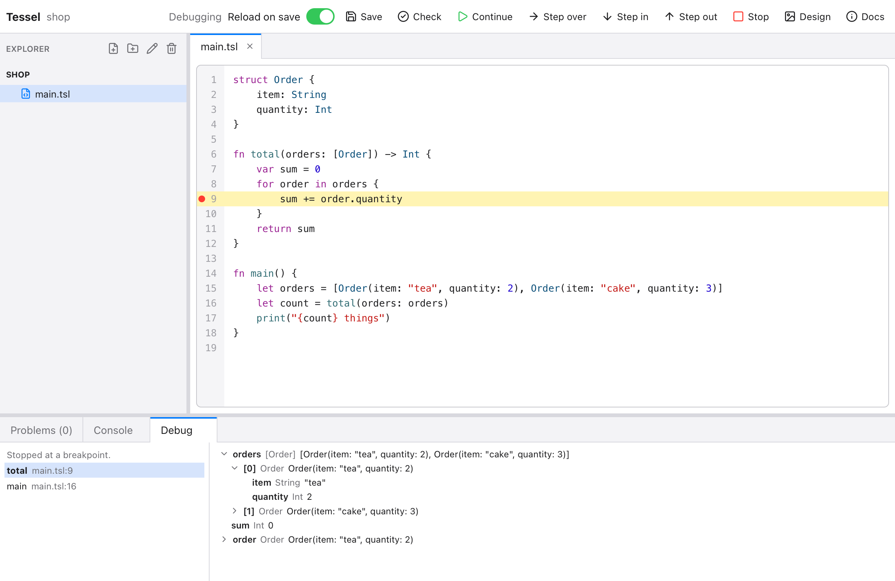

# Tessel

A small, compiled language for building native apps, with the UI written
in the language itself. The same source builds an app for macOS, Windows
and Android.

```tessel
app Counter(width: 320, height: 200) {
    state count = 0

    VStack(spacing: 12) {
        Text("Count: {count}")
        Button("+") { count += 1 }
    }
}
```

You describe what the window looks like for the current state; Tessel
works out what changed and redraws it. Programs compile ahead of time to
native code through LLVM, with no garbage collector, and a built app is a
single executable that needs nothing else installed.

**Documentation, tutorials and reference: <https://tessel-lang.syncster.dev>**

Tessel is young (version 0.18). It's enough to write real apps (the Tessel
IDE is one), but plenty is missing and details of the language may still
change. [Status and roadmap](https://tessel-lang.syncster.dev/about/roadmap/)
is an honest list of where things stand.



## What's in it

- **The language:** structs, enums with values, interfaces, generics,
  closures, optionals, errors with `Result` and `try`, `async` and `await`,
  constants, computed properties and static members, and modules. Values
  are copied, not shared; the types are inferred almost everywhere.
- **The UI toolkit:** stacks, lists, text fields, a code editor, tabs,
  menus, ribbons, popovers, drawing in a `Canvas`, 3D scenes, over 100 built-in icons,
  light and dark appearance, and animation. Tessel draws every control
  itself, so an app looks the same everywhere.
- **The standard library:** files, JSON and binary encoding of your own
  types, SQLite, HTTP and WebSockets, dates and time zones, running other
  programs, and work on a background thread.
- **The tools:** the `tessel` command, the Tessel IDE, a REPL, hot reload,
  a debugger, a language server, a VS Code extension, and a headless mode
  for testing apps.
- **Libraries:** published libraries for charts, CSV files, regular
  expressions, units, linear algebra and more, added with `tessel add`
  (see [Libraries](#libraries)).

A program doesn't need a window:

```tessel
fn main() {
    let names = ["Ada", "Grace", "Linus"]
    for name in names.sorted() {
        print("Hello, {name}!")
    }
}
```

## Libraries

Libraries are published in the
[library index](https://github.com/alexiusacademia/tessel-packages), and
listed with their READMEs at
**<https://tessel-packages.syncster.dev>**. Add one to a project and import
it:

```sh
tessel add csv
```

```tessel
import csv
```

| Library | What it does |
|---|---|
| [chart](https://tessel-packages.syncster.dev/chart/) | Line, scatter, area and bar charts for Canvas, PNG and PDF |
| [csv](https://tessel-packages.syncster.dev/csv/) | Read and write CSV files |
| [inspector](https://tessel-packages.syncster.dev/inspector/) | Property panels: numbers with units and math, choices, colors |
| [interpolate](https://tessel-packages.syncster.dev/interpolate/) | Linear, spline, PCHIP, Akima and step interpolation, and 2D grids |
| [linalg](https://tessel-packages.syncster.dev/linalg/) | Matrices, LU, Cholesky, QR, least squares, eigenvalues and the SVD |
| [numeric](https://tessel-packages.syncster.dev/numeric/) | Root finding, integration and differential equations |
| [pytessel](https://tessel-packages.syncster.dev/pytessel/) | A Python interpreter, to run Python code from a program |
| [regex](https://tessel-packages.syncster.dev/regex/) | Regular expressions that always run in linear time |
| [units](https://tessel-packages.syncster.dev/units/) | Engineering units: conversions, checked quantities, parsing and formatting |
| [viewport](https://tessel-packages.syncster.dev/viewport/) | Pan, zoom and rotate for Canvas views, with grids, rulers and scale bars |

`tessel publish` publishes your own; see
[Libraries](https://tessel-lang.syncster.dev/guides/libraries/).

## Installing

macOS (Apple silicon):

```sh
curl -fsSL https://github.com/alexiusacademia/tessel/releases/latest/download/install.sh | sh
```

or with Homebrew: `brew install alexiusacademia/tessel/tessel`.

Windows (PowerShell):

```powershell
irm https://github.com/alexiusacademia/tessel/releases/latest/download/install.ps1 | iex
```

`tessel update` brings an installation up to date.
[Installation](https://tessel-lang.syncster.dev/start/installation/) has
the details.

Nothing else is needed to build apps: no Xcode or Visual Studio. `tessel`
has LLVM and a linker built in, and comes with what apps link against.

### What Tessel reports

So that installations can be counted, Tessel reports when it's installed or
updated, and at most once a day that it's in use: its version, the system,
and a random id for the installation. Nothing about you, your files or
your code. `tessel telemetry off` turns it off. See
[What Tessel reports](https://tessel-lang.syncster.dev/start/installation/#what-tessel-reports).

## Using it

```sh
tessel new hello          # a project to start from
tessel run hello          # build and run (with --hot: reload as you save)
tessel check hello        # only look for errors
tessel build hello --bundle           # an app to double-click (macOS: Hello.app)
tessel build hello --android          # an Android package (needs the Android SDK)
tessel debug hello        # stop at lines, step, and look at variables
tessel repl               # type code, a line at a time
tessel                    # open the Tessel IDE on this folder
```

A program is one `.tsl` file, or a folder of them.

### The Tessel IDE

`tessel` in a project folder (or `tessel ide <folder>`) opens the IDE: a
file list, a code editor with completion and errors as you type, Run and
Debug, a Design panel for building a window by pointing at it, the
documentation, and a console. It's a Tessel app itself: see [`ide/`](ide/).

### Other editors

The [VS Code extension](https://marketplace.visualstudio.com/items?itemName=alexiusacademia.tessel)
gives highlighting, errors as you type, types on hover, completion and
the debugger. Other editors can use `tessel lsp` (a language server) and
`tessel debug --dap` (a debug adapter).

## This repository

| Path | |
|---|---|
| `crates/tessel-compiler` | Lexer, parser, type checker, LLVM code generation |
| `crates/tessel-runtime` | What every program links against: values, the UI toolkit, rendering, the event loop, the standard library |
| `crates/tessel-cli` | The `tessel` command: build, run, the REPL, the debugger, the language server, Android packaging, updates |
| `ide/` | The Tessel IDE, written in Tessel |
| `examples/` | Sample programs, one folder each |
| `editors/vscode/` | The VS Code extension |
| `website/` | The documentation site (Astro Starlight) |
| `install/` | The install scripts, and what packages a release |
| `tests/` | Programs and sessions with their expected output |
| `docs/design.md` | The language's early design notes |

## Building from source

Requires Rust and LLVM 22 (`brew install llvm@22`; the path is set in
`.cargo/config.toml`).

```sh
cargo build
./target/debug/tessel check examples/todos       # a folder of .tsl files, or one file
./target/debug/tessel run examples/todos         # compile and run (opens a window)
./target/debug/tessel build app.tsl -o app        # compile to a native executable
cargo test    # unit tests, error-message fixtures, and the programs in tests/
              # (checked for memory leaks on macOS)
```

On Windows, build with `cargo build --target x86_64-pc-windows-msvc` (see
`.cargo/config.toml`) and set `LLVM_SYS_221_PREFIX` to an LLVM 22 install;
`.github/workflows/ci.yml` shows the exact steps.

Use `cargo build --release` for much smaller app binaries: `tessel build`
links against the runtime library built next to the `tessel` executable.

A `tessel` built from source reports nothing (see "What Tessel reports").

### Tests

| | |
|---|---|
| `tests/run/` | Programs with their expected output. Apps run without a window, driven by a `.script`. |
| `tests/repl/`, `tests/hot/`, `tests/preview/`, `tests/net/` | Sessions of the REPL, hot reload, `tessel preview`, and networking against local servers |
| `tests/debug/` | Debugger sessions: commands in, what the debugger says out |
| `tests/ide/` | The IDE itself, driven by scripts |
| `crates/tessel-compiler/tests/ui/` | Programs with mistakes, and the error messages they should get |

`TESSEL_TEST_DEBUG=1 cargo test -p tessel-cli --test run run_programs`
runs every program in `tests/run/` as the debugger builds it, which must
change nothing about what it does.

Apps are tested without a window by setting `TESSEL_SCRIPT`: click, type,
wait for timers, print the view tree, or save a picture.

```sh
TESSEL_SCRIPT='click "+"; click "+"; tree; snapshot counter.png' ./counter
```

[Testing apps](https://tessel-lang.syncster.dev/ui/testing/) lists the
commands.

### Releases

Packages are built on GitHub's runners by `.github/workflows/release.yml`
when a `v*` tag is pushed, and published as a GitHub release. (Releases up
to 0.16.3 were also copied to the old `tessel-releases` bucket, which
Tessel 0.15.1 and earlier update from; its latest is 0.16.3.) A
package holds
`tessel`, the runtime library, and `sdk/`: stubs of the macOS libraries
apps use (`install/macos-stubs.py`), or MinGW-w64's C runtime and Windows
import libraries (`install/windows-sdk.sh`). The runtime for Android is
published alongside, and fetched the first time an app is built for it.

## How Tessel is made

Tessel is developed with the help of an AI coding assistant, which is why
its first releases came so quickly.

## License

MIT. See [LICENSE](LICENSE).
