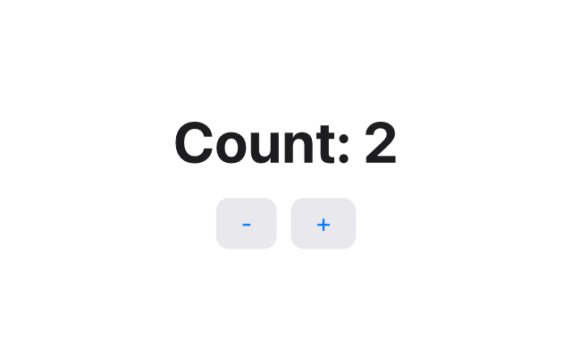
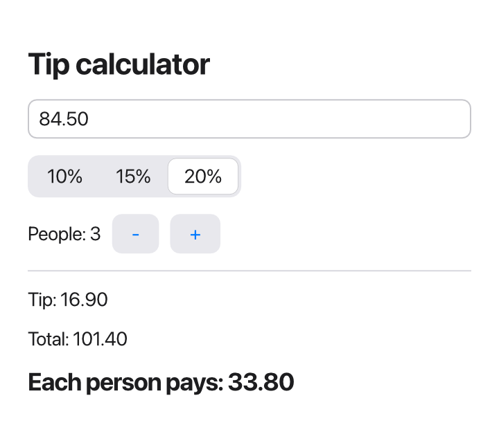

Everything so far has run in the terminal. Most programs people use every
day have windows instead, with buttons to click and fields to type in. In
Tessel, making one takes only a few more ideas than you already know.

In this lesson you'll learn:

- how an `app` replaces `fn main`
- what views are, and how `Text`, `Button`, `VStack` and `HStack` build a
  window
- how `state` makes the window change, and why you never redraw anything
  yourself
- how a `TextField` edits a value through a **binding**
- how to check an app without opening its window

You'll build a counter, then a tip calculator.

## From `fn main` to `app`

A terminal program starts at `fn main`, runs from top to bottom, and ends.
A program with a window starts with an `app` instead:

```tessel
app Hello(title: "Hello", width: 320, height: 200) {
    Text("Hello, window!")
}
```

Save it as `hello.tsl` and run it the usual way:

```sh
tessel run hello.tsl
```

A window opens, 320 by 200 points, with "Hello, window!" in the middle and
"Hello" in its title bar. The program keeps running until you close the
window. (A *point* is the unit for sizes on screen; on most screens today,
one point is two pixels.)

A program has either an `app` or a `fn main`, never both.

## Views

Everything you see in a window is made of **views**. `Text` is a view that
shows some text. `Button` is a view you can click. And some views hold other
views and arrange them:

- `VStack` stacks views **vertically**, one under the other.
- `HStack` puts them side by side, **horizontally**.

```tessel
app Stacks(width: 360, height: 240) {
    VStack(spacing: 8) {
        Text("Top")
        HStack(spacing: 8) {
            Text("Left")
            Text("Middle")
            Text("Right")
        }
        Text("Bottom")
    }
}
```

This shows "Top", then a row with "Left Middle Right", then "Bottom".
`spacing: 8` is the gap between the views, in points. You build a whole
window like this: views inside stacks, inside other stacks. The
[Layout](/ui/layout/) page shows everything stacks can do.

You change how a view looks with **modifiers**, written after it with a
dot. A line that starts with `.` continues the line above:

```tessel
Text("Welcome")
    .font(size: 24, weight: .bold)
    .color(.blue)
    .padding(12)
```

`.font` changes the size and weight of the text, `.color` its color, and
`.padding` adds space around it. All the modifiers are listed in the
[modifiers reference](/reference/modifiers/).

## State: a counter

A window that never changes is not very useful. Here is a counter, with a
number and two buttons:

```tessel
app Counter(width: 320, height: 200) {
    state count = 0

    VStack(spacing: 12) {
        Text("Count: {count}")
            .font(size: 32, weight: .bold)

        HStack(spacing: 8) {
            Button("-") { count -= 1 }
            Button("+") { count += 1 }
        }
    }
}
```



Two new things:

- `state count = 0` declares a value that belongs to the app and can
  change while it runs. It's like a `var`, but for an app.
- `Button("+") { count += 1 }` shows a button. The block after it is the
  button's **action**: the code that runs when you click it.

Click `+` and the number goes up. But look at the code again: nowhere does
it say "now change the text on the screen". The action only changes
`count`. So how does the text know?

### You describe, Tessel draws

This is the big idea behind apps in Tessel. The body of the `app` is not a
list of steps to run once. It's a **description of what the window shows,
for the current state**. It says: "there's a text that reads *Count:*
followed by the count, and two buttons under it."

Whenever the state changes (after a click, say), Tessel runs the body again
with the new values, gets a fresh description, and updates the window to
match. You never add, remove or redraw things yourself. You change the
state, and the window follows.

This style is called **declarative**: you declare *what* should be on
screen, not *how* to change it. It makes a whole kind of bug impossible:
the window can never show an old value, because it's always built from the
current ones.

It also means the body can use `if`, `for` and everything else you know,
to decide what to show:

```tessel
if count > 10 {
    Text("That's a lot!")
}
```

When `count` goes past 10, the text appears. When it drops back, it
disappears. There's no code to show or hide it.

One rule follows from this: the body only *describes*. It runs every time
anything changes, so it must not change things itself. Changes happen in
actions, like a button's block, or in functions that actions call.

## Typing text: TextField and bindings

A `TextField` is a box to type in. Here's a program that greets you by
name:

```tessel
app Greeter(width: 360, height: 200) {
    state name = ""

    VStack(spacing: 12) {
        TextField("Your name", text: name)
        if name.isEmpty {
            Text("Hello! What's your name?")
        } else {
            Text("Hello, {name}!")
                .font(size: 24, weight: .bold)
        }
        Text("{name.count} letters")
            .color(.secondary)
    }
    .padding(20)
}
```

`"Your name"` is the placeholder, shown in gray while the field is empty.
The interesting part is `text: name`.

Normally, when you pass a value to a function, it gets a copy. A text field
can't work with a copy: it needs to *change* `name` every time you type a
letter. So `TextField`'s `text:` parameter is a **binding**: instead of a
copy, it gets access to the `name` state itself. Type a letter, and `name`
changes, and (because it's state) the greeting and the letter count update
right away.

You don't write anything special to pass a binding: `text: name` is
enough, because `TextField` declares that parameter as a binding. You'll
write views with bindings of your own in the [next lesson](/learn/20-project-app/).

## Checking an app without opening it

With a terminal program, you can see the output. With an app, you'd have to
click around by hand to check it still works. Tessel has a better way:
every app can run **headless**, without a window, following a script of
clicks and key presses. Set the `TESSEL_SCRIPT` environment variable to the
script:

```sh
TESSEL_SCRIPT='tree; click "Your name"; type Ada; tree' tessel run greeter.tsl
```

```text
Root
  View
    VStack
      TextField "Your name" = ""
      Text "Hello! What's your name?"
      Text "0 letters"
Root
  View
    VStack
      TextField "Your name" = "Ada"
      Text "Hello, Ada!"
      Text "3 letters"
```

The commands are separated by `;`. `tree` prints every view in the window,
indented to show which view is inside which. `click "Your name"` clicks the
view with that label (here, the field with that placeholder), and
`type Ada` types into it. When the script ends, so does the app.

The tree shows exactly what you'd see: after typing, the field holds
`"Ada"`, and the texts have changed. `View` stands for the body of your
app. [Testing your UI](/ui/testing/) lists all the script commands.

## Worked example: a tip calculator

Let's put it together. The tip calculator takes the amount of a restaurant
bill, lets you choose a tip of 10, 15 or 20 percent and the number of
people, and shows what each person pays.

```tessel
app TipCalculator(title: "Tip calculator", width: 360, height: 320) {
    state bill = ""
    state percent = 15
    state people = 1

    VStack(spacing: 12, alignment: .leading) {
        Text("Tip calculator")
            .font(size: 22, weight: .bold)

        TextField("Bill amount", text: bill)

        Picker(selection: percent) {
            Text("10%").tag(10)
            Text("15%").tag(15)
            Text("20%").tag(20)
        }

        HStack(spacing: 8) {
            Text("People: {people}")
            Button("-") { removePerson() }
            Button("+") { people += 1 }
        }

        Divider()

        if let amount = Float(bill.trim()) {
            let tip = amount * Float(percent) / 100.0
            let total = amount + tip
            Text("Tip: {money(tip)}")
            Text("Total: {money(total)}")
            Text("Each person pays: {money(total / Float(people))}")
                .font(size: 18, weight: .bold)
        } else {
            Text("Type the amount of the bill.")
                .color(.secondary)
        }
    }
    .padding(20)

    fn removePerson() {
        if people > 1 {
            people -= 1
        }
    }

    fn money(_ value: Float) -> String {
        value.formatted(decimals: 2)
    }
}
```



Let's go through it:

- **Three pieces of state**: the bill as typed (a `String`, because a text
  field edits text), the tip percentage, and the number of people.
- `alignment: .leading` lines the views up on the left, instead of
  centering them.
- A **`Picker`** shows a few options side by side. Its `selection:` is a
  binding, like the text field's `text:`: clicking `20%` sets `percent` to
  that option's `.tag`, which is `20`.
- The `-` button calls a **function inside the app**, `removePerson`.
  Functions declared in the app can change its state, which keeps longer
  actions out of the view code. It stops at one person: you can't split a
  bill between zero people. (Dividing by zero here would give `inf`, not a
  useful answer.)
- The bill is text, and the user could type anything, so `Float(…)` returns
  an optional. **`if let`** shows the results only when the text is a
  number, and a hint otherwise.
- **`let`** in the body names values that are used more than once, like
  `tip` and `total`. They're computed fresh each time the body runs, so
  they're always up to date.
- `Divider()` draws a thin line.

Check it, and try it headless: type a bill, choose 20%, and add two people.

```sh
tessel check tip.tsl
```

```text
ok: 1 file checked, no errors
```

```sh
TESSEL_SCRIPT='click "Bill amount"; type 84.50; click "20%"; click "+"; click "+"; tree' tessel run tip.tsl
```

```text
Root
  View
    VStack
      Text "Tip calculator"
      TextField "Bill amount" = "84.50"
      Picker
        Text "10%"
        Text "15%"
        Text "20%"
      HStack
        Text "People: 3"
        Button "-"
        Button "+"
      Divider
      Text "Tip: 16.90"
      Text "Total: 101.40"
      Text "Each person pays: 33.80"
```

20% of 84.50 is 16.90, the total is 101.40, and a third of that is 33.80.
Then run it for real with `tessel run tip.tsl`, and play with it: every
key you type updates the results at once.

## Common mistakes

### Changing a value in the body

The body describes the window; it can't
change things while doing so:

```tessel
app Counter(width: 320, height: 200) {
    state count = 0

    Text("Count: {count}")
    count += 1
}
```

```text
error: views can't change values while they're being built
 --> main.tsl:5:5
  |
5 |     count += 1
  |     ^^^^^^^^^^
  |
  = help: change values in an action instead, like `Button("Add") { count += 1 }`
```

### Using `var` instead of `state`

A `var` would be created afresh every
time the body runs, so it couldn't remember anything. Tessel doesn't allow
it:

```tessel
app Counter(width: 320, height: 200) {
    var count = 0

    Text("Count: {count}")
    Button("+") { count += 1 }
}
```

```text
error: `var` can't be used while building a view
 --> main.tsl:2:5
  |
2 |     var count = 0
  |     ^^^^^^^^^^^^^
  |
  = help: use `let` here, or `state` at the top of the view for values that change
```

The help says exactly what to do: values that change are declared with
`state`, at the top of the app or view.

### Passing a value where a binding is needed

A text field needs something
it can change, like a `state`:

```tessel
    TextField("Your name", text: "name")
```

```text
error: `TextField`'s `text:` needs something it can change
 --> main.tsl:4:34
  |
4 |     TextField("Your name", text: "name")
  |                                  ^^^^^^ this is a value, not a variable
  |
  = help: pass a `state` or `var`, or a field of one
```

Here the quotes turned `name` into a fixed piece of text. Write
`text: name`.

### Forgetting that typed text might not be a number

`Float(bill)` is an
optional, so you can't do arithmetic with it directly:

```tessel
    Text("Tip: {Float(bill) * 0.15}")
```

```text
error: can't use `*` on `Float?` and `Float`
 --> main.tsl:5:17
  |
5 |     Text("Tip: {Float(bill) * 0.15}")
  |                 ^^^^^^^^^^^^^^^^^^
  |
  = help: one side might be `nil`: give it a default with `??` (like `count ?? 0`), or unwrap it with `if let`
```

Use `if let`, as the tip calculator does, or a default:
`(Float(bill) ?? 0.0) * 0.15`.

## Exercises

**1. A better counter.** Add a **Reset** button to the counter that sets
the count back to 0. Then stop the count from going below zero, by
disabling the `-` button at 0 with the `.disabled(…)` modifier, which takes
a `Bool`. Check it with a script.

<details>
<summary>Solution</summary>

```tessel
app Counter(width: 320, height: 200) {
    state count = 0

    VStack(spacing: 12) {
        Text("Count: {count}")
            .font(size: 32, weight: .bold)

        HStack(spacing: 8) {
            Button("-") { count -= 1 }
                .disabled(count == 0)
            Button("+") { count += 1 }
            Button("Reset") { count = 0 }
        }
    }
}
```

```sh
TESSEL_SCRIPT='click "+"; click "+"; tree; click "Reset"; click "-"; tree' tessel run counter.tsl
```

```text
Root
  View
    VStack
      Text "Count: 2"
      HStack
        Button "-"
        Button "+"
        Button "Reset"
Root
  View
    VStack
      Text "Count: 0"
      HStack
        Button "-" disabled
        Button "+"
        Button "Reset"
```

After Reset, the `-` button is disabled, so clicking it does nothing: the
count stays at 0.

</details>

**2. A temperature converter.** Make an app with a text field for a
temperature in degrees Celsius, which shows it in degrees Fahrenheit
(multiply by 9, divide by 5, add 32), with one decimal. When the text isn't
a number, show a hint instead.

<details>
<summary>Solution</summary>

```tessel
app Converter(width: 320, height: 200) {
    state celsius = ""

    VStack(spacing: 12) {
        TextField("Degrees Celsius", text: celsius)
        if let c = Float(celsius.trim()) {
            let f = c * 9.0 / 5.0 + 32.0
            Text("{c.formatted(decimals: 1)} °C is {f.formatted(decimals: 1)} °F")
        } else {
            Text("Type a temperature.")
                .color(.secondary)
        }
    }
    .padding(20)
}
```

```sh
TESSEL_SCRIPT='click "Degrees Celsius"; type 21.5; tree' tessel run converter.tsl
```

```text
Root
  View
    VStack
      TextField "Degrees Celsius" = "21.5"
      Text "21.5 °C is 70.7 °F"
```

</details>

**3. Round up.** Nobody wants to pay 33.80 in coins. Add a `Toggle` (an
on/off switch) labeled "Round up" to the tip calculator:
`Toggle("Round up", isOn: roundUp)`, where `roundUp` is a `Bool` state.
When it's on, round each person's share up to a whole number with
`ceil(…)`.

<details>
<summary>Solution</summary>

Add `state roundUp = false` next to the other state, the toggle before the
`Divider()`:

```tessel
        Toggle("Round up", isOn: roundUp)
```

and replace the line that shows each person's share with:

```tessel
            let share = total / Float(people)
            let pays = if roundUp { ceil(share) } else { share }
            Text("Each person pays: {money(pays)}")
```

With the same clicks as before, plus `click "Round up"`, the last line of
the tree reads:

```text
      Text "Each person pays: 34.00"
```

</details>

**4. A guessing game.** The app picks a secret number from 1 to 100 with
`random(1..101)` (as a `state`'s starting value). The user types a guess and
clicks **Guess** (or presses Enter: add `.onSubmit { check() }` to the text
field). The app says "too low", "too high", or that it was right, and counts
the tries. A **New game** button starts over.

<details>
<summary>Solution</summary>

```tessel
app Guess(width: 360, height: 220) {
    state secret = random(1..101)
    state guess = ""
    state message = "I'm thinking of a number from 1 to 100."
    state tries = 0

    VStack(spacing: 12) {
        Text(message)
        HStack(spacing: 8) {
            TextField("Your guess", text: guess)
                .onSubmit { check() }
            Button("Guess") { check() }
        }
        Text("Tries: {tries}")
            .color(.secondary)
        Button("New game") { newGame() }
    }
    .padding(20)

    fn check() {
        if let number = Int(guess.trim()) {
            tries += 1
            if number < secret {
                message = "{number} is too low."
            } else if number > secret {
                message = "{number} is too high."
            } else {
                message = "Yes! It was {secret}. You needed {tries} tries."
            }
        } else {
            message = "Please type a whole number."
        }
        guess = ""
    }

    fn newGame() {
        secret = random(1..101)
        tries = 0
        message = "I'm thinking of a number from 1 to 100."
    }
}
```

The number is random, so each run is different. One run:

```sh
TESSEL_SCRIPT='click "Your guess"; type 50; click "Guess"; tree' tessel run guess.tsl
```

```text
Root
  View
    VStack
      Text "50 is too low."
      HStack
        TextField "Your guess" = ""
        Button "Guess"
      Text "Tries: 1"
      Button "New game"
```

Which algorithm from [lesson 17](/learn/17-algorithms/) finds the number
in at most 7 guesses?

</details>

## Summary

- A program with a window starts with `app Name(title:width:height:)`
  instead of `fn main`, and runs until the window is closed.
- A window is made of **views**: `Text`, `Button`, `TextField`, `Picker`,
  arranged with `VStack` and `HStack`. **Modifiers** like `.font` and
  `.padding` change how they look.
- **`state`** holds values that change. Buttons change state in their
  action blocks.
- The body **describes** the window for the current state. When state
  changes, Tessel runs the body again and updates the window: you never
  redraw anything yourself.
- A **binding** lets a control change your state directly:
  `TextField("…", text: name)`, `Picker(selection: percent)`.
- `TESSEL_SCRIPT='click "+"; tree' tessel run app.tsl` runs an app without
  a window and prints what's on screen.
- For more, see [Your first app](/start/first-app/),
  [Apps and views](/ui/apps-views/), [State and bindings](/ui/state/) and
  [Controls](/ui/controls/).

**Next:** [20. Project: a complete app](/learn/20-project-app/)
