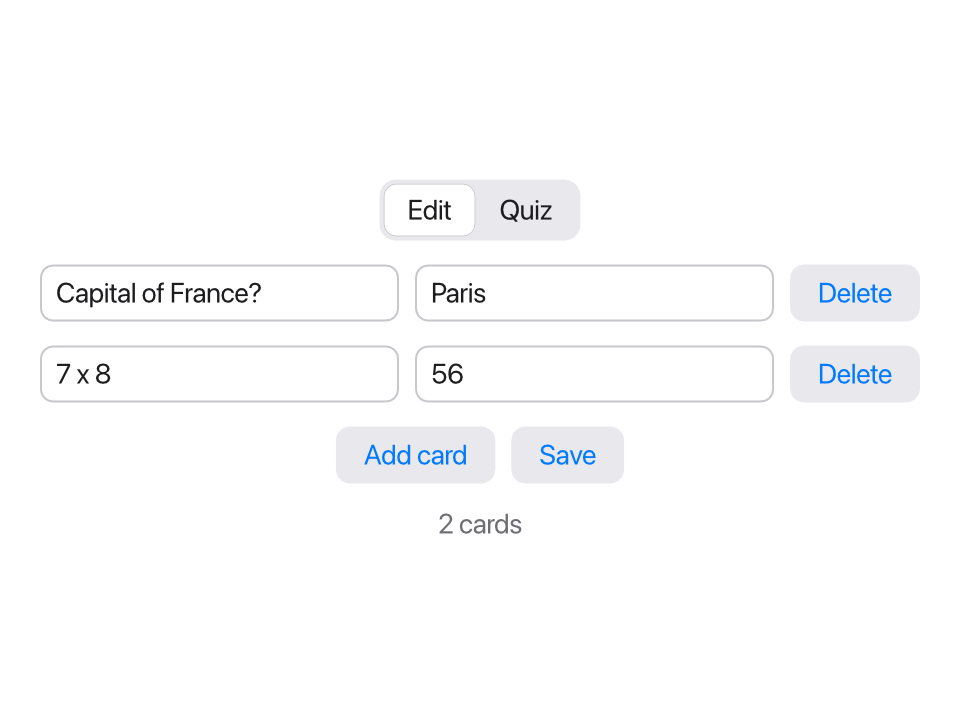
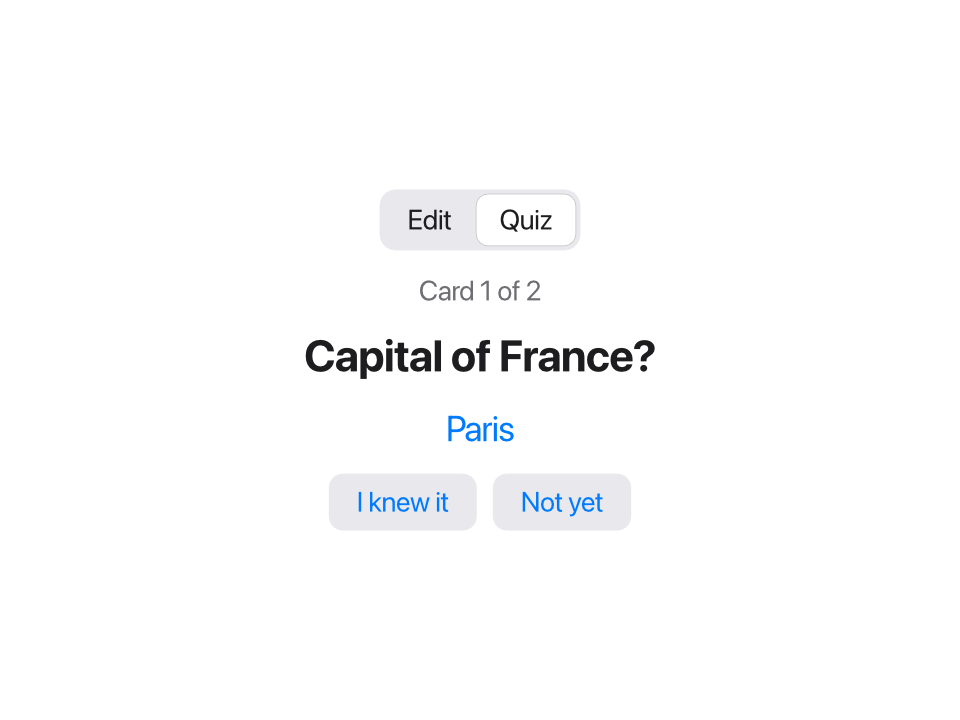

In this project you'll build a complete app with a window: **flashcards**
for learning anything, from capital cities to times tables. You write
cards with a question on one side and the answer on the other, and the app
quizzes you.





In this lesson you'll learn:

- how to organize an app into files: model, storage, views and the app
- how to write your own views, and pass them data with **`bind`**
  parameters so they can change it
- how to show a list with `for`, and add and delete items
- how to load saved data when the app starts, with `.onAppear`
- how to switch between two modes with an enum and `match`
- how to check the whole app with a script

It uses almost everything from the course: structs, enums, lists,
closures, JSON files, and the app ideas from the
[last lesson](/learn/19-first-app/).

## The plan

The app has two **modes**:

- **Edit**: a list of cards. Each card has a text field for the question
  and one for the answer, and a Delete button. Below the list: **Add card**
  and **Save**.
- **Quiz**: one card at a time. First you see the question. Click **Show
  answer** to see the answer, then say whether you knew it. At the end, the
  app tells you your score.

The data is a list of cards, and the cards are saved in a JSON file, like
the to-do list in [lesson 18](/learn/18-project-cli/).

Like that project, this one is split into files by what they're about:

```text
flashcards/
  model.tsl     the Card struct, the Mode enum, small helper functions
  storage.tsl   loading and saving cards
  views.tsl     the views for one card: CardRow and QuizCard
  main.tsl      the app: its state, the window, and what the buttons do
```

Make a folder called `flashcards`. You'll add the files one by one.

## Step 1: the model

The **model** is the data the app works with, without anything about how
it looks. Create `model.tsl`:

```tessel
// model.tsl: the data.

struct Card {
    id: Int
    question: String
    answer: String
}

// The next free id: one more than the biggest id in use.
fn nextCardId(_ cards: [Card]) -> Int {
    (cards.map { c in c.id }.max() ?? 0) + 1
}

// "1 card", "2 cards": the right word for the number.
fn cardCount(_ count: Int) -> String {
    if count == 1 { "1 card" } else { "{count} cards" }
}
```

Why does a card need an `id`? Two cards could have the same question and
answer, so the question can't tell them apart. The Delete button needs to
say *which* card to delete, and the window needs to know which row belongs
to which card. A number that's different for every card solves both.
`nextCardId` finds the biggest id so far and adds one. (`max()` is `nil`
for an empty list, so the first card gets `0 + 1`.)

## Step 2: a view for one card

Each card in the list is shown as a row: two text fields and a button. A
row is a good candidate for a **view of your own**. You declare it with
`view`, much like a function, and use it just like `Text` or `Button`.
Create `views.tsl`:

```tessel
// views.tsl: the parts of the window.

// One card in the editor. `bind` lets the fields change the app's card.
view CardRow(card: bind Card, onDelete: fn()) {
    HStack(spacing: 8) {
        TextField("Question", text: card.question)
        TextField("Answer", text: card.answer)
        Button("Delete") { onDelete() }
    }
}
```

Two parameters, and each teaches something:

- **`card: bind Card`**. A normal parameter is a copy, which the view can
  read but not change. But typing in the row's text fields must change the
  real card in the app's list. The word **`bind`** makes the parameter a
  binding, like `TextField`'s `text:` from the last lesson: the row gets
  access to the caller's card itself. So `text: card.question` binds the
  text field to one field of that card.
- **`onDelete: fn()`**. The row can't delete itself: the list of cards
  belongs to the app, and the row can't see it. So the app gives the row a
  function to call when Delete is clicked, and decides itself what deleting
  means. You met function parameters in
  [lesson 13](/learn/13-closures/).

## Step 3: the app, with a list

Now create `main.tsl`, with an app that shows one `CardRow` per card:

```tessel
app Flashcards(width: 480, height: 360) {
    state cards: [Card] = []

    VStack(spacing: 12) {
        for card in cards {
            CardRow(card: card) { delete(id: card.id) }
                .id(card.id)
        }
        Button("Add card") { addCard() }
        Text(cardCount(cards.count))
            .color(.secondary)
    }
    .padding(20)

    fn addCard() {
        cards.append(Card(id: nextCardId(cards), question: "", answer: ""))
    }

    fn delete(id: Int) {
        cards.removeAll(where: { c in c.id == id })
    }
}
```

- `for card in cards` inside the body makes one row per card. Because
  `cards` is `state`, each `card` in the loop stands for that card *in the
  list*, so it can be passed to the `bind` parameter: `CardRow(card: card)`.
  No special marker is needed at the call.
- The block after `CardRow(card: card)` is its `onDelete` function, written
  as a trailing block like a button's action. It calls the app's `delete`
  with this card's id.
- **`.id(card.id)`** tells Tessel which row belongs to which card. Without
  it, rows are matched by position, and after deleting the first card, the
  text field you were typing in could end up attached to the wrong row. See
  [Identity with .id](/ui/lists/#identity-with-id).
- `addCard` adds an empty card, ready to fill in. `delete` removes the card
  with that id.

Check it and try it headless. `click field 1` clicks the first text field
in the window, and `click button 1` the first button, which is the first
row's Delete button:

```sh
tessel check flashcards
TESSEL_SCRIPT='click "Add card"; click "Add card"; click "Add card"; click field 1; type Capital of France?; click field 2; type Paris; tree; click button 1; tree' tessel run flashcards
```

```text
ok: 3 files checked, no errors
Root
  View
    VStack
      View
        HStack
          TextField "Question" = "Capital of France?"
          TextField "Answer" = "Paris"
          Button "Delete"
      View
        HStack
          TextField "Question" = ""
          TextField "Answer" = ""
          Button "Delete"
      View
        HStack
          TextField "Question" = ""
          TextField "Answer" = ""
          Button "Delete"
      Button "Add card"
      Text "3 cards"
Root
  View
    VStack
      View
        HStack
          TextField "Question" = ""
          TextField "Answer" = ""
          Button "Delete"
      View
        HStack
          TextField "Question" = ""
          TextField "Answer" = ""
          Button "Delete"
      Button "Add card"
      Text "2 cards"
```

Each `CardRow` shows up in the tree as a `View` with its `HStack` inside.
Typing went into the first card, and Delete removed exactly that card.

## Step 4: saving and loading

Close the window, and the cards are gone. Add `storage.tsl`, which works
exactly like in the last two projects:

```tessel
// storage.tsl: saving and loading cards as JSON.

fn cardsFile() -> String {
    joinPath(appDataFolder("Flashcards"), "cards.json")
}

fn loadCards() -> [Card] {
    let text = readFile(cardsFile()) ?? "[]"
    let cards: [Card] = fromJson(text) ?? []
    cards
}

fn saveCards(_ cards: [Card]) {
    writeFile(path: cardsFile(), text: toJson(cards, pretty: true))
}
```

In an app, *when* do you load? The body can't do it: it runs again after
every change, and it isn't allowed to change state. Instead, use the
**`.onAppear`** modifier. Its block runs once, when the view first appears,
which for the app's outermost view is when the app starts. It's the usual
place to load data.

In `main.tsl`, add a Save button next to Add card, load the cards in
`.onAppear`, and save after deleting:

```tessel
app Flashcards(width: 480, height: 360) {
    state cards: [Card] = []

    VStack(spacing: 12) {
        for card in cards {
            CardRow(card: card) { delete(id: card.id) }
                .id(card.id)
        }
        HStack(spacing: 8) {
            Button("Add card") { addCard() }
            Button("Save") { saveCards(cards) }
        }
        Text(cardCount(cards.count))
            .color(.secondary)
    }
    .padding(20)
    .onAppear { cards = loadCards() }

    fn addCard() {
        cards.append(Card(id: nextCardId(cards), question: "", answer: ""))
    }

    fn delete(id: Int) {
        cards.removeAll(where: { c in c.id == id })
        saveCards(cards)
    }
}
```

Test it with two runs. The first adds a card and saves; the second only
prints the tree, so everything it shows was loaded from the file:

```sh
TESSEL_SCRIPT='click "Add card"; click field 1; type Capital of France?; click field 2; type Paris; click "Save"' tessel run flashcards
TESSEL_SCRIPT='tree' tessel run flashcards
```

```text
Root
  View
    VStack
      View
        HStack
          TextField "Question" = "Capital of France?"
          TextField "Answer" = "Paris"
          Button "Delete"
      HStack
        Button "Add card"
        Button "Save"
      Text "1 card"
```

:::note
Scripted runs use the same `appDataFolder` as the real app, so a test
saves into your real cards. When you test a lot, point `cardsFile()` at a
test file for a while, as in [lesson 18](/learn/18-project-cli/).
:::

## Step 5: the quiz

Now the second mode. Two modes, one or the other: that's an enum. Add it to
`model.tsl`:

```tessel
enum Mode { edit, quiz }
```

A `Picker` at the top of the window chooses the mode, and a `match` in the
body shows the views for the current one. The quiz needs a little state of
its own: which card it's on (`current`), whether the answer is showing, and
how many you knew.

The quiz card is another view. Add it to `views.tsl`:

```tessel
// The quiz: one question at a time.
view QuizCard(card: Card, showAnswer: Bool) {
    VStack(spacing: 12) {
        Text(card.question)
            .font(size: 22, weight: .bold)
        if showAnswer {
            Text(card.answer)
                .font(size: 18)
                .color(.blue)
        } else {
            Text("?")
                .font(size: 18)
                .color(.secondary)
        }
    }
}
```

This one has no `bind`: it only *shows* the card, so a copy is all it
needs. Use `bind` only when a view has to change the caller's data.

Here's the finished `main.tsl`:

```tessel
// main.tsl: the app, its state, and what the buttons do.

app Flashcards(width: 480, height: 360) {
    state cards: [Card] = []
    state mode = Mode.edit
    state current = 0
    state showAnswer = false
    state known = 0

    VStack(spacing: 12) {
        Picker(selection: mode) {
            Text("Edit").tag(.edit)
            Text("Quiz").tag(.quiz)
        }

        match mode {
            .edit -> {
                for card in cards {
                    CardRow(card: card) { delete(id: card.id) }
                        .id(card.id)
                }
                HStack(spacing: 8) {
                    Button("Add card") { addCard() }
                    Button("Save") { saveCards(cards) }
                }
                Text(cardCount(cards.count))
                    .color(.secondary)
            }
            .quiz -> VStack(spacing: 12) {
                if cards.isEmpty {
                    Text("Add some cards first.")
                } else if current < cards.count {
                    Text("Card {current + 1} of {cards.count}")
                        .color(.secondary)
                    QuizCard(card: cards[current], showAnswer: showAnswer)
                    if showAnswer {
                        HStack(spacing: 8) {
                            Button("I knew it") { next(knewIt: true) }
                            Button("Not yet") { next(knewIt: false) }
                        }
                    } else {
                        Button("Show answer") { showAnswer = true }
                    }
                } else {
                    Text("You knew {known} of {cards.count}.")
                        .font(size: 22, weight: .bold)
                    Button("Start again") { restart() }
                }
            }
            .onAppear { restart() }
        }
    }
    .padding(20)
    .onAppear { cards = loadCards() }

    fn addCard() {
        cards.append(Card(id: nextCardId(cards), question: "", answer: ""))
    }

    fn delete(id: Int) {
        cards.removeAll(where: { c in c.id == id })
        saveCards(cards)
    }

    fn next(knewIt: Bool) {
        if knewIt {
            known += 1
        }
        current += 1
        showAnswer = false
    }

    fn restart() {
        current = 0
        known = 0
        showAnswer = false
    }
}
```

How the quiz works:

- The `.quiz` arm has three situations: no cards at all; a card to ask
  (`current < cards.count`); or the end, when `current` has gone past the
  last card.
- While a card is asked, **Show answer** sets `showAnswer`. The body runs
  again, `QuizCard` now shows the answer, and the two answer buttons
  replace the Show answer button.
- `next` counts the card if you knew it, and moves on. When `current`
  reaches `cards.count`, the body shows the score instead.
- The quiz's `VStack` has its own **`.onAppear { restart() }`**. It runs
  each time you switch to Quiz (the `match` starts showing that view), so
  every quiz starts from the first card. This is also why the app's own
  `.onAppear` only runs once: the outer view never goes away.
- The `Picker` changes `mode` through a binding, just like in the tip
  calculator.

## Checking the whole app

Put the steps of a test session in a file, `flashcards.script`, one command
per line. It fills in two cards, saves, and takes a quiz, knowing the first
answer but not the second:

```text
click "Add card"
click field 1
type Capital of France?
click field 2
type Paris
click "Add card"
click field 3
type 7 x 8
click field 4
type 56
click "Save"
click "Quiz"
tree
click "Show answer"
tree
click "I knew it"
click "Show answer"
click "Not yet"
tree
```

```sh
tessel check flashcards
TESSEL_SCRIPT="$(cat flashcards.script)" tessel run flashcards
```

```text
ok: 4 files checked, no errors
Root
  View
    VStack
      Picker
        Text "Edit"
        Text "Quiz"
      VStack
        Text "Card 1 of 2"
        View
          VStack
            Text "Capital of France?"
            Text "?"
        Button "Show answer"
Root
  View
    VStack
      Picker
        Text "Edit"
        Text "Quiz"
      VStack
        Text "Card 1 of 2"
        View
          VStack
            Text "Capital of France?"
            Text "Paris"
        HStack
          Button "I knew it"
          Button "Not yet"
Root
  View
    VStack
      Picker
        Text "Edit"
        Text "Quiz"
      VStack
        Text "You knew 1 of 2."
        Button "Start again"
```

Every step did what it should. Keep this script: whenever you change the
app, run it again and compare. That's exactly how Tessel tests its own
apps (see [Testing your UI](/ui/testing/)). The screenshots at the top of
this page were made the same way, with the `snapshot` script command.

The saved `cards.json`, in the app's folder, holds:

```text
[
  {
    "id": 1,
    "question": "Capital of France?",
    "answer": "Paris"
  },
  {
    "id": 2,
    "question": "7 x 8",
    "answer": "56"
  }
]
```

Finally, run it for real with `tessel run flashcards`, and make some cards
for something you want to learn.

## How the pieces fit together

Look at how data moves through the app:

- **The app owns the data.** `cards` and the quiz's state live in `main.tsl`,
  as `state`. Nothing else stores data.
- **Down, as copies**: `QuizCard(card: cards[current], showAnswer: …)` only
  shows the card, so it gets a copy.
- **Down, as bindings**: `CardRow(card: card)` edits the card, so it gets a
  binding, and the text fields inside change the app's list directly.
- **Back up, as function calls**: the row can't delete itself, so it calls
  the `onDelete` function the app gave it.
- **Out to the disk**: only `storage.tsl` knows about files.

That's the same shape as much bigger apps. [Programs and files](/language/programs/#how-data-moves-between-files)
describes it in more detail.

## Common mistakes

### Binding to a filtered list

Say you want to hide empty cards in the
editor, and loop over a filtered list:

```tessel
                for card in cards.filter({ c in !c.question.isEmpty }) {
                    CardRow(card: card) { delete(id: card.id) }
```

```text
error: `CardRow`'s `card:` changes its value, so it can't be given `card`, which is a loop variable
  --> flashcards/main.tsl:19:35
   |
19 |                     CardRow(card: card) { delete(id: card.id) }
   |                                   ^^^^
  ::: flashcards/main.tsl:18:21
   |
18 |                 for card in cards.filter({ c in !c.question.isEmpty }) {
   |                     ---- declared here
   |
   = help: loop over a `var` or `state` list to be able to change its items (a list made by `filter` or `sorted` is a new copy)
```

`filter` makes a *new* list of copies, so a change to one of its items would
go nowhere. Loop over `cards` itself, and use `if` inside the loop to skip
the ones you don't want to show:

```tessel
for card in cards {
    if !card.question.isEmpty {
        CardRow(card: card) { delete(id: card.id) }
            .id(card.id)
    }
}
```

### Changing the app's list from inside a row

It's tempting to delete the
card right in `CardRow`:

```tessel
view CardRow(card: bind Card) {
    HStack(spacing: 8) {
        TextField("Question", text: card.question)
        TextField("Answer", text: card.answer)
        Button("Delete") { cards.removeAll(where: { c in c.id == card.id }) }
    }
}
```

```text
error: cannot find `cards`
 --> flashcards/views.tsl:8:28
  |
8 |         Button("Delete") { cards.removeAll(where: { c in c.id == card.id }) }
  |                            ^^^^^ not found
  |
  = help: did you mean `card`?
```

A view only sees its own parameters and state; `cards` belongs to the app.
That's why `CardRow` takes an `onDelete` function instead.

### Running one file

As with any program in a folder, run the folder
(`tessel run flashcards`), not `main.tsl`, or the names from the other files
are missing.

## Ideas to extend it

**1. Shuffle.** Asking the cards in the same order every time makes the
quiz too easy. Make each quiz use a shuffled copy of the cards.

<details>
<summary>Solution</summary>

Add a state for the quiz's own list, `state quizCards: [Card] = []`, and
fill it in `restart`:

```tessel
    fn restart() {
        quizCards = cards.shuffled()
        current = 0
        known = 0
        showAnswer = false
    }
```

Then use `quizCards` instead of `cards` everywhere in the `.quiz` arm:
`quizCards.isEmpty`, `current < quizCards.count`,
`QuizCard(card: quizCards[current], …)` and so on. Since `restart` runs each
time the quiz appears, every quiz has a new order. (To skip empty cards
too: `cards.filter { c in !c.question.isEmpty }.shuffled()`.)

</details>

**2. Save automatically.** The user has to remember to click Save. Save
whenever a card is added, and when switching to the quiz (hint: `restart`
runs then). Could you remove the Save button?

**3. Practice what you missed.** At the end of a quiz, offer a button
**Practice the missed ones**, which starts a new quiz with only the cards
you answered "Not yet". You'll need to remember those cards: a list of ids
in a state works well.

**4. Several decks.** Add a `name` to a deck (`struct Deck { name: String;
cards: [Card] }`) and let the user switch between decks with a `Picker`.
Save all decks in one JSON file. Remember that a new field needs a default
value if old files should still load.

**5. Your own idea.** A notes app, a habit tracker, a recipe book: they're
all "a list of structs, a view for one item, and a JSON file". You now know
how to build every one of them.

## Summary

- Organize an app into files: **model** (the data), **storage** (files),
  **views** (parts of the window) and the **app** (state and actions).
- Write your own views with `view Name(parameters) { … }`, and use them
  like built-in ones.
- A **`bind`** parameter lets a view change its caller's data; a normal
  parameter is a read-only copy. Use `bind` only when the view edits.
- A `for` loop over a `state` list makes one view per item, and its loop
  variable can be bound. Give rows an `.id(…)`.
- A view that can't change the list itself takes a function parameter
  (`onDelete: fn()`), and the caller decides what happens.
- `.onAppear { … }` runs when a view appears: load data there.
- An enum and `match` switch between modes of an app.
- A script in a file, run with `TESSEL_SCRIPT`, checks the whole app in
  seconds.

**Next:** [21. Forms, tables and rich text](/learn/21-forms-tables/)
