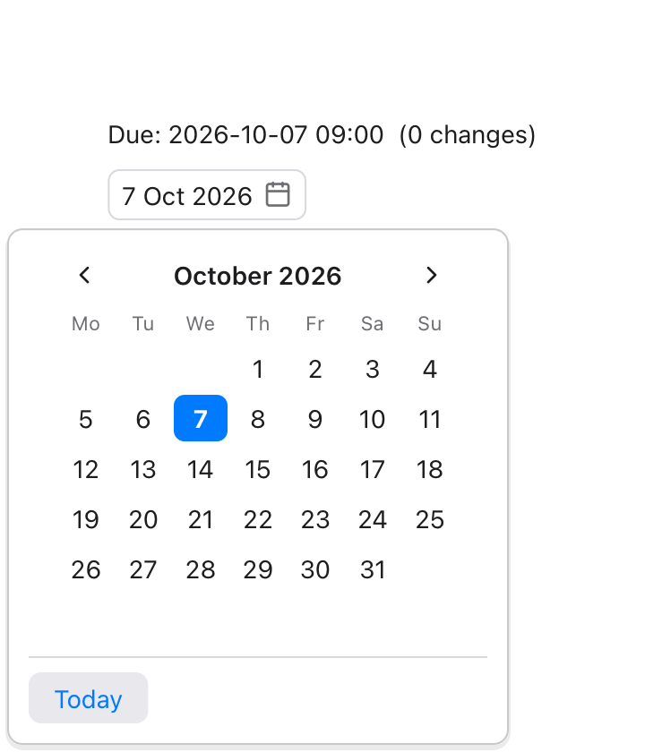

This page lists every built-in view, plus the `app` declaration. For a gentler
introduction, see [Apps and views](/ui/apps-views/) and [Controls](/ui/controls/).

## Reading the signatures

Each view's signature is written the way you would declare a view's
parameters in Tessel yourself:

```text
TextField(_ placeholder: String, text: bind String)
```

- `_` in front of a name means you pass that argument **without a label**:
  `TextField("Name", text: name)`.
- Every other argument is passed **with its label**, in the order shown.
- `= value` marks a parameter with a **default**; you can leave it out.
- `bind` means the view both reads and changes the value, so you must pass
  something it can change: a `state`, a `var`, a `bind` parameter, or a field
  or item of one. See [State and bindings](/ui/state/).
- A last parameter of type `View` (named `content`) is the **block after the
  call**: `VStack { … }`. A last parameter of function type, like a button's
  `action`, can also be written as a block after the call:
  `Button("Save") { save() }`.

Modifiers such as `.padding()` and `.font(size:)` work on every view; they are
listed in [Modifiers](/reference/modifiers/).

## How views take up space

Tessel lays views out like SwiftUI. Some views have a fixed natural size
(text, buttons, toggles, icons) and some are **flexible**: they grow to fill
the space they are offered.

| Flexible… | Views |
|---|---|
| horizontally only | `TextField`, `Slider`, `DisclosureGroup`, `LazyVStack` |
| in both directions | `Scroll`, `CodeEditor`, `TabView`, `Canvas`, `Scene3D` |
| along its stack's direction | `Spacer` |
| across its stack | `Divider` |
| when a child is flexible | `VStack`, `HStack`, `ZStack`, custom views |
| when given a maximum size | any view with `.frame(maxWidth:)` or `.frame(maxHeight:)` |

A fixed `.frame(width:)` or `.frame(height:)` makes a view inflexible in that
direction. See [Layout](/ui/layout/) for how stacks share out space.

## app

```text
app Name(title: String = "Name", width: Float = 640, height: Float = 480,
         appearance: Appearance = .system, documentTypes: [String] = []) { … }
```

Declares the program's window. The arguments are optional, but when you give
them they need their labels and must be in this order.

| Parameter | Default | Meaning |
|---|---|---|
| `title` | the app's name | The window title. |
| `width` | `640` | The window's starting width, in points. |
| `height` | `480` | The window's starting height, in points. |
| `appearance` | `.system` | [`.light` or `.dark`](/reference/colors/#appearance) to always look that way, whatever the system's setting. |
| `documentTypes` | `[]` | The extensions of the files the app opens, like `["gpkg", "geojson"]`: `tessel build --bundle` tells the system, so Finder offers the app for them. See [Opening documents](/ui/menus-windows/#opening-documents). |

```tessel
app Notes(title: "My Notes", width: 400, height: 300) {
    state text = ""

    TextField("Write something", text: text)
    Text("{text.count} characters")
}
```

The body works like a view body: it can declare `state` and functions, and
everything else in it must be views. The views are stacked vertically with
8 points between them, like a `VStack`, and centered in the window. A program
has at most one `app`, and can't have both an `app` and a `fn main()`. The
app's body can also declare other [windows](#window).

## Custom views

A `view` you declare yourself is used like a built-in one. Its body lays out
like a `VStack` with the default spacing (8) and centered alignment. A
modifier on a custom view applies to that whole body. See
[Apps and views](/ui/apps-views/).

## Text

```text
Text(_ text: String)
```

Shows text. Use string interpolation to show values: `Text("Total: {total}")`.

```tessel
Text("Hello, world!")
    .font(size: 20, weight: .semibold)
    .color(.blue)
```

- The text size, weight and color come from [`.font`](/reference/modifiers/#font)
  and [`.color`](/reference/modifiers/#color) (default: 14 points, regular,
  `.primary`).
- Text wraps onto more lines when it's wider than the space it's offered.
  `\n` in the string starts a new line.
- Lines line up on the leading edge; change that with
  [`.textAlignment`](/reference/modifiers/#textalignment).
- In a frame larger than the text, the text is centered unless the frame
  gives an `alignment:`.

## Button

```text
Button(_ label: String, action: fn())
```

A push button. Clicking it runs `action`. The action is almost always written
as a block after the call.

```tessel
Button("Add one") {
    count += 1
}
```

- The label is drawn in the accent blue on a light gray rounded background.
  `.color(…)` on the button changes the label color;
  `.background(…)` replaces the gray background.
- The button's size is its label plus 14 points of space on each side and 6
  above and below. A `.frame(width:)` or `.frame(maxWidth: .infinity)` makes
  the whole button wider.
- A disabled button (`.disabled(true)`) is dimmed and doesn't respond to
  clicks.

## TextField

```text
TextField(_ placeholder: String, text: bind String, secure: Bool = false)
```

A one-line text input. `text` is changed as the user types. The placeholder is
shown in gray while the text is empty.

```tessel
TextField("Your name", text: name)
    .onSubmit { save() }
TextField("Password", text: password, secure: true)
```

- `secure: true` is for passwords: the field shows a dot for each
  character, and its text can't be copied or cut. `text` holds what was
  typed, as usual.
- Click the field to start editing. **Enter** or **Escape** stops editing;
  Enter also runs the field's [`.onSubmit`](/reference/modifiers/#onsubmit)
  action.
- The usual editing keys work: arrows (with Shift to select, Option/Alt for
  words), Cmd+A, Cmd+C, Cmd+X, Cmd+V, and Cmd+Z / Shift+Cmd+Z for undo and
  redo (Ctrl instead of Cmd on Windows).
- A text field is flexible horizontally: it stretches to the width it's
  offered. It's at least 120 points wide when there's room.
- [`.autofocus()`](/reference/modifiers/#autofocus) makes it start editing as
  soon as it appears.

## Toggle

```text
Toggle(_ label: String = "", isOn: bind Bool)
```

An on/off switch. Clicking it flips `isOn`. The label is optional.

```tessel
Toggle("Dark mode", isOn: isOn)
Toggle(isOn: isOn)
```

- The label sits on the leading side and the switch on the trailing side,
  8 points apart. If the toggle is wider than that (for example with
  `.frame(maxWidth: .infinity)`), the label and switch move apart.
- Clicking anywhere on the toggle, label included, flips it.

## Picker

```text
Picker(selection: bind T, content: View)
```

A segmented control for choosing one of several options. Each view in the
block is one option; give each option a [`.tag(value)`](/reference/modifiers/#tag).
The option whose tag equals `selection` is highlighted, and clicking an option
sets `selection` to its tag.

```tessel
Picker(selection: mode) {
    Text("List").tag(Mode.list)
    Text("Grid").tag(Mode.grid)
}
```

- `selection` is usually an enum, a `String` or an `Int`. Every tag must
  have the same type as `selection`. When the tag type is known, you can write enum
  cases as `.tag(.list)`.
- Each view directly inside the block is one option, including views made by
  a `for` loop or an `if`. A `.tag` must be on those views themselves, not on
  something nested inside them.
- The options sit side by side, each with 12 points of space on either side.

## Slider

```text
Slider(value: bind Float, from: Float = 0, to: Float = 1, step: Float = 0, onChange: fn() = …)
```

A knob on a track, for a number between `from` and `to`. Dragging the knob,
or clicking the track, sets `value`.

```tessel
Slider(value: opacity, from: 0, to: 1, step: 0.05) { redraw() }
```

- With a `step` other than 0, the value moves in steps from `from`
  (`from`, `from + step`, …); with 0, it can be anything in between.
- `onChange` runs after the slider changes `value` (not when your program
  does). It's usually the block after the call.
- With the keyboard on it (click it, or [Tab](/ui/controls/#the-keyboard-and-controls)),
  the arrow keys move it by a step, or by a twentieth of its range.
- A slider is flexible horizontally; when nothing limits it, it is 160
  points wide. It is 22 points tall.

## Stepper

```text
Stepper(value: bind Int or Float, step: Float = 1, from: Float = …, to: Float = …,
        decimals: Int = …, onChange: fn() = …)
```

A number with − and + buttons, which make it a `step` smaller or larger.

```tessel
Stepper(value: lineWidth, step: 0.5, from: 0, to: 10)
Stepper(value: classes, from: 2, to: 12) { classify() }
```

- `value` is an `Int` or a `Float`. For an `Int`, `step` is rounded to a
  whole number (at least 1).
- `from` and `to` are the smallest and largest value; leave them out for no
  limit. A button that can't go further is grayed out.
- The value is shown between the buttons with `decimals` decimals: by default
  as many as `step` has (`0.5` shows one, `1` none).
- `onChange` runs after the stepper changes `value`.
- With the keyboard on it, Up and Right step up, Down and Left step down.

## ColorPicker

```text
ColorPicker(color: bind Color, onChange: fn() = …)
```

A swatch of `color`. Clicking it opens a palette over the window, with 60
colors and a field for a hex code; choosing a color sets `color` and closes
the palette.

```tessel
ColorPicker(color: layer.fill) { redraw() }
```

- A color chosen in the palette is stored as `.rgb(red, green, blue)`. The
  hex field takes `#rrggbb`, `#rgb` or `#rrggbbaa` (stored as
  `.rgba(…)` when it isn't opaque); Enter uses it.
- A click outside the palette, or Escape, closes it without changing
  anything.
- With the keyboard on the picker, Enter or Space opens the palette with its
  hex field ready to type in.
- `onChange` runs after the picker changes `color`.
- The swatch is 44 × 24 points. The palette goes below it, or above it when
  there's no room below.

## DatePicker

```text
DatePicker(date: bind Float, format: String = "d MMM yyyy", firstWeekday: Int = 1,
           onChange: fn() = …)
```

A field that shows a date, and opens a calendar under it to pick another.
`date` is a time as the [date functions](/reference/stdlib/#dates-and-time)
use it: seconds since 1970.

```tessel
state due = now()

DatePicker(date: due)
DatePicker(date: due, format: "EEEE, d MMMM yyyy", firstWeekday: 7) { save() }
```



- Clicking a day sets `date` to that day and closes the calendar. The time
  of day of `date` stays as it was, so a date picker can sit next to
  controls for the hour and minute.
- The arrows show the month before and after. **Today** picks today's date.
  A click outside the calendar, or Escape, closes it without a change.
- `format` is how the field shows the date, as
  [`formatDate`](/reference/stdlib/#formatdate) takes it.
- `firstWeekday` is the day weeks start on: 1 for Monday (the default) to 7
  for Sunday.
- `onChange` runs after a day is picked.
- Dates are in the computer's time zone.

## Calendar

```text
Calendar(date: bind Float, firstWeekday: Int = 1, onChange: fn() = …)
```

The calendar of a [`DatePicker`](#datepicker) by itself, always showing: a
month of days, with `date`'s highlighted and today's in blue. Clicking a day
sets `date`, keeping its time of day.

```tessel
Calendar(date: selected) { loadEvents() }
```

It's 222 points wide.

## TimePicker

```text
TimePicker(date: bind Float, minuteStep: Int = 5, use24Hour: Bool = true, onChange: fn() = …)
```

The hour and minute of a time, each with arrows to change it. It works on
the same `Float` as a [`DatePicker`](#datepicker), and leaves the day as it
is, so the two go side by side:

```tessel
HStack {
    DatePicker(date: start)
    TimePicker(date: start)
}
```

- The minute's arrows go to the next and the last multiple of `minuteStep`;
  past the end of the hour, the hour changes too (9:58 goes to 10:00).
- With `use24Hour: false`, the hour is shown from 1 to 12 with AM or PM,
  which a click changes.

## FontPicker

```text
FontPicker(family: bind String, onChange: fn() = …)
```

A field that shows a font family, in that font, and opens the list of the
families installed, each in its own font, with a field to search it.

```tessel
state font = "Georgia"

FontPicker(family: font)
Text("Sample").font(family: font)
```

`family` is what [`.font(family:)`](/reference/modifiers/#font) takes: a
family's name, `"monospaced"`, or `""` for the system's font (shown as
"System").

## ProgressBar

```text
ProgressBar(value: Float, total: Float = 1.0)
```

A bar that shows how far something is: `value` of `total`. It takes the
width it's offered.

```tessel
ProgressBar(value: fraction)
ProgressBar(value: Float(done), total: Float(files.count))
```

## ProgressPanel

```text
ProgressPanel(_ title: String, value: Float, total: Float = 1.0, note: String = "",
              cancelLabel: String = "Cancel", onCancel: fn() = …)
```

A title, a [`ProgressBar`](#progressbar), a note and a Cancel button: the
content of a [sheet](/ui/dialogs/#showing-progress) that shows while work
goes on. With `cancelLabel: ""` there's no button.

## TextPrompt

```text
TextPrompt(_ title: String, text: bind String, message: String = "", placeholder: String = "",
           confirmLabel: String = "OK", cancelLabel: String = "Cancel", onConfirm: fn() = …)
```

A question with a text field and two buttons: the content of a
[sheet](/ui/dialogs/#asking-for-a-text) that asks for one text.

```tessel
.sheet(isPresented: renaming) {
    TextPrompt("Rename", text: name) { saveName() }
}
```

The confirm button (or Enter) sets `text` to what was typed, closes the
sheet and runs `onConfirm`. The cancel button (or Escape) closes it and
leaves `text` as it was.

## VStack

```text
VStack(spacing: Float = 8, alignment: Alignment = .center, content: View)
```

Arranges its views from top to bottom.

```tessel
VStack(spacing: 4, alignment: .leading) {
    Text("Title").font(weight: .bold)
    Text("Subtitle").color(.secondary)
}
```

- `spacing` is the space between neighboring views. Hidden views get no
  space.
- `alignment` lines views up **across** the stack: `.leading`, `.center` or
  `.trailing`. Only the horizontal part of the alignment counts, so
  `.topLeading` acts like `.leading`, and `.top` or `.bottom` like `.center`.
- Along the stack, the views are packed together in the middle. Use a
  [`Spacer`](#spacer) to push them apart.
- The stack is as tall as its views plus the spacing, and as wide as its
  widest view. If a view inside is flexible (a `Spacer`, a `Scroll`, a
  `TextField`, …), the stack becomes flexible in that direction too.

## HStack

```text
HStack(spacing: Float = 8, alignment: Alignment = .center, content: View)
```

Arranges its views from leading to trailing (left to right).

```tessel
HStack(spacing: 12) {
    Icon(.folder)
    Text("Documents")
    Spacer()
    Text("12 files").color(.secondary)
}
```

- `alignment` lines views up across the stack, vertically: `.top`,
  `.center` or `.bottom`. Only the vertical part counts: `.topLeading` and
  `.topTrailing` act like `.top`, `.bottomLeading` and `.bottomTrailing` like
  `.bottom`.
- `.leading` and `.trailing` aren't vertical positions; in an `HStack` they
  mean `.top` and `.bottom`. Prefer writing `.top` and `.bottom`.
- Otherwise it behaves like `VStack`, turned sideways. Text in an `HStack`
  wraps if the row is too narrow.

## ZStack

```text
ZStack(alignment: Alignment = .center, content: View)
```

Layers its views on top of each other. Later views are drawn on top.

```tessel
ZStack(alignment: .topTrailing) {
    Icon(.bell).font(size: 24)
    Text("3").font(size: 10).color(.white).padding(2).background(.red, radius: 6)
}
```

- The stack is as big as its largest view.
- `alignment` places each view that is smaller than the stack; all nine
  [`Alignment`](/reference/colors/#alignment) cases work.
- A flexible view (like a `Scroll`) fills the whole stack. A `Spacer` in a
  `ZStack` takes no space.

## Spacer

```text
Spacer()
```

Empty space that grows along its stack's direction: vertically in a `VStack`,
horizontally in an `HStack`.

```tessel
HStack {
    Text("Left")
    Spacer()
    Text("Right")
}
.frame(maxWidth: .infinity)
```

- Several spacers in one stack share the leftover space equally.
- A spacer makes its stack flexible, so the stack fills the space its own
  parent offers.
- Outside a `VStack` or `HStack` (for example in a `ZStack`), a spacer takes
  no space.

## Scroll

```text
Scroll(content: View)
```

A vertically scrolling area. Scroll with the mouse wheel or trackpad, or
drag the scroll bar: it shows at the right edge when the content is taller
than the view, and clicking beside its thumb jumps there.

```tessel
Scroll {
    VStack(alignment: .leading) {
        for item in items {
            Text(item.name)
        }
    }
}
```

- A scroll view is flexible in both directions: it takes all the space it's
  offered, and its content can be as tall as it needs.
- Content starts at the top leading corner.
- Scrolling is vertical only. The content gets the scroll view's width, so
  text wraps rather than scroll sideways.

- If you put several views directly inside, they are stacked downwards like
  a leading-aligned `VStack` with spacing 8. Wrap them in your own `VStack`
  to choose a different spacing or alignment.

## LazyVStack

```text
LazyVStack(count: Int, rowHeight: Float, content: fn(Int) -> View)
```

`count` rows of `rowHeight` points each, top to bottom, of which only those
near the part that shows are built. The block after the call builds row
number `i` (from 0):

```tessel
Scroll {
    LazyVStack(count: features.count, rowHeight: 22) { i in
        Text(features[i].name)
    }
}
```

- It's for long lists inside a [`Scroll`](#scroll): a list of 100 000 rows
  builds the few dozen that show (and about a screenful more on each side),
  and builds others as it's scrolled.
- Every row is `rowHeight` tall and as wide as the list; what's in it is
  laid out like a leading-aligned `VStack` with no spacing, centered
  vertically.
- Each row is known by its number, so a row's `state` (in a custom view)
  stays with it while it's built, but a row that scrolls far out of view is
  built afresh when it comes back.
- The list is as tall as all its rows, and flexible horizontally.
- In a [headless run](/ui/testing/), `tree` shows only the rows built:
  `LazyVStack 100000 rows, built 1990..2020`.

## Image

```text
Image(_ path: String)
```

Shows an image file. The path is relative to the folder the program is run
from (see [`currentFolder()`](/reference/stdlib/#currentfolder)).

```tessel
Image("logo.svg").frame(width: 48, height: 48)
```

- SVG files (`.svg`) are drawn at the size the SVG declares. With a
  `.frame(width:)` or `.frame(height:)`, the drawing is scaled to fit the
  frame, keeping its proportions. `currentColor` in the SVG is drawn in the
  view's [`.color`](/reference/modifiers/#color).
- PNG and JPEG files are drawn one point for each pixel, or smaller when
  there's less room. A `.frame` scales them to fit it (larger too), keeping
  their proportions. A photo is shown the way up its camera recorded.
- Other files, and files that can't be read, show a 64 × 64 gray placeholder
  box.
- The file is read once, and again when it changes.

## Markdown

```text
Markdown(_ text: String, folder: String = "", onLink: fn(String)? = nil)
```

Shows text written in [Markdown](https://commonmark.org/help/): headings,
paragraphs with **bold**, *italic*, `code` and links, lists, quotes, blocks
of code, tables, pictures and rules. It's for longer or richer text than a
[`Text`](#text): help pages, release notes, a message with a link in it.

```tessel
Markdown("## Welcome\n\nRead the [guide](/guide/) or just *start typing*.", onLink: { link in
    open(page: link)
})
```

- It's as wide as the space it's given, and as tall as its text needs then.
  Put it in a [`Scroll`](#scroll) when it may be longer than the window.
- The text's size and color are the view's ([`.font`](/reference/modifiers/#font),
  [`.color`](/reference/modifiers/#color)); headings are larger in proportion.
- **Links.** A click on a link calls `onLink` with the link's address,
  exactly as written. Without `onLink`, links to the web (`http://`,
  `https://`) open in the browser, and other links do nothing.
- **Pictures** (``) are PNG and JPEG files,
  looked for in `folder` (or in the folder the program runs from). A picture
  that's wider than the view is made to fit. One that can't be read is
  replaced by its description.
- **Code.** A block marked `tessel` gets Tessel's syntax colors. Long lines
  wrap.
- Tables are as wide as their text, and wrap their cells when that's wider
  than the view.
- HTML in the text isn't shown. Text can't be selected.

## Icon

```text
Icon(_ name: IconName)
```

One of Tessel's built-in icons. See [Icons](/reference/icons/) for the full
list.

```tessel
HStack(spacing: 6) {
    Icon(.warning).color(.orange)
    Text("3 problems")
}
```

- An icon is a square whose side is 1.15 times the font size, rounded (16
  points at the default size of 14). Change it with `.font(size:)`.
- It is drawn in the current [`.color`](/reference/modifiers/#color), so it
  matches the text around it.

## Svg

```text
Svg(_ source: String)
```

Draws SVG markup written in the program.

```tessel
Svg("<svg xmlns='http://www.w3.org/2000/svg' width='24' height='24'><circle cx='12' cy='12' r='10' fill='currentColor'/></svg>")
    .color(.green)
```

- Sizing works like an SVG [`Image`](#image): the SVG's own `width` and
  `height`, scaled to fit a `.frame` if there is one.
- `currentColor` is drawn in the view's `.color`.
- Markup that isn't valid SVG draws nothing (in a 16 × 16 space).

## CodeEditor

```text
CodeEditor(text: bind String, errorLines: [Int] = [], line: bind Int = …,
           completions: [Completion] = [], completionStart: Int = …, onComplete: fn(Int) = …)
```

A multi-line code editor with line numbers and Tessel syntax colors. It's
what the [Tessel IDE](/start/ide/) uses. See [Code editor](/ui/code-editor/).

```tessel
CodeEditor(text: code, errorLines: errors, line: line)
```

| Parameter | Meaning |
|---|---|
| `text` | The code being edited. Changed as the user types. |
| `errorLines` | Line numbers (starting at 1) to mark with a red band and a red bar in the margin. |
| `line` | Optional. The line the caret is on, starting at 1. The editor updates it as the caret moves, and when your program sets it, the caret jumps to the start of that line. |
| `completions`, `completionStart`, `onComplete` | Optional. Suggestions shown as the user types; see [Code completion](/ui/code-editor/#code-completion). |

- Text is drawn in a 13-point monospaced font, which `.font` doesn't change.
- **Enter** keeps the current line's indentation, adding one level (4
  spaces) after a line ending in `{`. **Tab** inserts 4 spaces. Typing `}` on
  a line that is only spaces removes one level.
- The editor is flexible in both directions. When nothing limits it, it is
  480 × 320 points; it is never smaller than 160 × 80.

## TabView

```text
TabView(selection: bind T, onClose: fn(T) = …, content: View)
```

Pages with a row of tabs at the top. Each view in the block is one page. Give
each page a [`.tabItem("Title")`](/reference/modifiers/#tabitem) for its tab
and a [`.tag(value)`](/reference/modifiers/#tag) to identify it.

```tessel
TabView(selection: tab) {
    Text("Welcome!").tabItem("Home").tag("home")
    Text("No settings yet").tabItem("Settings").tag("settings")
}
```

- The page whose tag equals `selection` is shown; clicking a tab sets
  `selection` to that page's tag. If no page matches, the first page is
  shown.
- A page without `.tabItem` gets the title "Untitled".
- With `onClose:`, tabs get a close button (shown on the selected tab and the
  tab under the mouse). Clicking it calls `onClose` with that page's tag.
  The tab view doesn't remove the page itself; remove it from your data in
  `onClose`:

```tessel
TabView(selection: current, onClose: { name in close(name) }) {
    for doc in docs {
        Text(doc.text).tabItem(doc.name).tag(doc.name)
    }
}
```

- The tab bar is 34 points tall. The tab view is flexible in both
  directions; when nothing limits it, it is 480 × 320 points.

## DisclosureGroup

```text
DisclosureGroup(_ title: String, isExpanded: bind Bool, content: View)
```

A title with an arrow; clicking it opens or closes the group, showing or
hiding its content below, indented.

```tessel
DisclosureGroup("Layers", isExpanded: showLayers) {
    for layer in layers {
        Text(layer.name)
    }
}
```

- The content is built only while the group is open.
- Groups inside groups make a tree; see
  [Trees](/ui/lists/#trees-with-disclosuregroup).
- With the keyboard on it, Enter or Space opens or closes it, Right opens it
  and Left closes it.
- The content is indented 18 points, 4 points below the title, with 4 points
  between its views. The group is flexible horizontally.

## Canvas

```text
Canvas(redraw: Int = …, draw: fn(Graphics))
```

A view the program draws itself. `draw` is almost always the block after
the call; it gets a [`Graphics`](#graphics) to draw with. See
[Drawing and the mouse](/ui/drawing/).

```tessel
Canvas { g in
    g.fillRect(x: 0, y: 0, width: g.width, height: g.height, color: .sidebar)
    g.fillCircle(x: g.width / 2, y: g.height / 2, radius: 20, color: .blue)
    g.text("Hello", x: g.width / 2, y: 8, align: .top)
}
.frame(width: 200, height: 120)
```

- Coordinates are in points from the canvas's top left corner (inside its
  padding); `y` grows downwards. Nothing is drawn outside the canvas.
- A canvas is flexible in both directions. When nothing limits it, it is
  300 × 150 points.
- Without `redraw:`, the block runs each time the window is drawn. With it,
  the drawing is kept, and the block runs again only when the number is
  different from last time, the canvas's size changes, or the appearance
  switches between light and dark.
- The block shouldn't change `state`.
- In a [headless run](/ui/testing/), `tree` shows what was drawn:
  `Canvas (2 fills, 1 text)`.

### Graphics

What a `Canvas`'s block (and [`renderImage`](/reference/stdlib/#renderimage)'s)
draws with. It has two fields, `width` and `height`: the size of the canvas
in points. Its methods draw on the canvas being drawn; called at any other
time, they do nothing. Angles are in radians.

**A path** is an outline, built up and then drawn:

| Method | |
|---|---|
| `beginPath()` | Starts a new, empty path. |
| `moveTo(_ x, _ y)` | Starts a part of the path at a point. |
| `lineTo(_ x, _ y)` | A straight line to a point. |
| `quadTo(_ cx, _ cy, _ x, _ y)` | A curve to (x, y), pulled towards (cx, cy). |
| `curveTo(_ c1x, _ c1y, _ c2x, _ c2y, _ x, _ y)` | A curve to (x, y) that leaves towards the first control point and arrives from the second (a cubic Bézier). |
| `closePath()` | A line back to where the part started. |
| `lines(_ points: [Float], closed: Bool = false)` | A part through many points, given as `x, y, x, y, …`; closed too, with `closed: true`. Points that aren't numbers (NaN) are left out. |
| `rect(x:, y:, width:, height:, radius: = 0)` | A rectangle, with rounded corners if `radius` is given. |
| `circle(x:, y:, radius:)` | A circle around (x, y). |
| `ellipse(x:, y:, radiusX:, radiusY:)` | An ellipse around (x, y). |
| `arc(x:, y:, radius:, from:, to:)` | Part of a circle, from one angle to another (0 is to the right; angles grow clockwise). |
| `fill(_ color: Color, evenOdd: Bool = false)` | Fills the path. With `evenOdd: true`, a part inside another is a hole. |
| `stroke(_ color: Color, width: Float = 1, dash: [Float] = [])` | Draws the path's line. `dash` is the lengths of dashes and gaps in turn, like `[6, 3]`. |

`fill` and `stroke` keep the path, so it can be filled and then outlined.

**Gradients** (they keep the path too). `colors` are spread evenly, or put at
`stops` (one for each color, from 0 at the start to 1 at the end). The
points are in the current coordinates, and turn and scale with the transform.

| Method | |
|---|---|
| `fillLinear(x1:, y1:, x2:, y2:, colors: [Color], stops: [Float] = [], evenOdd: = false)` | Fills the path with colors that change along the line from (x1, y1) to (x2, y2): the first color before it, the last after it. |
| `fillRadial(x:, y:, radius:, colors: [Color], stops: [Float] = [], evenOdd: = false)` | Fills the path with colors that change from (x, y) out to `radius` from it. |
| `strokeLinear(x1:, y1:, x2:, y2:, colors: [Color], stops: [Float] = [], width: = 1, dash: = [])` | Draws the path's line in colors that change along a line. |
| `strokeRadial(x:, y:, radius:, colors: [Color], stops: [Float] = [], width: = 1, dash: = [])` | Draws the path's line in colors that change out from a point. |

**Shapes drawn at once** (they leave the path alone):

| Method | |
|---|---|
| `line(_ x1, _ y1, _ x2, _ y2, color:, width: = 1)` | A straight line. |
| `fillRect(x:, y:, width:, height:, color:, radius: = 0)` | A filled rectangle. |
| `strokeRect(x:, y:, width:, height:, color:, lineWidth: = 1, radius: = 0)` | A rectangle's outline. |
| `fillCircle(x:, y:, radius:, color:)` | A filled circle. |
| `strokeCircle(x:, y:, radius:, color:, lineWidth: = 1)` | A circle's outline. |

**Text and pictures:**

| Method | |
|---|---|
| `text(_ text, x:, y:, size: = 14, color: = .primary, weight: = .regular, align: = .topLeading, angle: = 0, halo: = .clear, haloWidth: = 0, italic: = false, family: = "system")` | Text at a point. `align` (an [`Alignment`](/reference/colors/#alignment)) says which part of the text sits on the point; `angle` turns it around the point; a halo is an outline of `haloWidth` points in another color, under the text. `family` is a font family, as for [`.font`](/reference/modifiers/#font). |
| `textWidth(_ text, size: = 14, weight: = .regular, italic: = false, family: = "system") -> Float` | How wide `text` would be drawn, with the spaces at its end (so `" "` is the width of a space). |
| `image(_ path, x:, y:, width:, height:, opacity: = 1) -> Bool` | A PNG or JPEG file, stretched to the rectangle. `false` if there's no such picture. |
| `image(pixels: [Int], pixelWidth: Int, pixelHeight: Int, x:, y:, width:, height:, opacity: = 1) -> Bool` | A picture from pixels in memory, row by row from the top left, each as [`writeImage`](/reference/stdlib/#writeimage) takes them, stretched to the rectangle. Kept between frames while the pixels stay the same. `false` if the size isn't from 1 to 8192 or there are fewer pixels than it needs. |
| `svg(_ path, x:, y:, width:, height:, color: = .primary, opacity: = 1) -> Bool` | An SVG file, scaled to fit the rectangle and centered in it; `currentColor` in it is `color`. `false` if it can't be read. |
| `svg(text:, x:, y:, width:, height:, color: = .primary, opacity: = 1) -> Bool` | The same, for SVG source. |

**Pages:**

| Method | |
|---|---|
| `newPage()` | In [`writePDF`](/reference/stdlib/#writepdf), ends the page and goes on to a new one, with nothing transformed or clipped. Elsewhere it does nothing. |

**The transform**, which says where coordinates land, **and clipping:**

| Method | |
|---|---|
| `translate(_ x, _ y)` | Moves what follows: (0, 0) is now where (x, y) was. |
| `scale(_ x, _ y)` | Makes what follows `x` times as wide and `y` times as tall. A negative number flips it. |
| `rotate(_ angle)` | Turns what follows around (0, 0). |
| `zoom(_ factor)` | Draws what follows `factor` times larger as a whole: positions like `scale(factor, factor)`, and line widths and text sizes too. For a small copy of a drawing, or a page shown at less than its size. |
| `resetTransform()` | Back to the canvas's own coordinates. |
| `save()` | Remembers the transform (and the clips). |
| `restore()` | Goes back to what the matching `save()` remembered. |
| `clip(x:, y:, width:, height:)` | Until the matching `restore()`, only what's inside the rectangle shows. |
| `clipPath(evenOdd: = false)` | The same, for the current path: only what's inside it shows (for hatching a shape, or a picture in a circle). |

**Layers:**

| Method | |
|---|---|
| `beginLayer(blend: BlendMode = .normal, opacity: = 1)` | What's drawn until the matching `endLayer()` is drawn on its own, then put onto the drawing under it as a whole: blended as `blend` says (a [`BlendMode`](/reference/colors/#blendmode)), at `opacity`. Layers nest. |
| `endLayer()` | Ends the layer the last `beginLayer` began, and the clips begun in it. `restore()` also ends the layers begun since its `save()`. |

The transform applies to the points of paths and shapes, to the corners of
pictures and SVGs, to the points of gradients, and to the point a text sits on. Line widths, dashes and text
sizes are always in points: scaling doesn't make lines thicker or text
larger. `zoom` is the exception: it enlarges those too.

## Scene3D

```text
Scene3D(redraw: Int = …, draw: fn(Scene))
```

A view that shows shapes in three dimensions. `draw` is almost always the
block after the call; it gets a [`Scene`](#scene) to fill. See
[3D scenes](/ui/3d/).

```tessel
Scene3D { s in
    s.camera(x: 3, y: 2, z: 4)
    s.box(color: .red)
    s.sphere(radius: 0.4, color: .blue, y: 0.9)
}
.frame(width: 300, height: 200)
```

- A scene is flexible in both directions. When nothing limits it, it is
  300 × 150 points.
- It has no background unless `s.background` gives it one: what's under the
  view shows around the shapes.
- Without `redraw:`, the block runs each time the window is drawn, and the
  picture is made again only when what the block said has changed. With it,
  the block runs again only when the number is different from last time,
  the view's size changes, or the appearance switches between light and
  dark.
- The block shouldn't change `state`.
- Where there's no graphics card to use, the view is an empty box.
- In a [headless run](/ui/testing/), `tree` shows what's in the scene:
  `Scene3D (2 shapes, 812 triangles)`.

### Scene

What a `Scene3D`'s block fills. It has two fields, `width` and `height`:
the size of the view in points. Its methods add to the scene being made;
called at any other time, they do nothing. `x` goes to the right, `y` up
and `z` towards the viewer; angles are in radians.

**Shapes.** Each has `x:`, `y:` and `z:` (0 unless given) for where its
middle is, `color:` (`.gray` unless given), and last `opacity:` (1 unless
given): how much of it shows, from 0 to 1. A shape with less than 1, or
with a see-through color, lets what's behind it show.

| Method | |
|---|---|
| `box(width: = 1, height: = 1, depth: = 1, color:, x:, y:, z:, opacity:)` | A box. |
| `sphere(radius: = 0.5, color:, x:, y:, z:, opacity:)` | A ball. |
| `cylinder(radius: = 0.5, height: = 1, color:, x:, y:, z:, opacity:)` | A cylinder, standing up, with closed ends. |
| `cone(radius: = 0.5, height: = 1, color:, x:, y:, z:, opacity:)` | A cone, its point up. |
| `plane(width: = 1, depth: = 1, color:, x:, y:, z:, opacity:)` | A flat sheet, lying down. |
| `mesh(vertices: [Float], triangles: [Int] = [], color:, colors: [Color] = [], smooth: Bool = false, opacity:)` | Triangles: `vertices` is `x, y, z` for each point, and `triangles` three points' numbers (from 0) for each triangle. Without `triangles`, every three points are one. `colors` gives each point its own color (a point without one takes `color`), and a triangle goes from one of its points' colors to the others'. `smooth` shades across the edges between triangles that share points. A number of a point that isn't there leaves the mesh out. |
| `surface(heights: [Float], columns: Int, width: = 1, depth: = 1, color:, colors: [Color] = [], opacity:)` | A sheet over a grid `columns` across, `width` × `depth` around the middle: `heights` is the height at each point, row by row from the back. With `colors`, each point is colored by its height, from the first (the lowest) to the last. Fewer than 2 columns or 2 rows show nothing. |

**Lines and text.** Their `color:` is `.primary` unless given.

| Method | |
|---|---|
| `line(_ x1, _ y1, _ z1, _ x2, _ y2, _ z2, color:)` | A line one pixel wide. |
| `lines(_ points: [Float], color:, closed: Bool = false)` | A line through points given as `x, y, z, …`; back to the first too, with `closed: true`. |
| `label(_ text: String, x:, y:, z:, size: = 12, color:)` | Text centered on a point. It faces the viewer, is `size` points high wherever the camera is, and shows over the shapes. |

**The view and its light.**

| Method | |
|---|---|
| `camera(x:, y:, z:, lookAtX: = 0, lookAtY: = 0, lookAtZ: = 0, fieldOfView: = 45)` | Where the scene is seen from, and the point at the middle of the view. `fieldOfView` is the angle seen from top to bottom, in degrees. Without a camera, a scene is seen from (3, 2.5, 4). |
| `orbit(distance:, yaw: = 0.6, pitch: = 0.4, x:, y:, z:, fieldOfView: = 45)` | The camera `distance` from (x, y, z), turned `yaw` around it and raised `pitch` above it. |
| `light(x:, y:, z:, color: = .white, strength: = 1)` | Light from the direction of (x, y, z), the same on every shape. Up to 4; with none, a scene is lit from over the viewer's left shoulder. |
| `ambient(_ amount: Float)` | The light there is everywhere, from 0 to 1 (0.3 unless set). |
| `background(_ color: Color)` | What's behind the shapes. |

**Transforms** apply to what's added after them.

| Method | |
|---|---|
| `translate(_ x, _ y, _ z)` | Moves. |
| `scale(_ x, _ y, _ z)` | Sizes, along each axis. |
| `rotateX(_ angle)`, `rotateY(_ angle)`, `rotateZ(_ angle)` | Turns around an axis. |
| `save()`, `restore()` | Remembers the transform, and goes back to it. |

## Divider

```text
Divider()
```

A thin gray line (the `.separator` color) that separates views.

```tessel
VStack {
    Text("Above")
    Divider()
    Text("Below")
}
```

- In a `VStack` it runs horizontally across the whole stack; in an `HStack`
  it runs vertically. It is 1 point thick.
- It makes its stack stretch across the space offered, so a `Divider` in an
  `HStack` makes the row as tall as the space available.

## MenuItem

```text
MenuItem(_ title: String, shortcut: String = "", checked: Bool = false, action: fn())
```

An item of a menu: of a [`.contextMenu`](/reference/modifiers/#contextmenu),
of the [`.menuBar`](/reference/modifiers/#menubar), or of a [`Menu`](#menu)
in them. Choosing it runs `action`.

```tessel
Text("Roads").contextMenu {
    MenuItem("Zoom to Layer", shortcut: "cmd+shift+z") { zoom() }
    MenuItem("Visible", checked: visible) { visible = !visible }
    MenuItem("Remove") { remove() }.disabled(locked)
}
```

- `shortcut:` shows the keys next to the title, and in the menu bar they
  choose the item. They're written `"cmd+shift+z"` or `"⇧⌘Z"`; see
  [Shortcut keys](/ui/menus-windows/#shortcut-keys).
- `checked: true` shows a check mark.
- `.disabled(…)` grays it out; `.hidden(…)` leaves it out.
- It can only be used in a menu (`tessel check` says so otherwise).

## MenuDivider

```text
MenuDivider()
```

A line between groups of items in a menu.

## Menu

```text
Menu(_ title: String, items: View)
```

A menu of items: one of the [`.menuBar`](/reference/modifiers/#menubar)'s
menus, or a submenu in another menu, which opens beside it.

```tessel
.menuBar {
    Menu("File") {
        MenuItem("Open…", shortcut: "cmd+o") { open() }
        Menu("Open Recent") {
            for path in recent {
                MenuItem(path.fileName) { open(path) }
            }
        }
    }
}
```

Its items are `MenuItem`s, `MenuDivider`s and other `Menu`s (or views of
your own made of them), built with `if` and `for` like other views.
`.disabled(…)` on a `Menu` disables all of its items. See
[Menus, windows and documents](/ui/menus-windows/).

## Window

```text
Window(_ title: String, isOpen: bind Bool, width: Float = 480, height: Float = 360, content: View)
```

Another window of the app, open while `isOpen` is `true`. Only the `app`'s
body can declare one.

```tessel
app Survey {
    state showTable = false

    Toggle("Attribute Table", isOn: showTable)

    Window("Attribute Table", isOpen: showTable, width: 280, height: 220) {
        Text("3 points")
    }
}
```

- It shares the app's state; its content lays out like the main window's.
- When the user closes it, `isOpen` becomes `false`; setting it to `false`
  closes the window, as `closeWindow()` from a view inside it does.
- See [More windows](/ui/menus-windows/#more-windows).

## Ribbon

```text
Ribbon(selection: bind String, content: View)
```

A band of tabs of commands, as office apps have. Its content is
[`RibbonTab`](#ribbontab)s; the one whose title is `selection` is shown,
and clicking a tab sets `selection` to its title. If none matches, the
first is shown.

```tessel
Ribbon(selection: tab) {
    RibbonTab("Home") {
        RibbonGroup("Clipboard") {
            RibbonButton("Paste", icon: .paste, size: .large) { paste() }
            RibbonButton("Copy", icon: .copy) { copy() }
        }
    }
}
```

- It's as wide as the space it's in and 126 points tall.
- When its groups don't fit, they show their items small, from the last
  group on.
- See [Ribbons](/ui/ribbons/).

## RibbonTab

```text
RibbonTab(_ title: String, content: View)
```

A tab of a [`Ribbon`](#ribbon), and only there. Its content is
[`RibbonGroup`](#ribbongroup)s, side by side.

## RibbonGroup

```text
RibbonGroup(_ title: String, content: View)
```

A group of a [`RibbonTab`](#ribbontab)'s items, with `title` under them. A
large item has a column of its own; small items, and other views (a
`Picker`, a `TextField`), stack in columns, three small ones to a column.

## RibbonButton

```text
RibbonButton(_ label: String, icon: IconName, size: RibbonSize = .small, action: fn())
```

A button of a ribbon: its [icon](/reference/icons/) and label, side by side
(`.small`) or the icon over the label (`.large`). Clicking it runs `action`.

## RibbonToggle

```text
RibbonToggle(_ label: String, icon: IconName, size: RibbonSize = .small, isOn: bind Bool)
```

Like `RibbonButton`, but clicking it switches `isOn`, and it's highlighted
while `isOn` is `true` (Bold, Italic, …).

## RibbonMenu

```text
RibbonMenu(_ label: String, icon: IconName, size: RibbonSize = .small, content: View)
```

Like `RibbonButton`, with an arrow; clicking it opens a menu of its
content, which is [`MenuItem`](#menuitem)s, [`MenuDivider`](#menudivider)s
and [`Menu`](#menu)s for submenus.
