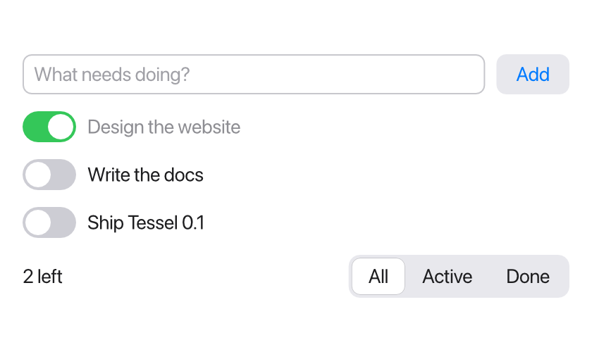
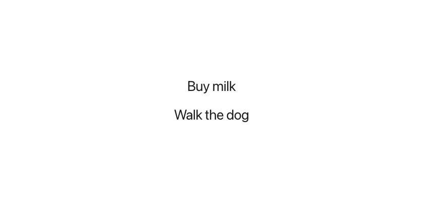
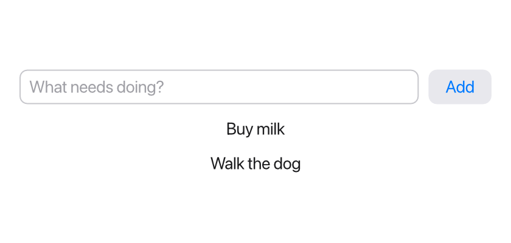
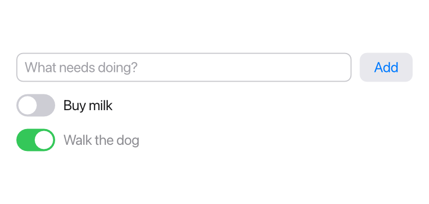
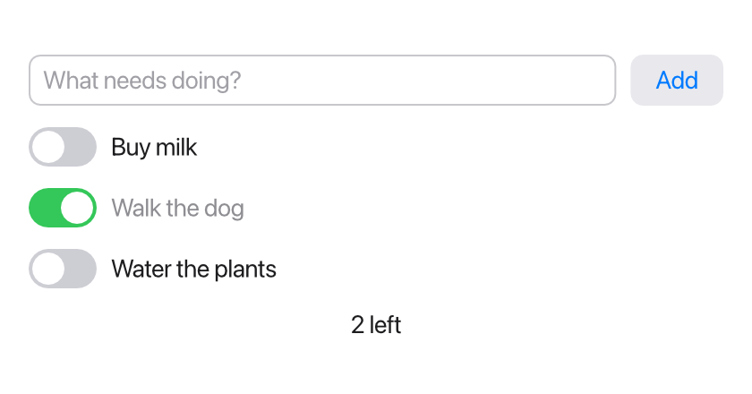
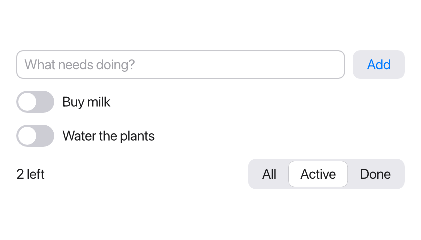

In this tutorial you build a todo list: you can add items, tick them off,
see how many are left, and filter the list. Along the way you meet most of
what makes Tessel apps work: structs, state, controls, loops, your own views,
bindings and enums.

This is where you'll end up:



You need a working `tessel` command; see [Installation](/start/installation/).
The finished program is also in the Tessel repository as `examples/todos`.

## Set up

A Tessel program is a folder of `.tsl` files. Make a folder called `todos`
with an empty file `main.tsl` in it. (This tutorial builds the app from
nothing, to show each part. To start a project of your own with a working
app already in it, use [`tessel new`](/start/cli/#tessel-new).) You can edit it in any text editor, in
the [Tessel IDE](/start/ide/) (run `tessel ide todos`), or in
[VS Code](/start/editors/).

After each step, check your program and run it:

```sh
tessel check todos
tessel run todos
```

`tessel check` only looks for mistakes, which is quick. `tessel run` compiles
the program and opens its window. Close the window to get back to the
terminal.

## Step 1: a struct and a list

A todo has a title and is either done or not. Describe that with a
**struct**, then show a list of todos in an **app**:

```tessel
struct Todo {
    title: String
    done: Bool = false
}

app Todos(width: 420, height: 560) {
    state todos = [
        Todo(title: "Buy milk"),
        Todo(title: "Walk the dog", done: true),
    ]

    VStack(spacing: 12) {
        for todo in todos {
            Text(todo.title)
        }
    }
    .padding(16)
}
```



Here is what's going on:

- `struct Todo` declares a new type with two fields. `done` has a default
  value, so you can leave it out: `Todo(title: "Buy milk")` makes a todo that
  isn't done yet.
- `app Todos(width: 420, height: 560)` is the program's entry point. It opens
  a window of that size, and its body describes what's in the window.
- `state todos = [...]` is a list of todos that belongs to the app. Its type,
  `[Todo]` (a list of `Todo`), is worked out from the value.
- `VStack` stacks views vertically, 12 points apart. `for` inside a view makes
  one `Text` per todo.
- `.padding(16)` is a **modifier**: it adds space around the stack.

## Step 2: adding todos

Now let the user type in new todos. Start the list empty and add a text
field and a button:

```tessel
struct Todo {
    title: String
    done: Bool = false
}

app Todos(width: 420, height: 560) {
    state todos: [Todo] = []
    state draft = ""

    VStack(spacing: 12) {
        HStack(spacing: 8) {
            TextField("What needs doing?", text: draft)
            Button("Add") { add() }
        }

        for todo in todos {
            Text(todo.title)
        }
    }
    .padding(16)

    fn add() {
        if draft != "" {
            todos.append(Todo(title: draft))
            draft = ""
        }
    }
}
```



- An empty list has no items to guess its type from, so you write the type:
  `state todos: [Todo] = []`.
- `state draft = ""` holds the text being typed.
- `TextField("What needs doing?", text: draft)` shows a text field. Its
  `text:` parameter is a **binding**: the field doesn't get a copy of
  `draft`, it reads and writes `draft` itself. As you type, `draft` changes.
- `Button("Add") { add() }` runs the block when it's clicked. The block
  after the call is the button's action.
- `fn add()` is a function inside the app, so it can change the app's state.
  It appends a new todo and clears the text field (setting `draft` to `""`
  empties the field, because the field shows `draft`).

Every time an action changes `state`, Tessel rebuilds the view and redraws
what changed. That is why the new todo appears without you writing any code
to show it.

## Step 3: a view of your own

Each todo should get a toggle to mark it done. You could write that inside
the `for` loop, but it's neater as a separate, reusable **view**. Add this
at the end of the file:

```tessel
view TodoRow(todo: bind Todo) {
    HStack(spacing: 8) {
        Toggle(isOn: todo.done)
        Text(todo.title)
            .color(if todo.done { .gray } else { .primary })
        Spacer()
    }
}
```

and use it in the loop, instead of `Text(todo.title)`:

```tessel
        for todo in todos {
            TodoRow(todo: todo)
        }
```



- `view TodoRow(todo: bind Todo)` declares a view with one parameter. The
  word `bind` means the row doesn't get a copy of the todo; it gets access
  to the caller's todo, so it can change it.
- `Toggle(isOn: todo.done)` binds the toggle to the `done` field. Clicking
  the toggle changes the todo inside the app's `todos` list.
- `.color(if todo.done { .gray } else { .primary })` greys out finished
  todos. `if` is an expression here: it picks one of two colors.
- `Spacer()` takes up the rest of the row, which pushes the toggle and text
  to the left.

Notice that the call `TodoRow(todo: todo)` has no special marker for passing
a binding. Because the loop runs over a `state` list, each `todo` is a place
that can be changed, and that's all a `bind` parameter needs. If you pass
something that can't be changed, `tessel check` tells you. For example,
`TodoRow(todo: Todo(title: "Hi"))` gives:

```
error: `TodoRow`'s `todo:` needs something it can change
  --> todos/main.tsl:17:27
   |
17 |             TodoRow(todo: Todo(title: "Hi"))
   |                           ^^^^^^^^^^^^^^^^^ this is a value, not a variable
   |
   = help: pass a `state` or `var`, or a field of one
```

## Step 4: counting what's left

Show how many todos are still to do. Add a function to the app that
counts them:

```tessel
    fn remaining() -> Int {
        todos.filter { t in !t.done }.count
    }
```

and a `Text` at the bottom of the `VStack` that uses it:

```tessel
        Text("{remaining()} left")
```



- `-> Int` says the function returns an `Int`. The last expression in its
  body is the result, so there's no need for `return`.
- `todos.filter { t in !t.done }` makes a new list with only the todos that
  aren't done. The part in braces is a **closure**: a small function that
  takes `t` and returns whether to keep it. `!` means "not".
- `"{remaining()} left"` puts a value into text. Anything inside `{ }` in a
  string is evaluated and inserted.

Because the text calls `remaining()` each time the view is rebuilt, the
count is always right: tick a todo, and it goes down.

## Step 5: filtering with an enum

Last, let the user choose to see all todos, only the active ones, or only
the done ones. The three choices are an **enum**:

```tessel
enum Filter { all, active, done }
```

Store the current choice in the app, as `state filter = Filter.all`, and
replace the `Text` from step 4 with a row that also has a `Picker`:

```tessel
        HStack {
            Text("{remaining()} left")
            Spacer()
            Picker(selection: filter) {
                Text("All").tag(.all)
                Text("Active").tag(.active)
                Text("Done").tag(.done)
            }
        }
```

The picker shows its options side by side. Each option has a `.tag`: the
value that `filter` gets when you click it. Since Tessel knows `filter` is a
`Filter`, you can write `.all` instead of `Filter.all`.

To use the filter, add a function that decides whether to show a todo, and
wrap the row in an `if`:

```tessel
        for todo in todos {
            if shows(todo) {
                TodoRow(todo: todo)
            }
        }
```

```tessel
    fn shows(todo: Todo) -> Bool {
        match filter {
            .all -> true
            .active -> !todo.done
            .done -> todo.done
        }
    }
```

`match` picks the branch for the current value of `filter`. It must cover
every case of the enum; if you add a fourth filter later, `tessel check`
reminds you to handle it here.



## The whole program

Here is the finished app, the same as `examples/todos` in the repository:

```tessel
// A todo list: structs, lists, enums, loops, bindings and custom views.

struct Todo {
    title: String
    done: Bool = false
}

enum Filter { all, active, done }

app Todos(width: 420, height: 560) {
    state todos: [Todo] = []
    state draft = ""
    state filter = Filter.all

    VStack(spacing: 12) {
        HStack(spacing: 8) {
            TextField("What needs doing?", text: draft)
            Button("Add") { add() }
        }

        for todo in todos {
            if shows(todo) {
                TodoRow(todo: todo)
            }
        }

        HStack {
            Text("{remaining()} left")
            Spacer()
            Picker(selection: filter) {
                Text("All").tag(.all)
                Text("Active").tag(.active)
                Text("Done").tag(.done)
            }
        }
    }
    .padding(16)

    fn add() {
        if draft != "" {
            todos.append(Todo(title: draft))
            draft = ""
        }
    }

    fn shows(todo: Todo) -> Bool {
        match filter {
            .all -> true
            .active -> !todo.done
            .done -> todo.done
        }
    }

    fn remaining() -> Int {
        todos.filter { t in !t.done }.count
    }
}

// A reusable view. `bind` means the row edits the caller's Todo in place.
view TodoRow(todo: bind Todo) {
    HStack(spacing: 8) {
        Toggle(isOn: todo.done)
        Text(todo.title)
            .color(if todo.done { .gray } else { .primary })
        Spacer()
    }
}
```

## Make it an app

`tessel run` builds a temporary program each time. To get an app you can
keep, use `tessel build`:

```sh
tessel build todos -o todos-app --bundle
```

On macOS this makes `Todos.app`, named after your `app`, which you can
double-click or move to your Applications folder. On Windows it makes
`todos-app.exe`, which you can double-click too. See
[Command line](/start/cli/) for the details.

:::note
Here `-o` just makes the name explicit. Without it, `tessel build todos`
would name the executable after the folder, but since a folder called
`todos` is already there, it uses `todos-app` instead.
:::

## Where to go next

- The language pages explain each feature in more depth, starting with
  [the basics](/language/basics/).
- [State and bindings](/ui/state/) covers `state` and `bind` fully.
- [Controls](/ui/controls/) lists the other built-in controls.
- [Lists and identity](/ui/lists/) explains `.id`, which keeps each row's own
  state attached to the right item when a list is reordered.
