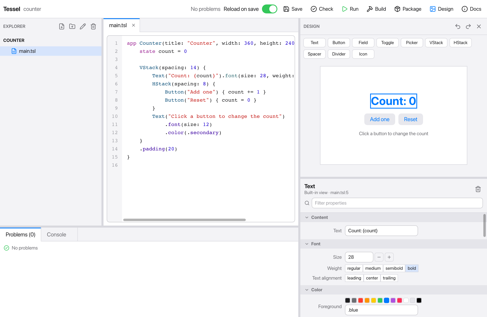
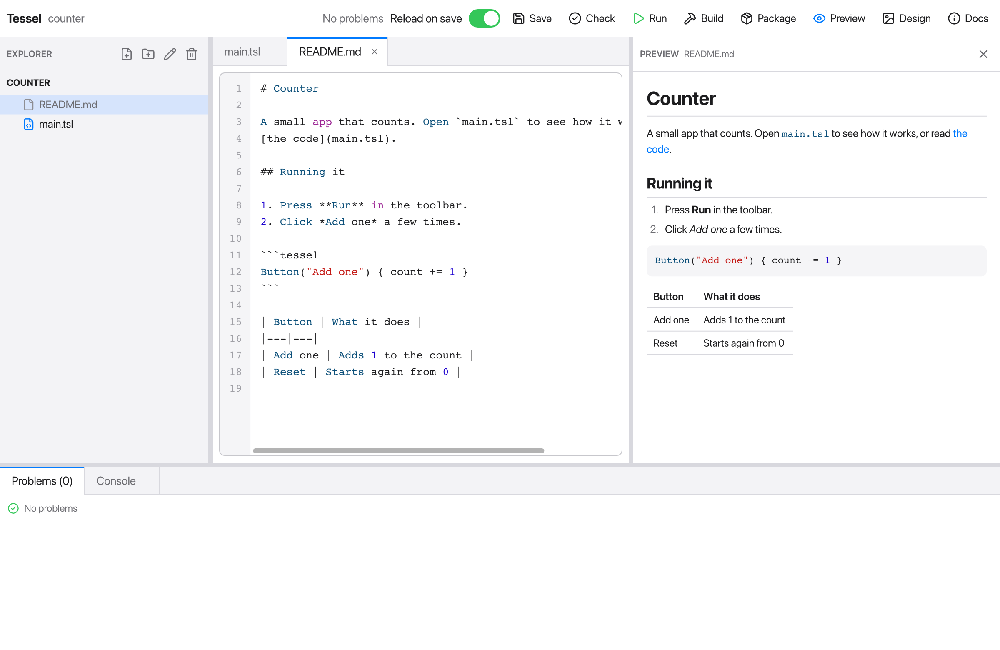

Tessel comes with its own small IDE: a file explorer, a tabbed code editor,
buttons to check, run and build your program, and panels for problems and
program output. You don't need a terminal or another editor to write Tessel
apps.


The IDE is itself a Tessel app. Its source is in the `ide/` folder of the
Tessel repository, and it's a good example of a larger Tessel program.

## Opening the IDE

Run `tessel` with no arguments to open the IDE on the current folder, or
name a folder:

```sh
tessel              # the current folder
tessel ide todos    # the folder `todos`
```

The folder is your project: the program the IDE checks, runs and builds.
The first time you open the IDE, `tessel` compiles it, which takes a moment
(`preparing the IDE (first run only)…`). After that it starts straight away,
until you update `tessel`.

When it opens, the IDE shows the first `.tsl` file of the project and
checks the program.

## The explorer

The left side lists the project's files and folders, folders first. Click a
folder to open or close it, and click a file to open it in the editor.
Files and folders whose names start with `.` are hidden.

The four buttons at the top of the explorer are:

| Button | What it does |
|---|---|
| New file | Asks for a name and creates an empty file. If the name has no extension, `.tsl` is added. |
| New folder | Asks for a name and creates a folder. |
| Rename | Renames the selected file or folder. Open tabs follow the renamed file. |
| Delete | Asks you to confirm, then deletes the selected file. Folders can't be deleted from the IDE. |

New files and folders go into the selected folder, or into the folder of the
selected file. Type the name and press Enter.

## The editor

Each open file gets a tab. The editor has:

- **Syntax colors** for Tessel code, and line numbers.
- **Error markers** on lines with errors. They are updated each time the
  program is checked: when the IDE opens, when you save, and when you press
  Check.
- **Code completion.** As you type, a list suggests what fits there: the
  fields and methods after `doc.`, the modifiers after a view, the cases
  after `.` where an enum is expected, and the names in scope (variables,
  functions, views, types and keywords) elsewhere. Up and Down choose, Enter
  or Tab insert, Escape closes the list. Accepting a function or method also
  types its `(`.
- **Undo and redo** with Cmd+Z and Cmd+Shift+Z.
- The usual text editing keys: select with the mouse or Shift and the arrow
  keys, copy, cut, paste, and select all. Tab inserts four spaces.

A tab whose file has unsaved changes shows a dot (`•`) before its name.
Closing a tab with its **×** button saves your changes first.

On Windows, use Ctrl wherever this page says Cmd.

## The toolbar

| Button | Shortcut | What it does |
|---|---|---|
| Save | Cmd+S | Saves every changed file, then checks the program again. |
| Check | Cmd+K | Checks the program for errors (like `tessel check`) and lists them under Problems. |
| Run / Stop | Cmd+R | Saves and runs the program, showing its output in the Console. While it runs, the button becomes Stop. |
| Build | Cmd+B | Builds an executable into the project folder, named after the folder. |
| Package | | Like Build, but makes an app bundle (`Name.app` on macOS). |
| Preview | | Only while a Markdown file is open: shows or hides the [Preview panel](#the-preview-panel). |
| Design | | Shows or hides the [Design panel](#the-design-panel). |
| Docs | | Shows or hides the [Docs panel](#the-docs-panel). |

When a newer Tessel is available, an **Update to v…** button appears next to
the status. It runs [`tessel update`](/start/installation/#updating) and shows
its progress in the Console; restart Tessel afterwards to use the new
version.

Next to the buttons, a status text says what the IDE is doing ("Building…",
"Running", "2 problem(s)", and so on).

### Reload on save

With **Reload on save** switched on (it is on by default), saving while
your app is running gives the running app its new code: the window stays
open, and what you had typed, switched on or scrolled to is still there. So
you can change a color or a layout and see it at once, in the middle of
whatever you were doing in the app. This is
[`tessel run --hot`](/start/cli/#hot-reload), which has the details: for
instance, a view whose `state` declarations change starts with fresh state.

If the saved code has errors, they're shown in the Console and the app
carries on with the code it had. A program without a window (`fn main()`)
is run again from the start instead.

With the switch off, Run builds the program and runs it as it was then;
saving doesn't change the running program. The executable is written to a
hidden file, `.tessel-run`, in the project folder.

## The Design panel

**Design** in the toolbar opens a picture of your app next to its code. You
can build the window by pointing at it: select a view, change how it looks,
drag new views in, and drag views to other places. Everything you do there
is written into the code, so you can go back and forth between the picture
and the editor as you like.



The panel runs down the right side of the window and has three parts:

- **The kinds of views** you can add, at the top: `Text`, `Button`,
  `TextField` (Field), `Toggle`, `Picker`, `VStack`, `HStack`, `Spacer`,
  `Divider` and `Icon`.
- **The picture**: the app's window as it first appears, made smaller if it
  doesn't fit. It's in the same appearance as the IDE, light or dark.
- **The inspector**, below it: everything the selected view is given, or,
  with **Outline**, the views as a tree. Drag the edge above it to give the
  picture or the inspector more room.

### The picture follows the code

The picture is made again whenever the code changes: a moment after you
stop typing, and after every change you make in the panel. It's made from
what's in the editor, saved or not.

If the code has an error, the panel says so in red and keeps the last
picture, dimmed, until the error is gone. Views can't be changed in the
picture while it doesn't match the code.

### Selecting a view

Click a view in the picture to select it. It gets a blue outline, and the
editor scrolls to the line where it's written. It works the other way too:
put the cursor on a line in the editor, and the view written there is
selected in the picture. Escape selects none.

**Outline**, above the inspector, lists the views in the picture as a tree,
with the text of each one that has some (`Text "Count: {count}"`). Click a
row to select its view: the way to get to one that's too small to click, or
hidden behind another. **Properties** goes back to the inspector.

A view made by a `for` loop is written once and shown several times: all of
them are outlined (and it's listed once). Views inside one of your own `view`s are selected where
the `view` declares them, in its file.

### The inspector

The inspector shows the selected view's name and where it's written, and
below that its properties in sections, each a row with a label: click a
section's title to close or open it. Type in **Filter properties** to see
only the rows whose label has that text.

| Section | Rows | What they write |
|---|---|---|
| Content | Text, Title, Placeholder, Label, Path; Text, Is on, Selection; Icon | The view's own arguments: `Text("Hello")`, `TextField("Name", text: name)`, `Icon(.star)`. |
| Arguments | One per argument | For one of your own views: what it's given, as code. |
| Stack | Spacing, Alignment | For a `VStack` or `HStack`: `VStack(spacing: 12, alignment: .leading)`. |
| Font | Size, Weight, Text alignment | `.font(size: 20, weight: .bold)`, `.textAlignment(.center)` |
| Color | Foreground, Background, Corner radius, Border, Border width | `.color(.blue)`, `.background(.lightGray, radius: 6)`, `.border(.gray, width: 2)` |
| Padding | All edges, Horizontal, Vertical, Top, Leading, Bottom, Trailing | `.padding(12)`, `.padding(horizontal: 8, vertical: 4)` |
| Size and place | Width, Height, Min and Max width and height, Offset X and Y | `.frame(width: 200, maxWidth: .infinity)`, `.offset(x: 4)` |
| Appearance | Opacity, Hidden, Disabled, Clipped, Tooltip | `.opacity(0.5)`, `.hidden()`, `.tooltip("Saves the file")` |
| Modifiers | Every modifier, as written | Each one's **−** takes it away, including ones the other sections don't show, like `.onTap`. |

How to change a value:

- **Text and numbers:** type and press **Enter**. Numbers have **−** and
  **+** to step them. A value can be any expression, not only a number:
  `Float(count) * 2`, say, or `.infinity` for a maximum width.
- **Choices** (weight, alignment): click one to pick it, and click it again
  to take it away.
- **Colors:** click a color to pick it, and again to take it away, or type
  one like `.rgb(255, 136, 0)` in the field below them.
- **On or off** (Hidden, Disabled, Clipped): click the box.

An empty field takes that part of the code away; a modifier left with
nothing to say goes too. A text whose code isn't plain text (a call, say)
shows the code itself, marked "(code)".

The trash button next to the view's name, or the Delete key, deletes the
view from the code; the copy button next to it duplicates it.

### Keys

After a click in the panel (anywhere but in a text field), these keys work
on the selected view:

| Key | |
|---|---|
| Delete, Backspace | Delete it. |
| Cmd+C | Copy its code, to paste in the panel or in the editor. |
| Cmd+X | Cut it: copy its code and delete it. |
| Cmd+V | Paste the code that was copied: into the selected stack, at its end, or after the selected view. Code copied from the editor can be pasted too. |
| Cmd+D | Duplicate it: a copy goes right after it. |
| Escape | Select none. |
| Cmd+Z, Cmd+Shift+Z | Undo and redo (see below). |

### Adding a view

Drag a kind of view from the top of the panel into the picture. A green
line shows where it would go: between two views of a stack, or at its end.
Let go, and the view is written there, with the indentation of the code
around it. It's selected, ready to be changed.

A click on a kind of view (without dragging) adds one after the selected
view, or inside it if a stack is selected.

A new `VStack` or `HStack` comes with a `Text` in it, so there's something
to see and to click. A `TextField`, `Toggle` or `Picker` needs `state` to
hold what it shows: one is added for it, after the other `state` of the
`view` or `app` it goes in, with a name that's free (`text`, `text2`, …):

```tessel
state text = ""
…
TextField("Placeholder", text: text)
```

### Moving a view

Drag a view in the picture to another place: elsewhere in its stack, or
into another stack. The green line shows where it would go. Its code is
moved there, with everything in it.

### Undo and redo

Every change the panel makes can be undone with **Cmd+Z** and redone with
**Cmd+Shift+Z**, or with the arrows at the top of the panel. A change in
the panel is one step of the editor's own undo history: Cmd+Z in the editor
undoes it just as it undoes typing, in the order things happened.

### What the panel doesn't do

- The picture shows the app as it starts. It isn't a running app: buttons
  in it select, they don't click. Use Run for that, with
  [Reload on save](#reload-on-save) to see changes at once.
- To make the picture, the app's code runs up to its first frame, including
  what it does in `.onAppear`.
- Views can go into stacks: the block of a `VStack`, `HStack`, `ZStack` or
  `Scroll`, or of one of your own views that takes content. Views in a `for`
  loop or an `if` can be selected, changed and moved out, but nothing can be
  dropped among them.
- A `TextField`, `Toggle` or `Picker` can only be added inside a `view` or
  `app`, where its `state` can go (not in a function that returns a view).
- A program needs an `app` to have a picture.

Drag the edge between the editor and the panel to make the panel wider.
Click **Design** again, or the × in the panel, to close it. The Preview,
Design and Docs panels take turns: opening one closes the others.

## The Preview panel

When the file in the editor is a Markdown file (`.md` or `.markdown`), a
**Preview** button appears in the toolbar. It opens the file as it reads,
next to its text:



- The preview follows what you type, saved or not.
- It shows what the [`Markdown`](/reference/views/#markdown) view shows:
  headings, lists, tables, quotes, code (Tessel code in color) and pictures.
  Pictures are found from the file's folder.
- A link to another file of the project opens that file in the editor; a
  link to the web opens in your browser.
- The panel shows while a Markdown file is in front: switch to another tab
  and it steps aside, come back and it's there again.

Drag the edge between the editor and the panel to make the panel wider.
Click **Preview** again, or the × in the panel, to close it.

## The Docs panel

**Docs** in the toolbar opens Tessel's documentation in a panel next to the
editor, so you can read while you write:


- The panel opens on the contents: every page of this documentation, in the
  same order. Click a page to read it.
- Links in a page go to other pages. The arrow goes back, and the house
  returns to the contents. Links to the web open in your browser.
- Type in the search field to find pages: the ones with your words in their
  title come first, then the ones with them in their text, each with the
  line they're on. Click one to read it. Large and small letters are the
  same to the search, and it needs two letters or more.
- The documentation comes with Tessel and is read from your computer: it
  works without a network, and it's the documentation of the version you
  have installed.

Drag the edge between the editor and the panel to make the panel wider or
narrower. Click **Docs** again, or the × in the panel, to close it.

## Resizing the panels

The edges between the parts of the window can be dragged: the one between
the explorer and the editor, the one above Problems and Console, and the one
beside the Preview, Design or Docs panel. An edge turns blue under the pointer. The sizes last
until you close the IDE.

## Problems and console

The bottom of the window has two tabs:

- **Problems** lists the errors from the last check, with the file and line
  of each one. The tab title shows how many there are. Click a problem to
  jump to it: its file opens and the editor goes to that line.
- **Console** shows what the program prints while it runs, the output of
  Build and Package, and finally the exit code. Errors in the console show
  their location as ` --> file:line:column`; click such a line to jump to it.
  This works for compile errors and for runtime errors, such as an index
  out of range.

## Other editors

If you prefer VS Code or another editor, see [Editor support](/start/editors/).
Everything the IDE does is also available from the
[command line](/start/cli/).
