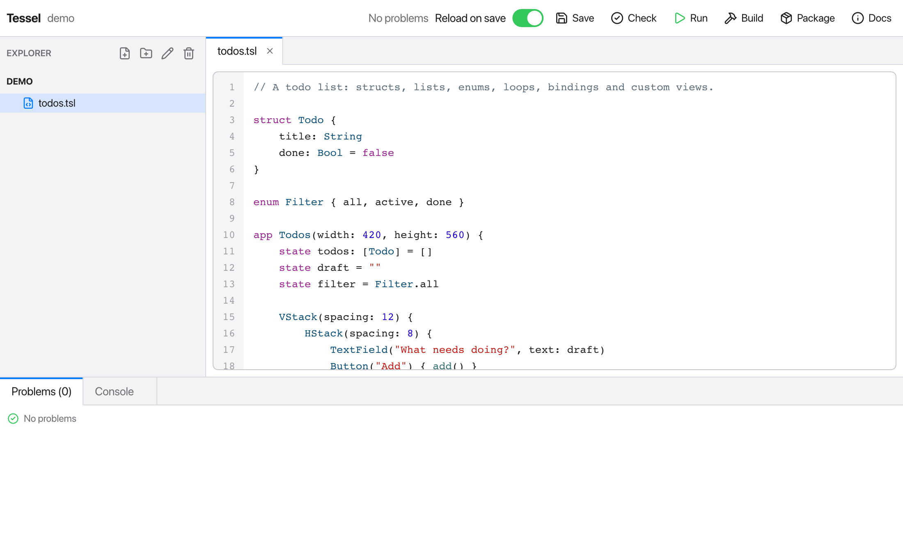
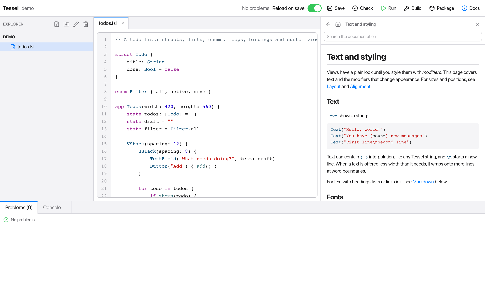

Tessel comes with its own small IDE: a file explorer, a tabbed code editor,
buttons to check, run and build your program, and panels for problems and
program output. You don't need a terminal or another editor to write Tessel
apps.



The IDE is itself a Tessel app. Its source is in the `ide/` folder of the
Tessel repository, and it's a good example of a larger Tessel program.

## Opening the IDE

Run `tessel` with no arguments to open the IDE on the current folder, or
name a folder:

```sh
tessel              # the current folder
tessel ide todos    # the folder `todos`
```

The folder is your project: the program the IDE checks, runs and builds.
The first time you open the IDE, `tessel` compiles it, which takes a moment
(`preparing the IDE (first run only)…`). After that it starts straight away,
until you update `tessel`.

When it opens, the IDE shows the first `.tsl` file of the project and
checks the program.

## The explorer

The left side lists the project's files and folders, folders first. Click a
folder to open or close it, and click a file to open it in the editor.
Files and folders whose names start with `.` are hidden.

The four buttons at the top of the explorer are:

| Button | What it does |
|---|---|
| New file | Asks for a name and creates an empty file. If the name has no extension, `.tsl` is added. |
| New folder | Asks for a name and creates a folder. |
| Rename | Renames the selected file or folder. Open tabs follow the renamed file. |
| Delete | Asks you to confirm, then deletes the selected file. Folders can't be deleted from the IDE. |

New files and folders go into the selected folder, or into the folder of the
selected file. Type the name and press Enter.

## The editor

Each open file gets a tab. The editor has:

- **Syntax colors** for Tessel code, and line numbers.
- **Error markers** on lines with errors. They are updated each time the
  program is checked: when the IDE opens, when you save, and when you press
  Check.
- **Code completion.** As you type, a list suggests what fits there: the
  fields and methods after `doc.`, the modifiers after a view, the cases
  after `.` where an enum is expected, and the names in scope (variables,
  functions, views, types and keywords) elsewhere. Up and Down choose, Enter
  or Tab insert, Escape closes the list. Accepting a function or method also
  types its `(`.
- **Undo and redo** with Cmd+Z and Cmd+Shift+Z.
- The usual text editing keys: select with the mouse or Shift and the arrow
  keys, copy, cut, paste, and select all. Tab inserts four spaces.

A tab whose file has unsaved changes shows a dot (`•`) before its name.
Closing a tab with its **×** button saves your changes first.

On Windows, use Ctrl wherever this page says Cmd.

## The toolbar

| Button | Shortcut | What it does |
|---|---|---|
| Save | Cmd+S | Saves every changed file, then checks the program again. |
| Check | Cmd+K | Checks the program for errors (like `tessel check`) and lists them under Problems. |
| Run / Stop | Cmd+R | Saves and runs the program, showing its output in the Console. While it runs, the button becomes Stop. |
| Build | Cmd+B | Builds an executable into the project folder, named after the folder. |
| Package | | Like Build, but makes an app bundle (`Name.app` on macOS). |
| Docs | | Shows or hides the [Docs panel](#the-docs-panel). |

When a newer Tessel is available, an **Update to v…** button appears next to
the status. It runs [`tessel update`](/start/installation/#updating) and shows
its progress in the Console; restart Tessel afterwards to use the new
version.

Next to the buttons, a status text says what the IDE is doing ("Building…",
"Running", "2 problem(s)", and so on).

### Reload on save

With **Reload on save** switched on (it is on by default), saving while
your app is running gives the running app its new code: the window stays
open, and what you had typed, switched on or scrolled to is still there. So
you can change a color or a layout and see it at once, in the middle of
whatever you were doing in the app. This is
[`tessel run --hot`](/start/cli/#hot-reload), which has the details: for
instance, a view whose `state` declarations change starts with fresh state.

If the saved code has errors, they're shown in the Console and the app
carries on with the code it had. A program without a window (`fn main()`)
is run again from the start instead.

With the switch off, Run builds the program and runs it as it was then;
saving doesn't change the running program. The executable is written to a
hidden file, `.tessel-run`, in the project folder.

## The Docs panel

**Docs** in the toolbar opens Tessel's documentation in a panel next to the
editor, so you can read while you write:



- The panel opens on the contents: every page of this documentation, in the
  same order. Click a page to read it.
- Links in a page go to other pages. The arrow goes back, and the house
  returns to the contents. Links to the web open in your browser.
- Type in the search field to find pages: the ones with your words in their
  title come first, then the ones with them in their text, each with the
  line they're on. Click one to read it. Large and small letters are the
  same to the search, and it needs two letters or more.
- The documentation comes with Tessel and is read from your computer: it
  works without a network, and it's the documentation of the version you
  have installed.

Click **Docs** again, or the × in the panel, to close it.

## Problems and console

The bottom of the window has two tabs:

- **Problems** lists the errors from the last check, with the file and line
  of each one. The tab title shows how many there are. Click a problem to
  jump to it: its file opens and the editor goes to that line.
- **Console** shows what the program prints while it runs, the output of
  Build and Package, and finally the exit code. Errors in the console show
  their location as ` --> file:line:column`; click such a line to jump to it.
  This works for compile errors and for runtime errors, such as an index
  out of range.

## Other editors

If you prefer VS Code or another editor, see [Editor support](/start/editors/).
Everything the IDE does is also available from the
[command line](/start/cli/).
