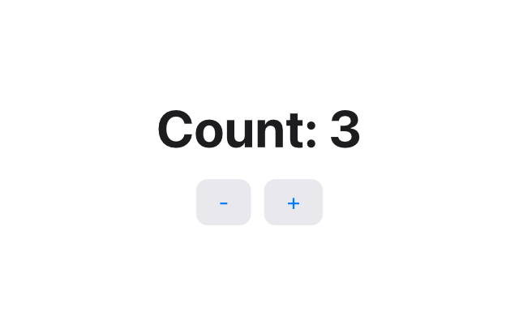

Tessel is a small programming language for building desktop apps. You
describe what your window should look like for the current data, and Tessel
keeps the screen up to date when that data changes. Your program is compiled
ahead of time into a native executable for macOS or Windows.

Here is a complete Tessel app:

```tessel
// The smallest useful Tessel app: one piece of state and two buttons.

app Counter(width: 320, height: 200) {
    state count = 0

    VStack(spacing: 12) {
        Text("Count: {count}")
            .font(size: 32, weight: .bold)

        HStack(spacing: 8) {
            Button("-") { count -= 1 }
            Button("+") { count += 1 }
        }
    }
    .padding(24)
}
```

`state count = 0` is a value that belongs to the app. The buttons change it,
and the text that shows it is redrawn by itself. You never write code to
"update the label".



Tessel is not only for windows. A program with a `fn main()` instead of an
`app` runs in the terminal and prints its output:

```tessel
struct Planet {
    name: String
    moons: Int
}

fn describe(planet: Planet) -> String {
    if planet.moons == 0 {
        "{planet.name} has no moons"
    } else {
        "{planet.name} has {planet.moons} moons"
    }
}

fn main() {
    let planets = [
        Planet(name: "Mercury", moons: 0),
        Planet(name: "Mars", moons: 2),
        Planet(name: "Jupiter", moons: 95),
    ]
    for planet in planets {
        print(describe(planet: planet))
    }
}
```

```
Mercury has no moons
Mars has 2 moons
Jupiter has 95 moons
```

## Who Tessel is for

- **People who want to make a desktop app** without learning a large
  framework first. A useful app fits in one short file.
- **Beginners.** Tessel has 18 keywords, one kind of block, and error
  messages that point at your code and suggest a fix.
- **People who know SwiftUI, React or Flutter.** The ideas will feel
  familiar: views are built from state, and the framework redraws them.
  You don't need to know any of those to learn Tessel.

## The main ideas

**Declarative views.** A view is a description of the screen, built from
nested views like `VStack`, `Text` and `Button`. Inside a view you can use
`if` and `for` to show views conditionally or once per item.
See [Apps and views](/ui/apps-views/).

**State.** `state` declares data that belongs to a view. When an action
changes it, Tessel rebuilds that view and redraws what changed. A view can
also take a `bind` parameter, which lets it edit data that belongs to its
caller. See [State and bindings](/ui/state/).

**Value types only.** Every value in Tessel, including lists and structs,
behaves like a number: assigning it or passing it to a function gives the
receiver its own copy. There are no shared objects that change behind your
back. Copies are cheap, because Tessel only really copies when one side
changes. See [Values and copying](/language/values/).

**No imports.** A program is a folder. Every `.tsl` file in it can use
everything declared in the others. See [Programs and files](/language/programs/).

**Optionals instead of crashes.** A value that might be missing has a type
like `String?`, and you must check it before you use it. Functions that can
fail, like turning text into a number with `Int("42")` or reading a file,
return an optional: `nil` means it didn't work.
See [Optionals](/language/optionals/) and [Errors](/language/errors/).

**Compiled to native code.** The Tessel compiler checks your types, then
uses LLVM to produce machine code. Memory is managed with reference counting,
so there is no garbage collector and no pauses.

**Its own controls.** Tessel draws every button, text field and toggle
itself, with the system's graphics (Core Graphics on macOS, Direct2D on
Windows), rather than using the operating system's widgets. Apps look the
same on macOS and Windows.

## Current status

Tessel is young. It is at version 0.1, it runs on **macOS and Windows**,  and you
[install it](/start/installation/) with one command. The language and its built-in views are
already enough to write real apps (the [Tessel IDE](/start/ide/) is written
in Tessel), but many things are still missing, and details may change.
The [roadmap](/about/roadmap/) lists what works and what doesn't yet.

## Where to go next

- [Install Tessel](/start/installation/) and run the examples.
- [Build your first app](/start/first-app/), a todo list, step by step.
- Learn the language, starting with [the basics](/language/basics/).
- Read about [Tessel's design](/about/design/) and why it looks the way it does.
