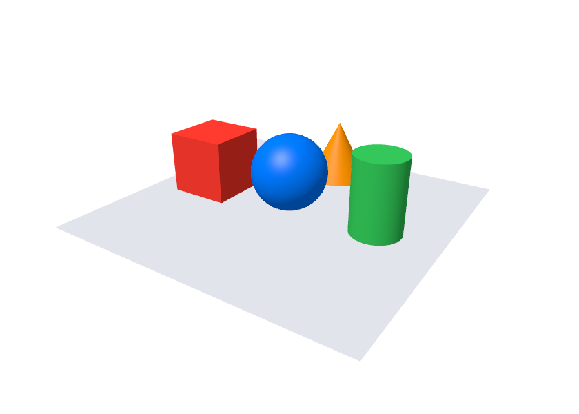
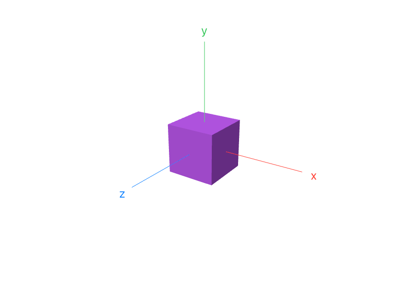
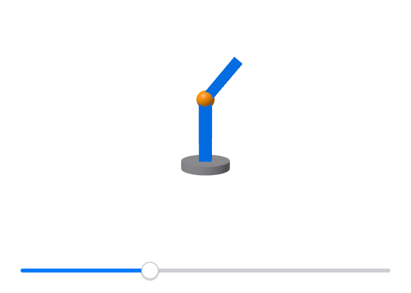
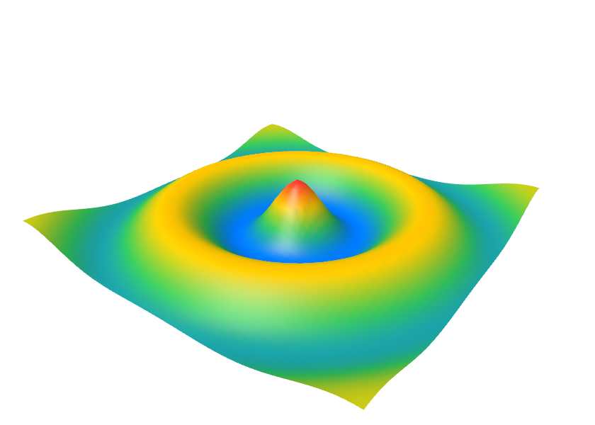
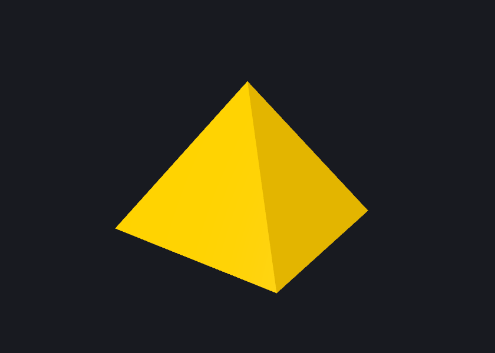
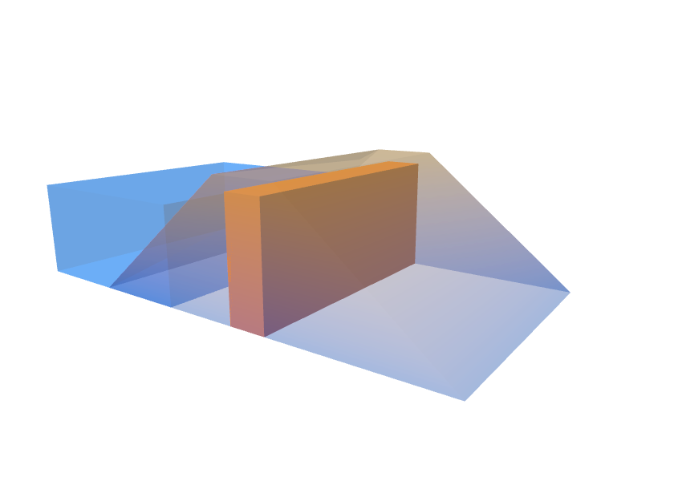

A [`Canvas`](/ui/drawing/) draws flat shapes. A `Scene3D` shows solid ones:
you say what's in the scene and where it's seen from, and the graphics card
draws it, with nearer things in front of farther ones, lit and shaded.

## A first scene

A `Scene3D` is a view with a block. The block gets a `Scene` value, usually
called `s`, and says what's in the scene by calling its methods:

```tessel
app Shapes(title: "Shapes", width: 420, height: 300) {
    Scene3D { s in
        s.camera(x: 4, y: 3.5, z: 6)
        s.plane(width: 5, depth: 5, color: .rgb(225, 228, 235))
        s.box(color: .red, x: -1.5, y: 0.5)
        s.sphere(radius: 0.6, color: .blue, y: 0.6)
        s.cylinder(radius: 0.4, height: 1.2, color: .green, x: 1.5, y: 0.6)
        s.cone(radius: 0.5, height: 1, color: .orange, y: 0.5, z: -1.6)
    }
}
```



- Places and sizes are in the scene's own units: what a unit is (a meter, a
  millimeter) is up to you. `x` goes to the right, `y` **up**, and `z`
  towards you.
- A shape's `x:`, `y:` and `z:` say where its **middle** is, and are 0 when
  left out. The box above is 1 high, so with `y: 0.5` it stands on the sheet.
- Like a canvas, a scene takes all the space it's offered; `.frame` gives it
  a size. It has no background of its own: what's under the view shows
  around the shapes, so `.background(…)` works, and so does `s.background(…)`.
- The block runs when the window is drawn, so it reads `state` like any
  view, and the scene follows it. It shouldn't change `state`.

## Shapes

| Method | |
|---|---|
| `s.box(width:, height:, depth:, color:)` | A box. Each size is 1 when left out. |
| `s.sphere(radius:, color:)` | A ball. |
| `s.cylinder(radius:, height:, color:)` | A cylinder, standing up. |
| `s.cone(radius:, height:, color:)` | A cone, its point up. |
| `s.plane(width:, depth:, color:)` | A flat sheet, lying down. |
| `s.line(x1, y1, z1, x2, y2, z2, color:)` | A thin line between two points. |
| `s.lines(points, color:, closed:)` | A line through many points, given as `x, y, z, x, y, z, …`. |
| `s.label(text, x:, y:, z:, size:, color:)` | Text at a point of the scene. It faces you and keeps its size wherever the camera is, and shows over the shapes. |

Each shape also takes `x:`, `y:` and `z:`, and `opacity:` (see
[Seeing through shapes](#seeing-through-shapes)). See
[`Scene`](/reference/views/#scene) for every parameter and its default.

## The camera

Without a camera, a scene is seen from (3, 2.5, 4), looking at the middle.
`s.camera` puts it somewhere else, and says what it looks at:

```tessel
s.camera(x: 0, y: 10, z: 0.1)                  // from above
s.camera(x: 4, y: 1.5, z: 0, lookAtY: 1.5)     // from the right, level with y = 1.5
```

For looking **around** something, `s.orbit` is easier: the camera is at a
`distance` from a point, turned `yaw` around it and raised `pitch` above
it (both angles in radians, like every angle in Tessel). With the angles in
`state`, the mouse can move it:

```tessel
app Look(title: "Look around", width: 420, height: 300) {
    state yaw = 0.6
    state pitch = 0.4
    state distance = 7.0

    Scene3D { s in
        s.orbit(distance: distance, yaw: yaw, pitch: pitch)
        s.box(color: .purple)
        s.line(0, 0, 0, 2, 0, 0, color: .red)
        s.line(0, 0, 0, 0, 2, 0, color: .green)
        s.line(0, 0, 0, 0, 0, 2, color: .blue)
        s.label("x", x: 2.2, color: .red)
        s.label("y", y: 2.2, color: .green)
        s.label("z", z: 2.2, color: .blue)
    }
    .onPointer { e in
        if e.kind == .drag {
            yaw -= e.dx * 0.01
            pitch += e.dy * 0.01
        }
        if e.kind == .scroll {
            distance = (distance - e.dy * 0.05).clamped(min: 2, max: 30)
        }
    }
}
```



Things twice as far look half as large. `fieldOfView:` (on both methods) is
the angle seen from the top of the view to the bottom, 45 degrees unless
you say otherwise: smaller looks through a telescope, larger through a wide
lens.

## Moving, turning and sizing

`s.translate`, `s.rotateX`, `s.rotateY`, `s.rotateZ` and `s.scale` change
where everything **after** them goes, as a canvas's do. `s.save()` remembers
that, and `s.restore()` goes back to it. A turn is around the axis it's
named after, through the point everything has been moved to: move first,
then turn, and a part turns in its own place.

```tessel
app Arm(title: "Arm", width: 420, height: 300) {
    state bend = 0.7

    VStack {
        Scene3D { s in
            s.camera(x: 0.5, y: 2, z: 7, lookAtY: 1.2)
            s.cylinder(radius: 0.6, height: 0.2, color: .gray, y: 0.1)

            s.translate(0, 0.2, 0)
            s.box(width: 0.3, height: 1.5, depth: 0.3, color: .blue, y: 0.75)

            // The second part hangs from the end of the first, and turns there.
            s.translate(0, 1.5, 0)
            s.rotateZ(-bend)
            s.sphere(radius: 0.22, color: .orange)
            s.box(width: 0.25, height: 1.2, depth: 0.25, color: .blue, y: 0.6)
        }
        Slider(value: bend, from: 0, to: 2)
            .padding(12)
    }
}
```



## Light

A scene with no light of its own is lit from over your left shoulder,
wherever the camera is. `s.light` adds a light instead: `x:`, `y:` and `z:`
are the direction it comes **from**. It's as far as the sun, so every shape
is lit from the same side, and nothing casts a shadow. A scene can have up
to 4.

```tessel
s.light(x: 2, y: 3, z: 4)                                           // white, from the upper right in front
s.light(x: -3, y: 1, z: -2, color: .rgb(255, 200, 150), strength: 0.5)   // a weaker, warm one from behind
s.ambient(0.15)
```

`s.ambient(amount)` is the light there is everywhere, which the sides
turned away from every light still get: 0.3 unless you say otherwise, from
0 (black shadows) to 1 (no shading at all).

## Surfaces

`s.surface` is a sheet over a grid, for a terrain or a function of two
numbers. `heights` holds the height at each point of the grid, row by row
from the back, and `columns` says how many there are in a row. With
`colors:`, each point is colored by its height, from the first color (the
lowest) to the last:

```tessel
app Ripple(title: "Ripple", width: 420, height: 300) {
    state heights: [Float] = []

    Scene3D(redraw: heights.count) { s in
        s.camera(x: 3, y: 2.6, z: 4)
        s.surface(heights: heights, columns: 60, width: 4, depth: 4, colors: [.blue, .green, .yellow, .red])
    }
    .onAppear {
        for j in 0..60 {
            for i in 0..60 {
                let x = Float(i) / 59 * 12 - 6
                let z = Float(j) / 59 * 12 - 6
                let d = sqrt(x * x + z * z)
                heights.append(cos(d * 1.5) * 0.4 / (1 + d * 0.3))
            }
        }
    }
}
```



The heights here never change, so `redraw:` keeps the picture: see
[When a scene is drawn](#when-a-scene-is-drawn).

## Shapes of your own

`s.mesh` takes triangles. `vertices` is the points, `x, y, z` for each, and
`triangles` says which three points make each triangle, counting points
from 0:

```tessel
app Pyramid(title: "Pyramid", width: 420, height: 300) {
    Scene3D { s in
        s.camera(x: 2.5, y: 2, z: 3.5, lookAtY: 0.5)
        s.light(x: 2, y: 3, z: 4)
        s.light(x: -3, y: 1, z: -2, color: .rgb(255, 200, 150), strength: 0.5)
        s.ambient(0.15)
        s.background(.rgb(24, 26, 32))
        s.mesh(
            vertices: [
                -1, 0, 1,    1, 0, 1,    1, 0, -1,    -1, 0, -1,    // the base's corners
                0, 1.5, 0,                                            // the top
            ],
            triangles: [0, 1, 4,  1, 2, 4,  2, 3, 4,  3, 0, 4,  0, 2, 1,  0, 3, 2],
            color: .yellow
        )
    }
}
```



- Without `triangles:`, every three points are a triangle.
- `colors:` gives each point a color of its own, in the order of the
  points, and each triangle goes smoothly from one of its points' colors
  to the others': that's how a value known at every point (a temperature,
  a pressure) is shown. A point without a color takes `color:`.
- Both sides of a triangle show, so the order of its points doesn't matter.
- Each triangle is flat, with a sharp edge to the next. `smooth: true`
  shades across the edges between triangles that share points, for a
  curved thing made of many small triangles.
- A triangle that names a point that isn't there leaves the whole mesh out.

## Seeing through shapes

`opacity:` makes a shape see-through: 1 (the default) hides what's behind
it, 0.5 lets half of it show, and 0 shows nothing of the shape. A color
that's see-through itself, like `.rgba(0, 120, 255, 0.4)`, does the same.

```tessel
app Dam(title: "Dam", width: 420, height: 300) {
    Scene3D { s in
        s.camera(x: 5, y: 3, z: 7, lookAtY: 0.8)

        // The core, and the water behind the dam.
        s.box(width: 0.6, height: 1.8, depth: 4, color: .orange, y: 0.9)
        s.box(width: 3, height: 1.5, depth: 4, color: .blue, x: -3, y: 0.75, opacity: 0.35)

        // The shell: a section drawn along the dam, see-through, and
        // colored from wet at the bottom to dry at the top.
        let wet: Color = .rgb(60, 110, 200)
        let dry: Color = .rgb(190, 160, 110)
        s.mesh(
            vertices: [
                -3, 0, 2,    3, 0, 2,    0.5, 2, 2,    -0.5, 2, 2,
                -3, 0, -2,   3, 0, -2,   0.5, 2, -2,   -0.5, 2, -2,
            ],
            triangles: [
                0, 1, 2,  0, 2, 3,    4, 6, 5,  4, 7, 6,    // the ends
                0, 3, 7,  0, 7, 4,    1, 5, 6,  1, 6, 2,    // the slopes
                3, 2, 6,  3, 6, 7,                          // the top
            ],
            colors: [wet, wet, dry, dry, wet, wet, dry, dry],
            opacity: 0.45
        )
    }
}
```



See-through shapes are drawn after the solid ones, the farthest triangle
first. Where two of them pass **through** each other, the one that's drawn
in front can be the wrong one; shapes that are beside or inside each other
are fine.

## When a scene is drawn

Without `redraw:`, the block runs each time the window is drawn, and the
picture is made again only when what the block said has changed. That's
right for most scenes.

When the block itself is slow (it builds a large mesh, say), give the scene
`redraw:` a number: the block then runs again only when the number is
different from last time, when the view's size changes, or when the
appearance switches between light and dark.

```tessel
Scene3D(redraw: version) { s in … }
```

A scene is drawn by the graphics card into a picture, which the window then
shows. Tens of thousands of triangles are fine; a scene that moves all the
time costs more as the view gets larger.

## What a scene doesn't do

- Shadows, textures (pictures on shapes), and loading models from files.
- Telling which shape the mouse is on. `.onPointer` says where the mouse is
  in the view; working out what's under it is up to the program.
- Thicker lines: a line is always one pixel wide.
- On a computer with no graphics card to use, a scene shows as an empty
  box.

## Testing

In a [headless run](/ui/testing/), `tree` shows what's in a scene without
drawing it: `Scene3D (4 shapes, 1668 triangles, 3 lines, 3 labels)`.
`snapshot` draws it.
