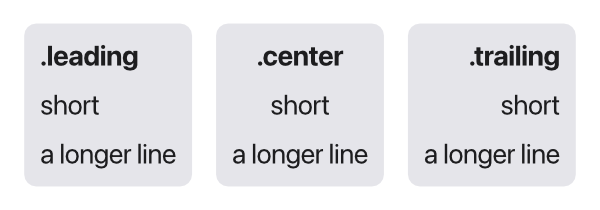
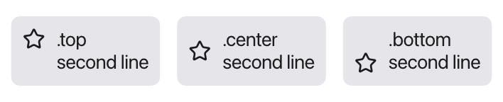
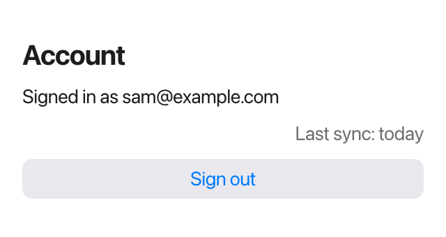
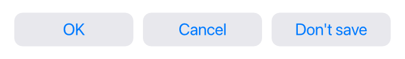
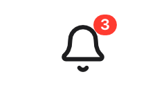
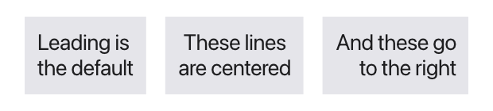

By default Tessel centers things: stacks center their children, and the window
centers its content. This page shows how to line views up differently.

## The `Alignment` values

Everything on this page uses the built-in `Alignment` type. It has nine
values:

|                  |           |                   |
|------------------|-----------|-------------------|
| `.topLeading`    | `.top`    | `.topTrailing`    |
| `.leading`       | `.center` | `.trailing`       |
| `.bottomLeading` | `.bottom` | `.bottomTrailing` |

*Leading* means the left side and *trailing* the right side.

## Aligning the children of a stack

A stack's `alignment:` lines its children up *across* the stack:

- a `VStack` places its children left, center or right with `.leading`,
  `.center` (the default) or `.trailing`;
- an `HStack` places its children at the top, center or bottom with `.top`,
  `.center` (the default) or `.bottom`.

```tessel
VStack(alignment: .leading) {
    Text(".leading").font(weight: .bold)
    Text("short")
    Text("a longer line")
}
```



When you give a stack both `spacing:` and `alignment:`, `spacing:` comes
first: `VStack(spacing: 4, alignment: .leading) { … }`.

```tessel
HStack(alignment: .top) {
    Icon(.star)
    Text(".top\nsecond line")
}
```



## Pushing views to one end

*Along* a stack, children are packed together in the middle. To push them to
one end, fill the rest with a `Spacer()`:

```tessel
HStack {
    Spacer()
    Text("On the right")
}
VStack {
    Text("At the top")
    Spacer()
}
```

With spacers on both sides, a view sits in the middle of the free space
between its neighbors, and the stack stretches across the whole width:

```tessel
HStack {
    Button("Back") {}
    Spacer()
    Text("Title")
    Spacer()
    Button("Next") {}
}
```

## Placing content in a frame

`.frame(width:height:alignment:)` gives a view a size, and `alignment:` says
where the view's content sits inside it:

```tessel
Text("topLeading")
    .frame(width: 140, height: 50, alignment: .topLeading)
    .background(.lightGray)
Text("center")
    .frame(width: 140, height: 50)
    .background(.lightGray)
```

Text, icons and SVG drawings are centered in their frame unless you give an
alignment. A stack with a frame is different: its children are spread over the
whole frame, and the stack's own `alignment:` decides where they go. Giving the
frame an alignment too makes the stack keep its natural size and sit at that
spot in the frame instead.

## Growing with `maxWidth` and `maxHeight`

`.frame(maxWidth:)` makes a view take all the width it's offered, up to the
maximum. Use `.infinity` for "as much as there is". Together with `alignment:`,
this is the usual way to line views up with the edges of their container:

```tessel
VStack(spacing: 10) {
    Text("Account").font(size: 20, weight: .bold)
        .frame(maxWidth: .infinity, alignment: .leading)
    Text("Signed in as sam@example.com")
        .frame(maxWidth: .infinity, alignment: .leading)
    Text("Last sync: today")
        .color(.secondary)
        .frame(maxWidth: .infinity, alignment: .trailing)
    Button("Sign out") {}.frame(maxWidth: .infinity)
}
.padding(16)
```



The button's background stretches too, because the frame is the button's own
size.

- `.infinity` is a shorthand for an infinitely large `Float`. It's the only
  shorthand of its kind, and it's meant for `maxWidth:` and `maxHeight:`.
- A finite maximum caps the growth: `.frame(maxWidth: 200)` grows up to 200
  points and no further.
- `.frame(maxHeight: .infinity)` does the same vertically, for example to let
  a view fill the rest of a window.
- A view with a maximum is [flexible](/ui/layout/#how-sizes-are-decided), so
  a stack around it becomes flexible too.

Inside an `HStack`, a view with `maxWidth: .infinity` takes the room that's
left after its fixed-size neighbors, like a `Spacer` would:

```tessel
HStack {
    Text("Name").frame(maxWidth: .infinity, alignment: .leading)
    Text("Size")
}
```

## Minimum sizes

`.frame(minWidth:)` and `.frame(minHeight:)` keep a view from getting smaller
than a size. It still grows if its content needs more. A common use is
buttons of equal width:

```tessel
HStack(spacing: 8) {
    Button("OK") {}.frame(minWidth: 100)
    Button("Cancel") {}.frame(minWidth: 100)
    Button("Don't save") {}.frame(minWidth: 100)
}
```



Minimums and maximums combine, and `alignment:` works here as well:

```tessel
Text("tall").frame(minWidth: 120, minHeight: 60, alignment: .bottomTrailing)
Text("between 100 and 250").frame(minWidth: 100, maxWidth: 250)
```

## Layers with `ZStack(alignment:)`

A `ZStack` puts its children on top of each other, all centered by default.
`alignment:` takes any of the nine values and places every layer at that spot.
That's how you put a badge in a corner:

```tessel
ZStack(alignment: .topTrailing) {
    Icon(.bell).font(size: 32).padding(6)
    Text("3")
        .font(size: 11, weight: .bold)
        .color(.white)
        .padding(horizontal: 5, vertical: 1)
        .background(.red, radius: 8)
}
```



## Lining up lines of text

Everything above moves whole views around. `.textAlignment(…)` is about the
*lines inside* a multi-line `Text`: whether they line up on the left, in the
center or on the right.

```tessel
Text("Leading is\nthe default")
Text("These lines\nare centered").textAlignment(.center)
Text("And these go\nto the right").textAlignment(.trailing)
```



Only the left-to-right part of the alignment counts, so use `.leading`,
`.center` or `.trailing`.

Like `.font`, `.textAlignment` is inherited: set it on a stack, and every text
inside follows it.

```tessel
VStack(alignment: .trailing) {
    Text("Inherited\nfrom the stack")
    Text("both lines\nright")
}
.textAlignment(.trailing)
```

`.textAlignment` doesn't move the text's box. Where the box goes is still up to
the stack's `alignment:` or a frame's. For a paragraph that wraps across the
full width, combine the two:

```tessel
Text("A long paragraph that wraps onto several lines, centered in the window.")
    .textAlignment(.center)
    .frame(maxWidth: .infinity)
```
