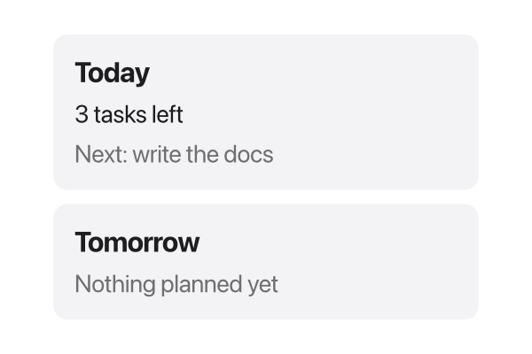

A Tessel program with a window starts with an `app`. Everything you see in the
window is made of *views*: small building blocks like `Text`, `Button` and
`VStack` that you combine into bigger ones.

```tessel
app Greeter(title: "Greeter", width: 360, height: 200) {
    state name = ""

    TextField("Your name", text: name)
    Text(greeting())

    fn greeting() -> String {
        if name == "" { "Hello!" } else { "Hello, {name}!" }
    }
}
```

This page explains each part of that program.

## The `app` declaration

`app` gives your program a name and opens its main window. The arguments in
parentheses are all optional:

| Argument  | Type     | Default         | What it does                          |
|-----------|----------|-----------------|---------------------------------------|
| `title:`  | `String` | the app's name  | The text in the window's title bar.   |
| `width:`  | `Float`  | `640`           | The window's starting width, in points. |
| `height:` | `Float`  | `480`           | The window's starting height, in points. |
| `appearance:` | `Appearance` | `.system` | `.light` or `.dark` to always look that way. See [Light and dark](/ui/styling/#light-and-dark). |

If you give more than one, write them in that order: `title:`, `width:`,
`height:`, `appearance:`. You can also leave the parentheses out entirely:

```tessel
app Hello {
    Text("Hello, world!")
}
```

A program has exactly one entry point: either one `app` or one `fn main()`
(for programs without a window). See [Programs and files](/language/programs/).

## The body

Everything between the braces of the `app` is its *body*. The body can contain:

- **views**, like `Text("Hello")` or `VStack { … }`, which are shown in the window;
- **`state` declarations**, the values that can change while the app runs
  (see [State and bindings](/ui/state/));
- **functions** declared with `fn`, which can read and change that state;
- **`let` constants**, **`if`**, **`for`** and **`match`**, to decide which
  views to show (see [Lists and conditions](/ui/lists/)).

The views in a body are stacked from top to bottom, 8 points apart, like a
[`VStack`](/ui/layout/). The whole body is centered in the window.

The body describes what the window should look like *right now*. You never add
or remove views by hand: when state changes, Tessel runs the body again and
updates the window to match.

:::note
A view body can't change values while it is being built. Assignments such as
`count += 1` belong in actions, like a button's block or a function called
from one. `var` isn't allowed in a view body either; use `let` for a
temporary name, or `state` for a value that changes.
:::

## Views are building blocks

A view is a value that describes something on screen. Tessel has built-in
views for text, controls and layout:

| View | What it shows |
|------|---------------|
| `Text("…")` | A line (or paragraph) of text. See [Text and styling](/ui/styling/). |
| `Button("…") { … }` | A push button that runs an action. See [Controls](/ui/controls/). |
| `TextField("…", text: …)` | A one-line text input. |
| `Toggle("…", isOn: …)` | An on/off switch. |
| `Picker(selection: …) { … }` | A segmented control for picking one option. |
| `VStack`, `HStack`, `ZStack` | Arrange views vertically, horizontally, or on top of each other. See [Layout](/ui/layout/). |
| `Spacer()`, `Divider()` | Empty stretchy space, and a thin separator line. |
| `Scroll { … }` | A vertically scrolling area. |
| `TabView(selection: …) { … }` | Tabs. See [Tabs](/ui/tabs/). |
| `Icon(.name)`, `Svg("…")`, `Image("…")` | Icons and drawings. See [Icons, SVG and images](/ui/icons/). |
| `CodeEditor(text: …)` | A multi-line code editor. See [Code editor](/ui/code-editor/). |

You change how a view looks with *modifiers*, which you chain after it with a
dot:

```tessel
Text("Welcome")
    .font(size: 24, weight: .bold)
    .color(.blue)
    .padding(12)
```

The full list is in the [modifiers reference](/reference/modifiers/).

## Your own views

When part of your UI gets big, or you need it more than once, give it a name
with `view`. A view declaration looks like a function: a name, parameters, and
a body that works exactly like the app's body.

```tessel
view Badge(label: String, color: Color = .blue) {
    Text(label)
        .font(size: 12, weight: .semibold)
        .color(.white)
        .padding(horizontal: 8, vertical: 3)
        .background(color, radius: 8)
}

app Labels(width: 320, height: 200) {
    HStack(spacing: 6) {
        Badge(label: "new")
        Badge(label: "urgent", color: .red)
    }
}
```

You show a custom view by calling it, just like a built-in one. Parameters
work like [function parameters](/language/functions/): arguments are passed by
label, parameters can have default values (`color: Color = .blue`), and a
parameter declared with `_` is passed without a label. A view without
parameters can leave out the parentheses in its declaration:

```tessel
view Header {
    Text("My App").font(size: 20, weight: .bold)
}
```

You still call it with parentheses: `Header()`.

Views can also have their own `state` and `bind` parameters; see
[State and bindings](/ui/state/).

### Views that take other views

A parameter of type `View` accepts any view, including a whole block of them.
Show it by writing the parameter's name in the body. If it's the last
parameter, the caller can pass it as a *trailing block* after the parentheses,
the same way you give a `VStack` its content:

```tessel
view Card(title: String, content: View) {
    VStack(spacing: 6, alignment: .leading) {
        Text(title).font(size: 16, weight: .bold)
        content
    }
    .padding(12)
    .frame(width: 240, alignment: .leading)
    .background(.sidebar, radius: 8)
}

app Planner(width: 300, height: 200) {
    Card(title: "Today") {
        Text("3 tasks left")
        Text("Next: write the docs").color(.secondary)
    }
    Card(title: "Tomorrow") {
        Text("Nothing planned yet").color(.secondary)
    }
}
```



A trailing block also works for a last parameter that is a function, which is
how you make a view with an action, like a button:

```tessel
view ToolButton(icon: IconName, label: String, action: fn()) {
    HStack(spacing: 5) {
        Icon(icon)
        Text(label)
    }
    .padding(6)
    .hoverBackground(.lightGray, radius: 6)
    .onTap { action() }
}

app Toolbar(width: 320, height: 120) {
    state saves = 0

    ToolButton(icon: .save, label: "Save") { saves += 1 }
    Text("Saved {saves} times")
}
```

Tessel decides whether a trailing block is *content* (views) or an *action*
(code to run) from the type of the parameter it fills, so both look the same
at the call site.

### Views in functions

A function can also return a `View`. That's handy for a small piece of UI that
doesn't need parameters with labels or its own state:

```tessel
fn tag(_ text: String) -> View {
    Text(text).padding(4).background(.lightGray, radius: 4)
}

app Tags {
    HStack {
        tag("swift")
        tag("tessel")
    }
}
```

Struct fields can't hold views, though: store the data, and build the view from
it in a `view` or function.

## Functions inside apps and views

Functions declared inside an `app` or `view` body belong to it. They can read
and change its `state` and `bind` parameters, and read its other parameters,
so they're the natural place for the work your buttons do:

```tessel
app Counter(width: 300, height: 160) {
    state count = 0

    HStack {
        Button("-") { change(by: -1) }
        Text("{count}").font(size: 24)
        Button("+") { change(by: 1) }
    }

    fn change(by: Int) {
        count += by
        if count < 0 {
            count = 0
        }
    }
}
```

They can also compute values the body shows, like `greeting()` at the top of
this page. Declare them directly in the body (not inside a `VStack` or other
block); where in the body they go doesn't matter.

Such a function can also be passed as a value, wherever a function is
expected: to a button's `action:`, to a callback like `runCommand`'s
`onOutput:`, or to a parameter of your own view. Here the row's `toggle`
function uses the view's parameters, and the app passes its `picked` function
on as `onPick`:

```tessel
struct Task {
    title: String
    done: Bool = false
}

view TaskRow(task: bind Task, label: String, onPick: fn(String)) {
    fn toggle() {
        task.done = !task.done
        onPick(label)
    }

    HStack(spacing: 8) {
        Text(task.title)
        Button(if task.done { "Undo" } else { "Done" }, action: toggle)
    }
}

app Tasks(width: 320, height: 200) {
    state tasks = [Task(title: "Write"), Task(title: "Test")]
    state last = ""

    fn picked(_ label: String) {
        last = label
    }

    for i in 0..tasks.count {
        TaskRow(task: tasks[i], label: "task {i + 1}", onPick: picked)
    }
    Text("Last changed: {last}")
}
```

A function inside a view always sees the view's latest arguments, even when it
runs later, for example from a button click.

Functions declared at the top level of a file, outside any view, work
everywhere but can't see a view's state; pass them what they need as
arguments.

## Running code when a view appears

`.onAppear { … }` runs a block when a view first shows up: when the app
starts, or later when an `if` or `for` starts showing it. It's the usual place
to load data:

```tessel
app Notes(width: 400, height: 300) {
    state text = ""

    VStack {
        TextField("Notes", text: text)
        Button("Save") { writeFile(path: "notes.txt", text: text) }
    }
    .onAppear {
        text = readFile("notes.txt") ?? ""
    }
}
```

The block runs once per appearance, not on every rebuild. If the view goes away
(an `if` stops showing it) and comes back, it runs again. It may change state;
the window is then rebuilt with the new values.
