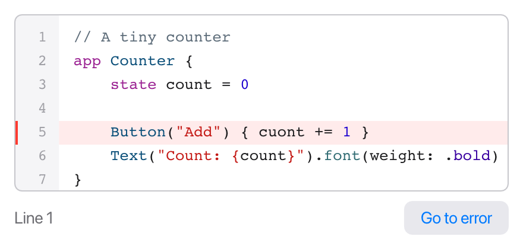

`CodeEditor` is a multi-line text editor made for code. It's the editor the
[Tessel IDE](/start/ide/) is built with, and you can use it in your own apps.

```tessel
app Editor(width: 440, height: 210) {
    state source = "// A tiny counter\napp Counter \{\n    state count = 0\n\n    Button(\"Add\") \{ cuont += 1 }\n    Text(\"Count: \{count}\").font(weight: .bold)\n}\n"
    state line = 1

    VStack(spacing: 8) {
        CodeEditor(text: source, errorLines: [5], line: line)
        HStack {
            Text("Line {line}").color(.secondary)
            Spacer()
            Button("Go to error") { line = 5 }
        }
    }
    .padding(12)
}
```



(The `\{` in the string is an escaped brace, so that `{` isn't read as
[interpolation](/language/basics/).)

## Parameters

```tessel
CodeEditor(text: source, errorLines: problems, line: currentLine)
```

| Parameter | Type | What it does |
|-----------|------|--------------|
| `text:` | `bind String` | The text being edited. Required. |
| `errorLines:` | `[Int]` | Line numbers to mark as having errors. Optional; empty by default. |
| `line:` | `bind Int` | The line the cursor is on. Optional. |
| `completions:` | `[Completion]` | Suggestions to offer as the user types. Optional; see [Code completion](#code-completion). |
| `completionStart:` | `Int` | Where the word those suggestions are for starts (a byte offset in `text`). |
| `onComplete:` | `fn(Int)` | Called when the editor wants suggestions, with the cursor's byte offset. |
| `breakpoints:` | `[Int]` | Lines to mark with a red dot in the margin. Optional; see [For a debugger](#for-a-debugger). |
| `stoppedLine:` | `Int` | A line to highlight in yellow, as where a program is stopped. 0 (the default) for none. |
| `onBreakpoint:` | `fn(Int)` | Called with the line when the margin is clicked. |
| `onChange:` | `fn()` | Called after each edit that changes `text` (not when your program sets it). Optional. |
| `highlights:` | `[Range]` | Stretches of the text to mark, like what a search found. Optional; see [Finding text](#finding-text). |
| `selection:` | `bind Range` | What's selected, or where the cursor is. Optional; see [Finding text](#finding-text). |

Line numbers start at 1, as they do in the gutter.

## What it does

- **Line numbers** in a gray gutter on the left.
- **Syntax colors for Tessel:** keywords, strings (with the `{…}` parts inside
  them colored as code), numbers, comments, capitalized names like types and
  views, function calls, and `.cases`. The colors are always Tessel's, whatever
  the text is.
- **A monospaced font** at 13 points. Long lines don't wrap.
- **Scrolling.** Scroll with the mouse wheel or trackpad, up and down and
  (for long lines) sideways, or drag a scroll bar: one shows at the right
  when there are more lines than fit, and one at the bottom when a line is
  longer than the editor is wide. The editor also scrolls by itself to bring
  the cursor into view when you type or move it.
- **All the usual editing keys**, including selection, the clipboard and
  undo; see [Editing text](/ui/controls/#editing-text). On top of those, the
  keys of a code editor like VS Code's, listed below.
- **Indentation help:**
  - Enter starts the new line with the same indentation as the current one,
    plus one more level (4 spaces) after a line ending in `{`. Spaces left
    before the cursor are dropped, so a line of only spaces becomes empty.
  - Enter between `{` and `}` puts the `}` on a line of its own, with the
    cursor indented on the line between.
  - Tab inserts 4 spaces.
  - Typing `}` on a line that only has spaces so far removes one level of
    indentation.
- **Closing brackets and quotes.** Typing `(`, `[`, `{` or `"` also types the
  closing one after the cursor, when what follows is a space, the end of
  the line or a closing character. A `"` isn't closed right after a letter
  or inside a string or comment. Typing a closing character next to the same
  one steps over it, and Backspace between an empty pair (`(|)`) deletes
  both. With text selected, an opening character goes around it.
- **Matching brackets.** With the cursor next to a bracket, it and its partner
  get a box. Brackets in strings and comments don't count.
- **Folding.** Each line that opens a `{` block whose `}` is on a later line
  has an arrow left of its code (shown while the pointer is over the
  margin). Click it to fold the block to one line, shown as `{ … }`, and
  again to unfold it. The line numbers skip the folded lines. The cursor
  steps over a folded block; a block unfolds when the cursor or an edit goes
  into it.
- **Several cursors.** Alt+click adds a cursor (Alt+click on one takes it
  away again), Cmd+D selects the word at the cursor and then each next place
  it's found, and Cmd+Alt+Up or Down adds one on the line above or below.
  Typing, Backspace and Delete, the arrow keys, Home and End, cut, copy and
  paste work at every cursor. Pasting as many lines as there are cursors puts
  one line at each. Escape goes back to a single cursor.

### Editing keys

These are on top of the [usual ones](/ui/controls/#editing-text). On Windows,
use Ctrl where it says Cmd. Each change is one step for undo.

| Keys | What they do |
|------|-------------|
| Cmd+/ | Comments out the line with `// ` (or every line of the selection, at their least indentation), or uncomments it when all of them are comments. |
| Alt+Up, Alt+Down | Moves the line (or the selected lines) up or down. |
| Shift+Alt+Up, Shift+Alt+Down | Copies the line (or the selected lines) above or below. |
| Shift+Cmd+K | Deletes the line (or the selected lines). |
| Cmd+Enter, Shift+Cmd+Enter | Starts a new line below or above, whatever the cursor's place on the line. |
| Tab, Shift+Tab | With a selection over several lines: indents or outdents them by 4 spaces. Shift+Tab outdents the cursor's line too. |
| Cmd+], Cmd+[ | Indents or outdents the line (or the selected lines). |
| Cmd+L | Selects the line; again, the next one too. |
| Home | Goes to the line's first character that isn't a space; again, to its very start. Cmd+Left does the same. |
| Cmd+D | Selects the word at the cursor; again, adds the next place it's found as another cursor. |
| Alt+click | Adds a cursor (or takes one away). |
| Cmd+Alt+Up, Cmd+Alt+Down | Adds a cursor on the line above or below. |
| Escape | Goes back to one cursor (with one, stops editing). |
| Cmd+Alt+[, Cmd+Alt+] | Folds or unfolds the block the cursor is in. |

A [`.shortcut`](/reference/modifiers/#shortcut) of the app takes its keys
from the editor only when it asks for exactly those keys: `.shortcut("shift+k")`
takes Shift+Cmd+K, but `.shortcut("k")` (which otherwise also runs with Shift)
leaves it to the editor.

## Marking errors

`errorLines:` takes a list of line numbers. Each one gets a light red background
and a red mark in the gutter. It's an ordinary list, so it can come from
anything, typically from checking the text:

```tessel
CodeEditor(text: doc.text, errorLines: problems.filter { p in p.file == doc.path }.map { p in p.line })
```

The IDE gets its errors by running `tessel check --format lines` with
[`runCommand`](/ui/async/#running-other-programs) and parsing each line of
output.

## Following and moving the cursor

`line:` is a two-way [binding](/ui/state/#bindings-bind-parameters) to the
line the cursor is on:

- **When the cursor moves** (by typing, clicking or the arrow keys), the editor
  writes its line number into the bound value. The example above uses that to
  show "Line 5" under the editor.
- **When your code changes the value,** the editor puts the cursor at the
  start of that line, scrolls it into view, and starts editing, ready for the
  user to type. If the user last clicked in a view with
  [`.onKey`](/reference/modifiers/#onkey), that view keeps the keyboard: the
  editor only scrolls to the line.

That's how you jump to an error: store the line in the bound value, for
example when the user clicks an error in a list. Setting it to the line the
cursor is already on does nothing, since nothing changed.

## Finding text

Two parameters are for a find bar, like the [Tessel IDE](/start/ide/)'s:

- `highlights:` marks stretches of the text with a yellow background.
- `selection:` is a two-way binding to what's selected: a `Range` from the
  first character selected up to the one after the last. With nothing
  selected, it's where the cursor is (`7..7`), and `start` and `end` are
  the same.

Both count characters, as [`find`](/language/collections/#strings) and
`substring` do, from 0 at the start of the text.

```tessel
app Finder(width: 460, height: 240) {
    state source = "let a = 1\nlet b = a + a\nprint(b)\n"
    state query = "a"
    state selection = 0..0

    VStack(spacing: 8) {
        TextField("Find", text: query)
        CodeEditor(text: source, highlights: found(), selection: selection)
        HStack {
            Text("Selected: {selection.start} to {selection.end}").color(.secondary)
            Spacer()
            Button("Next") { next() }
        }
    }
    .padding(12)

    // Every place `query` is in the text: the pieces between them say where.
    fn found() -> [Range] {
        var out: [Range] = []
        if query == "" {
            return out
        }
        var at = 0
        let pieces = source.split(query)
        for (i, piece) in pieces.enumerated() {
            at += piece.count
            if i < pieces.count - 1 {
                out.append(at..at + query.count)
                at += query.count
            }
        }
        out
    }

    // The next one after what's selected, or the first.
    fn next() {
        let all = found()
        if let r = all.first(where: { r in r.start >= selection.end }) {
            selection = r
        } else if let r = all.first {
            selection = r
        }
    }
}
```

- **When the user selects** or moves the cursor, the editor writes the
  selection into the bound value.
- **When your code changes the value,** the editor selects that stretch and
  scrolls to it, if it doesn't show already. Like [`line:`](#following-and-moving-the-cursor),
  it starts editing, unless another text field is being edited (the find
  field, say) or a view with [`.onKey`](/reference/modifiers/#onkey) has
  the keyboard. Then the editor keeps the selection, and shows it, for when
  it's edited again.
- A new editor starts with the selection it's given, scrolled to it.

To give the editor the keyboard back, when the find bar closes, call
[`startEditing`](/reference/stdlib/#startediting) with its
[`.id`](/reference/modifiers/#id): it goes on with the selection it kept.
[`.onFieldKey`](/reference/modifiers/#onfieldkey) gives the find field the
Enter, Shift+Enter and Escape keys, to go to the next match, the one before,
or close.

Setting `text` and `selection` together, as a Replace button does, is one
step of the editor's undo history.

## Code completion

The editor can offer suggestions as the user types, in a list under the
word. You provide them; the editor decides when to ask, shows and filters
them, and inserts the chosen one:

1. When the user starts a word (or types `.`), the editor calls
   `onComplete` with the cursor's position in `text`, as a byte offset.
2. Your code works out the suggestions, maybe in the background, and sets
   `completions` to a list of `Completion` values, and `completionStart` to
   the offset where the word starts.
3. The list shows while the cursor stays in that word, keeping only the
   suggestions that match what's typed so far. It only shows when
   `completionStart` is where the current word starts, so a late answer for a
   word the user has moved on from never shows.

`Completion` is a built-in struct:

```tessel
Completion(label: "count", detail: "Int", kind: "variable")
```

- `label` is inserted in place of the word.
- `detail` is shown in gray on the right, like a type or a signature.
- `kind` picks the little badge: `"function"`, `"method"`, `"variable"`,
  `"field"`, `"view"`, `"modifier"`, `"type"`, `"case"` or `"keyword"`.
  Accepting a function, method, view or modifier also types `(` (or `()` when
  its `detail` starts with `()`).

While the list shows, **Up** and **Down** choose, **Enter** or **Tab** insert,
and **Escape** closes it. Clicking a suggestion inserts it too. Enter on a
suggestion that's already typed in full just starts a new line.

A small example with a fixed list of words:

```tessel
app Editor(width: 500, height: 300) {
    state code = ""
    state suggestions: [Completion] = []
    state start = 0

    CodeEditor(text: code, completions: suggestions, completionStart: start, onComplete: { offset in suggest(offset: offset) })

    fn suggest(offset: Int) {
        // The word starts after the last space or `.` before the cursor.
        let chars = code.characters
        var s = offset
        for _ in 0..offset {
            if s > 0 && chars[s - 1] != " " && chars[s - 1] != "." {
                s -= 1
            }
        }
        start = s
        suggestions = ["count", "color", "print"].map { w in Completion(label: w, detail: "", kind: "variable") }
    }
}
```

(This counts characters, which equal bytes only for plain ASCII text. The
[Tessel IDE](/start/ide/) asks `tessel complete` instead, which knows Tessel
and works in bytes.)

## For a debugger

Three parameters make the margin a place for breakpoints, as in the
[Tessel IDE](/guides/debugging/#in-the-tessel-ide):

```tessel
app Stops(width: 440, height: 200) {
    state source = "let a = 1\nlet b = 2\nprint(a + b)\n"
    state stops: [Int] = [2]

    CodeEditor(text: source, breakpoints: stops, stoppedLine: 2, onBreakpoint: { line in
        if stops.contains(line) {
            stops.removeAll(where: { l in l == line })
        } else {
            stops.append(line)
        }
    })
    .padding(12)
}
```

- `breakpoints:` lines get a red dot at the left of the margin.
- `stoppedLine:` is highlighted in yellow across the editor.
- `onBreakpoint:` is called with the line when the margin is clicked,
  beside that line. The editor doesn't keep the breakpoints itself: the
  block changes the list, as above.

What these mean is up to your app. The editor only draws them.

## Size

A `CodeEditor` is [flexible](/ui/layout/#how-sizes-are-decided): it takes all
the space it's offered, in both directions. Give it a `.frame(height:)` (or
`width:`) to make it smaller, or put it next to fixed-size views in a stack.

## Several editors

When editors are made in a `for` loop, as tabs in a
[`TabView`](/ui/tabs/) for example, give each one an [`.id`](/ui/lists/#identity-with-id)
so it keeps its own undo history, scroll position and cursor when files are
opened and closed. This is how the IDE shows its open files:

```tessel
TabView(selection: current, onClose: { path in closeDoc(path: path) }) {
    for doc in docs {
        CodeEditor(text: doc.text, errorLines: errorLines(path: doc.path), line: doc.line)
            .id(doc.path)
            .tabItem(doc.name)
            .tag(doc.path)
    }
}
```

`.autofocus()` works on a code editor too: it starts editing as soon as the
editor appears.

Pasting keeps line breaks (Windows line endings become plain `\n`). In a
one-line `TextField`, pasted line breaks become spaces instead.
