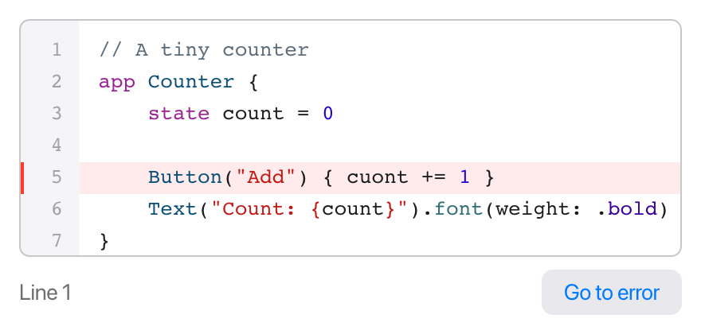

`CodeEditor` is a multi-line text editor made for code. It's the editor the
[Tessel IDE](/start/ide/) is built with, and you can use it in your own apps.

```tessel
app Editor(width: 440, height: 210) {
    state source = "// A tiny counter\napp Counter \{\n    state count = 0\n\n    Button(\"Add\") \{ cuont += 1 }\n    Text(\"Count: \{count}\").font(weight: .bold)\n}\n"
    state line = 1

    VStack(spacing: 8) {
        CodeEditor(text: source, errorLines: [5], line: line)
        HStack {
            Text("Line {line}").color(.secondary)
            Spacer()
            Button("Go to error") { line = 5 }
        }
    }
    .padding(12)
}
```



(The `\{` in the string is an escaped brace, so that `{` isn't read as
[interpolation](/language/basics/).)

## Parameters

```tessel
CodeEditor(text: source, errorLines: problems, line: currentLine)
```

| Parameter | Type | What it does |
|-----------|------|--------------|
| `text:` | `bind String` | The text being edited. Required. |
| `errorLines:` | `[Int]` | Line numbers to mark as having errors. Optional; empty by default. |
| `line:` | `bind Int` | The line the cursor is on. Optional. |
| `completions:` | `[Completion]` | Suggestions to offer as the user types. Optional; see [Code completion](#code-completion). |
| `completionStart:` | `Int` | Where the word those suggestions are for starts (a byte offset in `text`). |
| `onComplete:` | `fn(Int)` | Called when the editor wants suggestions, with the cursor's byte offset. |

Line numbers start at 1, as they do in the gutter.

## What it does

- **Line numbers** in a gray gutter on the left.
- **Syntax colors for Tessel:** keywords, strings (with the `{…}` parts inside
  them colored as code), numbers, comments, capitalized names like types and
  views, function calls, and `.cases`. The colors are always Tessel's, whatever
  the text is.
- **A monospaced font** at 13 points. Long lines don't wrap.
- **Scrolling.** Scroll up and down with the mouse wheel or trackpad. The
  editor also scrolls by itself, in both directions, to keep the cursor in
  view as you type and move around.
- **All the usual editing keys**, including selection, the clipboard and
  undo; see [Editing text](/ui/controls/#editing-text).
- **Indentation help:**
  - Enter starts the new line with the same indentation as the current one,
    plus one more level (4 spaces) after a line ending in `{`.
  - Tab inserts 4 spaces.
  - Typing `}` on a line that only has spaces so far removes one level of
    indentation.

## Marking errors

`errorLines:` takes a list of line numbers. Each one gets a light red background
and a red mark in the gutter. It's an ordinary list, so it can come from
anything, typically from checking the text:

```tessel
CodeEditor(text: doc.text, errorLines: problems.filter { p in p.file == doc.path }.map { p in p.line })
```

The IDE gets its errors by running `tessel check --format lines` with
[`runCommand`](/ui/async/#running-other-programs) and parsing each line of
output.

## Following and moving the cursor

`line:` is a two-way [binding](/ui/state/#bindings-bind-parameters) to the
line the cursor is on:

- **When the cursor moves** (by typing, clicking or the arrow keys), the editor
  writes its line number into the bound value. The example above uses that to
  show "Line 5" under the editor.
- **When your code changes the value,** the editor puts the cursor at the
  start of that line, scrolls it into view, and starts editing, ready for the
  user to type.

That's how you jump to an error: store the line in the bound value, for
example when the user clicks an error in a list. Setting it to the line the
cursor is already on does nothing, since nothing changed.

## Code completion

The editor can offer suggestions as the user types, in a list under the
word. You provide them; the editor decides when to ask, shows and filters
them, and inserts the chosen one:

1. When the user starts a word (or types `.`), the editor calls
   `onComplete` with the cursor's position in `text`, as a byte offset.
2. Your code works out the suggestions, maybe in the background, and sets
   `completions` to a list of `Completion` values, and `completionStart` to
   the offset where the word starts.
3. The list shows while the cursor stays in that word, keeping only the
   suggestions that match what's typed so far. It only shows when
   `completionStart` is where the current word starts, so a late answer for a
   word the user has moved on from never shows.

`Completion` is a built-in struct:

```tessel
Completion(label: "count", detail: "Int", kind: "variable")
```

- `label` is inserted in place of the word.
- `detail` is shown in gray on the right, like a type or a signature.
- `kind` picks the little badge: `"function"`, `"method"`, `"variable"`,
  `"field"`, `"view"`, `"modifier"`, `"type"`, `"case"` or `"keyword"`.
  Accepting a function, method, view or modifier also types `(` (or `()` when
  its `detail` starts with `()`).

While the list shows, **Up** and **Down** choose, **Enter** or **Tab** insert,
and **Escape** closes it. Clicking a suggestion inserts it too. Enter on a
suggestion that's already typed in full just starts a new line.

A small example with a fixed list of words:

```tessel
app Editor(width: 500, height: 300) {
    state code = ""
    state suggestions: [Completion] = []
    state start = 0

    CodeEditor(text: code, completions: suggestions, completionStart: start, onComplete: { offset in suggest(offset: offset) })

    fn suggest(offset: Int) {
        // The word starts after the last space or `.` before the cursor.
        let chars = code.characters
        var s = offset
        for _ in 0..offset {
            if s > 0 && chars[s - 1] != " " && chars[s - 1] != "." {
                s -= 1
            }
        }
        start = s
        suggestions = ["count", "color", "print"].map { w in Completion(label: w, detail: "", kind: "variable") }
    }
}
```

(This counts characters, which equal bytes only for plain ASCII text. The
[Tessel IDE](/start/ide/) asks `tessel complete` instead, which knows Tessel
and works in bytes.)

## Size

A `CodeEditor` is [flexible](/ui/layout/#how-sizes-are-decided): it takes all
the space it's offered, in both directions. Give it a `.frame(height:)` (or
`width:`) to make it smaller, or put it next to fixed-size views in a stack.

## Several editors

When editors are made in a `for` loop, as tabs in a
[`TabView`](/ui/tabs/) for example, give each one an [`.id`](/ui/lists/#identity-with-id)
so it keeps its own undo history, scroll position and cursor when files are
opened and closed. This is how the IDE shows its open files:

```tessel
TabView(selection: current, onClose: { path in closeDoc(path: path) }) {
    for doc in docs {
        CodeEditor(text: doc.text, errorLines: errorLines(path: doc.path), line: doc.line)
            .id(doc.path)
            .tabItem(doc.name)
            .tag(doc.path)
    }
}
```

`.autofocus()` works on a code editor too: it starts editing as soon as the
editor appears.

Pasting keeps line breaks (Windows line endings become plain `\n`). In a
one-line `TextField`, pasted line breaks become spaces instead.
