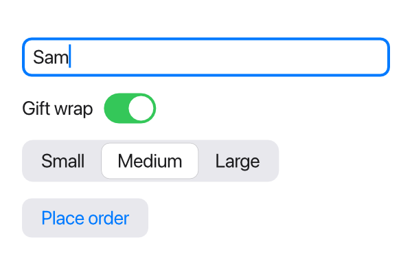
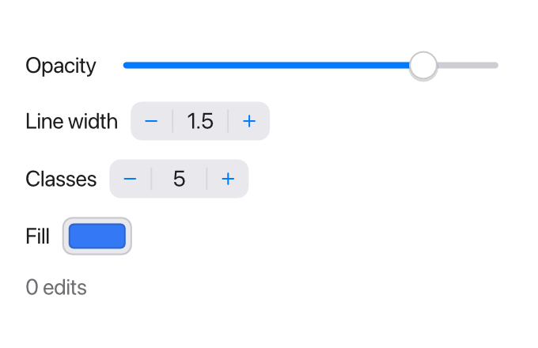
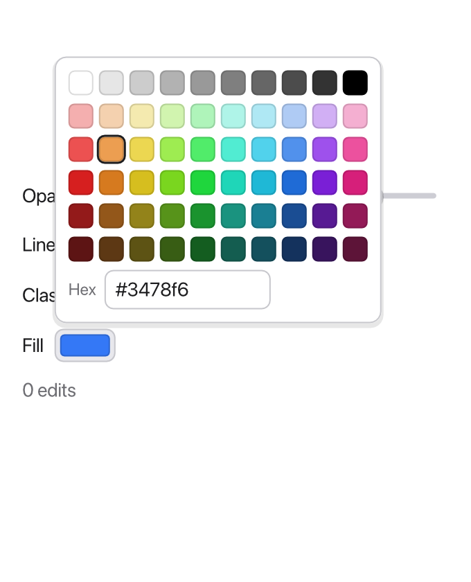

Controls are the views people interact with. Each one either runs an action
(a button) or edits a value through a [binding](/ui/state/#bindings-bind-parameters)
(a text field, toggle or picker).

```tessel
enum Size { small, medium, large }

app Order(width: 300, height: 200) {
    state name = ""
    state giftWrap = true
    state size = Size.medium
    state placed = false

    VStack(spacing: 12, alignment: .leading) {
        TextField("Your name", text: name)
        Toggle("Gift wrap", isOn: giftWrap)
        Picker(selection: size) {
            Text("Small").tag(.small)
            Text("Medium").tag(.medium)
            Text("Large").tag(.large)
        }
        Button("Place order") { placed = true }
            .disabled(name == "")
    }
    .padding(16)
}
```



## Button

`Button` shows a label and runs its block when clicked:

```tessel
Button("Save") { save() }
```

The block is the button's `action:` parameter, written as a trailing block.
Writing it with its label, `Button("Save", action: { save() })`, means the
same thing. When the action is just a call to a function with no parameters,
you can also pass the function itself: `Button("Save", action: save)`.

The label is a `String`. Buttons have a light gray, rounded look with a blue
label; `.color(…)` changes the label color and `.background(…)` replaces the
gray. For something that doesn't look like a button at all, use `.onTap`
(below).

A disabled button (`.disabled(true)`) is faded and ignores clicks.

## TextField

`TextField` is a one-line text input. Its first argument is the placeholder,
shown in gray while the field is empty, and `text:` is bound to the `String`
it edits:

```tessel
TextField("Search", text: query)
```

Every key press changes the bound string right away, so anything that uses it
updates as the user types.

A text field is as wide as it's allowed to be: in a stack it stretches across
the available width. Give it a `.frame(width:)` to make it a fixed size.

Click a field to start editing it; a blue ring shows which field is being
edited. Clicking somewhere else, or pressing Escape, stops editing.

### Several lines

`lines:` makes a field for longer text, a few lines high. The text wraps at
the field's width, Enter starts a new line, and the field scrolls when the
text is longer than it:

```tessel
app Notes(width: 360, height: 260) {
    state notes = ""

    VStack(spacing: 8) {
        TextField("Notes", text: notes, lines: 5)
        Text("{notes.count} characters")
    }
    .padding(16)
}
```

In a field of several lines, Cmd+Enter (Ctrl+Enter on Windows) runs its
`.onSubmit`, since Enter is taken. On Android the keyboard's Enter key
starts a new line too.

### Submitting with Enter

`.onSubmit { … }` runs a block when the user presses Enter in the field.
Pressing Enter also stops editing the field.

```tessel
app Chat(width: 360, height: 240) {
    state draft = ""
    state messages: [String] = []

    TextField("Message", text: draft)
        .autofocus()
        .onSubmit { send() }
    for m in messages {
        Text(m)
    }

    fn send() {
        if draft != "" {
            messages.append(draft)
            draft = ""
        }
    }
}
```

### Starting with the cursor in a field

`.autofocus()` starts editing a text field as soon as it appears, so the user
can type right away without clicking it first. It also works on a
[`CodeEditor`](/ui/code-editor/). It applies when the field *appears*: at
startup, or when an `if` starts showing it. That makes it a good fit for a
field that pops up when needed, like a "New file name" prompt.

## Toggle

`Toggle` is an on/off switch bound to a `Bool`:

```tessel
Toggle("Dark background", isOn: darkBackground)
Toggle(isOn: todo.done)
```

The label is optional. Clicking the switch or its label flips the value.

## Picker

`Picker` lets the user choose one of a few options. It's drawn as a row of
segments, with the selected one highlighted. `selection:` is bound to the
chosen value, and each option is a view marked with `.tag(value)`:

```tessel
enum Filter { all, active, done }

app Todos(width: 360, height: 200) {
    state filter = Filter.all

    Picker(selection: filter) {
        Text("All").tag(.all)
        Text("Active").tag(.active)
        Text("Done").tag(.done)
    }
    Text("Showing: {filter}")
}
```

Clicking an option sets `selection` to that option's tag. The selection can be
any type: an enum is the usual choice, but a `String` or an `Int` works too, as
long as every `.tag` has the same type as the selection. Options are usually
`Text`, but can be other views such as [icons](/ui/icons/).

`.tag` only means something on the options of a `Picker` and the pages of a
[`TabView`](/ui/tabs/); anywhere else it's a compile error.

## Slider, Stepper and ColorPicker

These three edit a number or a color:

```tessel
app Symbol(width: 340, height: 220) {
    state opacity = 0.8
    state width = 1.5
    state classes = 5
    state fill: Color = .rgb(52, 120, 246)
    state edits = 0

    VStack(spacing: 12, alignment: .leading) {
        HStack {
            Text("Opacity")
            Slider(value: opacity, from: 0, to: 1, step: 0.05) { edits += 1 }
        }
        HStack {
            Text("Line width")
            Stepper(value: width, step: 0.5, from: 0, to: 10)
        }
        HStack {
            Text("Classes")
            Stepper(value: classes, from: 2, to: 12)
        }
        HStack {
            Text("Fill")
            ColorPicker(color: fill) { edits += 1 }
        }
        Text("{edits} edits").color(.secondary)
    }
    .padding(16)
}
```



- [`Slider`](/reference/views/#slider) sets a `Float` between `from` and
  `to` (0 and 1 if you leave them out), in steps of `step` if it isn't 0.
- [`Stepper`](/reference/views/#stepper) makes an `Int` or a `Float` a
  `step` larger or smaller, between `from` and `to`, and shows it.
- [`ColorPicker`](/reference/views/#colorpicker) shows a `Color`. Clicking
  it opens a palette over the window, with a field for a hex code like
  `#3478f6`; picking a color closes it.

Each takes an optional `onChange` block (the block after the call), which
runs after the user changes the value: the place to redraw a map or
recompute something.



## Dates

A `DatePicker` shows a date and opens a calendar to pick another; a
`Calendar` is that calendar by itself. Both change a time kept as a `Float`,
as [`now()` and `date(…)`](/reference/stdlib/#dates-and-time) give it:

```tessel
state due = now()

HStack {
    Text("Due")
    DatePicker(date: due)
}
Text("{daysBetween(now(), due)} days left")
```

See [DatePicker](/reference/views/#datepicker) and
[Calendar](/reference/views/#calendar).

## The keyboard and controls

Every control can be used without a mouse. Tab and Shift+Tab go from one
to the next: text fields, buttons, toggles, pickers, tab views, sliders,
steppers, color pickers and
[disclosure groups](/ui/lists/#trees-with-disclosuregroup). A blue ring
shows which one the keyboard is on. Then:

| Keys | What they do |
|------|-------------|
| Space, Enter | Press a button, or turn a toggle on or off. |
| Left, Right, Up, Down | Choose the option before or after in a picker, or the tab before or after in a tab view. |
| Left, Right, Up, Down | Move a slider or a stepper. |
| Right, Left | Open or close a disclosure group. |
| Enter, Space | Open a color picker's palette (ready to type a hex code), or open or close a disclosure group. |
| Escape | Take the keyboard away from the control, or close the palette. |

Clicking a slider, a stepper, a color picker or a disclosure group also
puts the keyboard on it; clicking a button doesn't. A view made pressable
with [`.onTap`](/reference/modifiers/#ontap) isn't a stop for Tab: use a
`Button` for what should be reachable from the keyboard.

Shortcuts still work meanwhile. Keys a control doesn't use go to
[`.onKeyEvent`](/reference/modifiers/#onkeyevent) or
[`.onKey`](/reference/modifiers/#onkey).

## Making any view clickable

`.onTap { … }` runs a block when a view is clicked. It works on any view,
including stacks, so you can build your own clickable rows and buttons:

```tessel
HStack {
    Icon(.folder)
    Text("Documents")
    Spacer()
}
.padding(6)
.hoverBackground(.lightGray, radius: 4)
.onTap { open(folder: "Documents") }
```

Add [`.hoverBackground`](/ui/styling/#hover-backgrounds) so people can see it's
clickable. If a clickable view contains a button or another clickable view, a
click goes to the innermost one.

## Dragging

`.onDrag { dx, dy in … }` runs while the mouse is dragged from a view, with
how far it moved each time. That's what a bar between two panes needs, to
resize them:

```tessel
app Split(width: 400, height: 200) {
    state left = 150.0

    HStack(spacing: 0) {
        Text("Left").frame(width: left, maxHeight: .infinity).background(.sidebar)
        Spacer()
            .frame(width: 6, maxHeight: .infinity)
            .background(.separator)
            .onDrag { dx, dy in left = (left + dx).clamped(min: 60, max: 300) }
        Text("Right").frame(maxWidth: .infinity, maxHeight: .infinity)
    }
}
```

The bar is a `Spacer` given a size and a color. Dragging it changes `left`,
the UI is rebuilt with the new width, and the bar follows the mouse. The
pointer turns into a resize arrow over it. See
[`onDrag`](/reference/modifiers/#ondrag) in the reference.

## Editing text

Text fields and code editors support the usual editing keys. On Windows, use
Ctrl where this table says Cmd, and Alt where it says Option.

| Keys | What they do |
|------|-------------|
| Left, Right | Move one character. With a selection, jump to its start or end. |
| Option+Left, Option+Right | Move one word. |
| Cmd+Left, Cmd+Right, Home, End | Move to the start or end of the line. |
| Up, Down | Move to the line above or below (in a code editor). |
| Shift + any of the above | Select text while moving. |
| Backspace, Delete | Delete the character before or after the cursor, or the selection. |
| Option+Backspace, Option+Delete | Delete a word. |
| Cmd+Backspace, Cmd+Delete | Delete to the start or end of the line. |
| Cmd+A | Select all. |
| Cmd+C, Cmd+X, Cmd+V | Copy, cut and paste, with the system clipboard. |
| Cmd+Z, Cmd+Shift+Z | Undo and redo. |
| Enter | In a text field: stop editing and run `.onSubmit`. |
| Escape | Stop editing. |

With the mouse, click to place the cursor, drag to select, Shift-click to
extend the selection, double-click to select a word, and triple-click to select
everything. A field scrolls sideways to keep the cursor in view when its text
is longer than the field.

Undo remembers each change separately, except that a run of typed letters and
digits is undone in one step. Each field keeps its own undo history. If the
program itself changes a text field's text, its history is cleared. In a
[code editor](/ui/code-editor/), a change the program makes is kept as a step
of the history instead, so it can be undone like typing.

While nothing is being edited, Cmd+Z and Cmd+Shift+Z undo and redo in the
field or editor whose text changed last, which is then edited, with the
cursor where the change was. [`undoTextEdit()`](/reference/stdlib/#undotextedit-and-redotextedit)
and `redoTextEdit()` do the same, for Undo and Redo buttons of your own.

Pasting into a text field turns line breaks into spaces, since it holds a
single line. The [code editor](/ui/code-editor/) adds a few keys of its own
for indentation.

### Moving between fields

Tab starts editing the next text field (or [code editor](/ui/code-editor/)),
and Shift+Tab the one before, in the order they're written. After the last one
comes the first again. A field you arrive at with Tab has its text selected, so
typing replaces it. Hidden and disabled fields are skipped. In a code editor,
Tab indents instead.

### Input methods

Text typed with an input method works in text fields and code editors:
Chinese, Japanese and Korean input, and accents typed with dead keys (such as
Option+E, then E, for é on a Mac). While you compose, the text so far is shown
underlined at the cursor. It becomes part of the field's text, and of your
state, when you confirm it.
