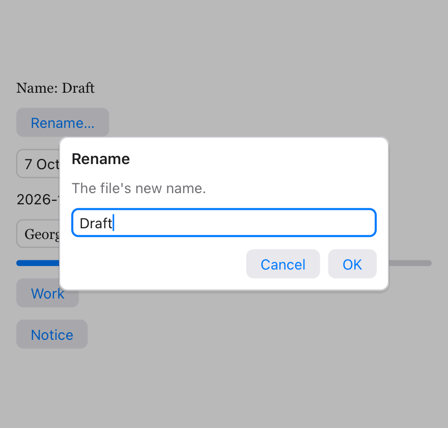
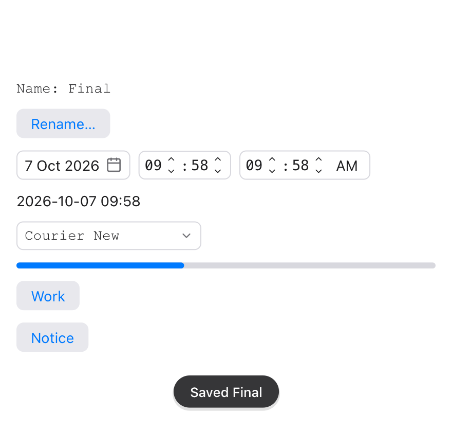

An app stops to ask or tell the user something in a few ways: the system's
own dialogs for a message, a question or a file; a **sheet** with your own
views over the window; a brief **notice** that goes by itself; and the
system's print dialog.

## Messages and questions

`alert` shows a message in the system's dialog, and `confirm` asks a
question. The program waits for the answer:

```tessel
Button("Save") {
    if let error = writeText(path: path, text: text) {
        alert("Couldn't save", message: error.message, kind: .error)
    }
}

Button("Delete") {
    if confirm("Delete {selected.count} items?", message: "This can't be undone.", confirmLabel: "Delete") {
        deleteSelected()
    }
}
```

- `confirm` gives `true` for the confirm button, and `false` for Cancel
  (or Escape).
- `kind:` is `.info` (the default), `.warning` or `.error`: the dialog's
  icon.
- `buttonLabel:` names an alert's button; `confirmLabel:` and
  `cancelLabel:` a question's.

See [`alert`](/reference/stdlib/#alert) and
[`confirm`](/reference/stdlib/#confirm).

## Files and folders

[`openFile`](/reference/stdlib/#openfile) and
[`saveFile`](/reference/stdlib/#savefile) ask for one file.
`openFiles` asks for several, and `chooseFolder` for a folder:

```tessel
Button("Add pictures…") {
    for path in openFiles(types: ["png", "jpg"]) {
        pictures.append(path)
    }
}

Button("Export…") {
    if let folder = chooseFolder(title: "Export to") {
        export(to: folder)
    }
}
```

`openFiles` gives an empty list when the dialog is cancelled; `chooseFolder`
gives `nil`.

On Android these open the system's file chooser, and the paths are of
copies that Tessel keeps in step with the documents chosen: see
[Files the user chooses](/guides/android/#files-the-user-chooses).

## Sheets

`.sheet(isPresented: bind Bool) { … }` shows your own views in a card in the
middle of the window, while the `Bool` is `true`. The rest of the window is
dimmed, and can't be clicked until the sheet closes: use it for what must
be answered before going on, like a form for a new document or the app's
settings.

```tessel
app Notes(width: 420, height: 320) {
    state creating = false
    state title = ""
    state due = now()

    VStack {
        Button("New note…") { creating = true }
    }
    .sheet(isPresented: creating) {
        VStack(spacing: 12, alignment: .leading) {
            Text("New note").font(size: 15, weight: .semibold)
            TextField("Title", text: title).autofocus()
            DatePicker(date: due)
            HStack {
                Spacer()
                Button("Cancel") { dismiss() }
                Button("Create") {
                    addNote()
                    dismiss()
                }
            }
        }
        .frame(width: 280)
    }
}
```

- A sheet is as large as its content: give the content a
  `.frame(width:)`.
- `dismiss()` closes the sheet (or popover) that's on top, from anywhere:
  a button's action, or a view of your own inside it. Setting the binding
  to `false` does the same.
- Escape closes it too. A click outside it does nothing (unlike a
  [popover](/ui/menus-windows/#popovers), which a click outside closes).
- Popovers work inside a sheet (a `DatePicker`'s calendar, a
  `FontPicker`'s list), and a sheet can show another.
- Put `.sheet` on any view of the window; where doesn't matter.

### Asking for a text

`TextPrompt` is a sheet's content for the common case of asking for one
text, like a new name:

```tessel
Button("Rename…") { renaming = true }
    .sheet(isPresented: renaming) {
        TextPrompt("Rename", text: name, message: "The file's new name.") {
            saveName()
        }
    }
```



OK (or Enter) puts what was typed in `text`, closes the sheet and runs the
block. Cancel (or Escape) closes it and leaves `text` as it was. See
[TextPrompt](/reference/views/#textprompt).

### Showing progress

`ProgressPanel` is a sheet's content for work that takes a while: a title, a
[`ProgressBar`](/reference/views/#progressbar), a note and a Cancel button.
With a [background job](/ui/async/) that reports its progress:

```tessel
state exporting = false
state done = 0.0
state note = ""
state job: BackgroundJob? = nil

Button("Export") {
    exporting = true
    job = background(work: { job in exportAll(job: job) }, progress: { fraction, text in
        done = fraction
        note = text
    }) { count in
        exporting = false
    }
}
.sheet(isPresented: exporting) {
    ProgressPanel("Exporting…", value: done, note: note, onCancel: {
        job?.cancel()
        exporting = false
    })
}
```

A `ProgressBar` by itself goes anywhere: `ProgressBar(value: done)`.

## Notices

`showNotice("Saved")` shows a short message near the bottom of the window,
which goes by itself after a moment. It doesn't stop the user: use it to
say that something was done.

```tessel
Button("Copy link") {
    copyToClipboard(link)
    showNotice("Link copied")
}
```



A notice shows for 2.5 seconds, or for `seconds:`. A new one takes the place
of the one that shows.

## Printing

`printDocument` draws pages the way
[`writePDF`](/ui/drawing/#making-a-pdf) does, and prints them:

```tessel
Button("Print…") {
    printDocument(title: "Invoice 42") { g in
        g.text("Invoice 42", x: 50, y: 50, size: 24, weight: .bold)
        drawLines(g)
        g.newPage()
        drawTerms(g)
    }
}
```

- On macOS, the system's print dialog opens for the document, with its
  preview, the printers and "Save as PDF". `printDocument` gives `false`
  when it's cancelled.
- On Windows, the document is handed to the app that opens PDF files, to
  print it; if that app can't be asked to print, the document opens in it,
  to be printed from there.
- `width:` and `height:` are the page's size in points, A4 unless given,
  as for `writePDF`.

## In test scripts

In a [headless test run](/ui/testing/) no system dialog opens. Alerts,
questions and print requests are printed, like `Confirm "Delete 3 items?"
[Cancel] [Delete]`, and the script's `answer` command decides how the next
dialog ends:

| Command | |
|---|---|
| `answer ok` | The next `confirm` is confirmed. (With no answer waiting, it's cancelled.) |
| `answer cancel` | The next dialog is cancelled. |
| `answer "/tmp/out"` | The next `chooseFolder` (or `openFile`, `saveFile`) gives this path. |
| `answer "a.png\|b.png"` | The next `openFiles` gives these paths. |

A sheet shows as `Sheet` at the end of `tree`, and a notice as `Notice
"Saved"`; `wait 3` lets a notice's time pass.
