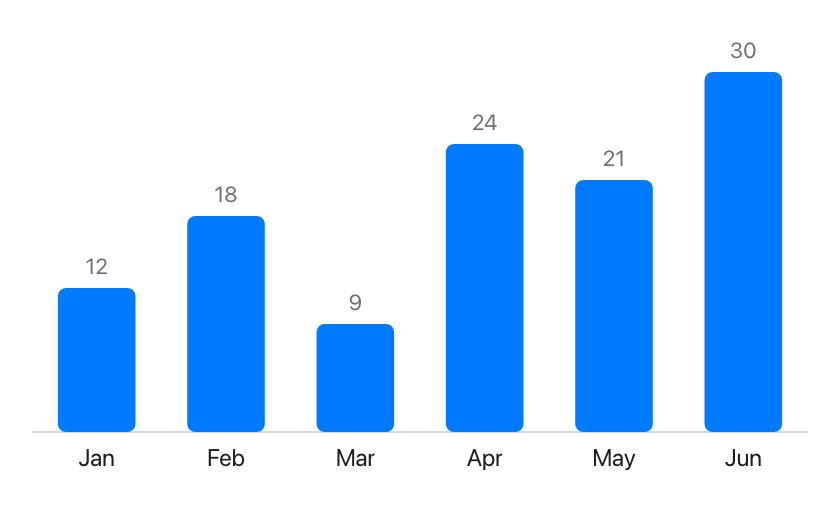
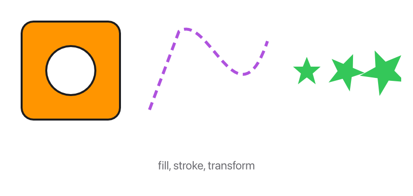
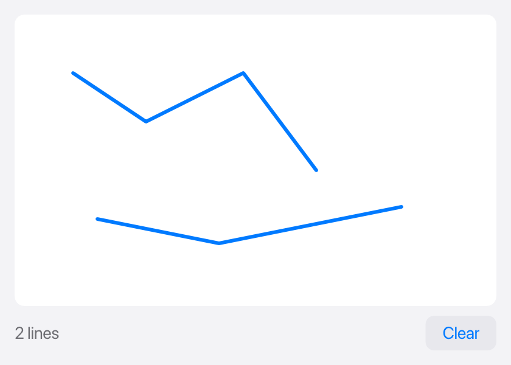

The built-in views cover text, controls and layout. When you need something
they don't have (a chart, a map, a game board, a signature pad), you draw it
yourself in a `Canvas`, and you follow the mouse over it with `.onPointer`.

## A first drawing

A `Canvas` is a view with a block. The block gets a `Graphics` value,
usually called `g`, and draws by calling its methods:

```tessel
struct Month {
    name: String
    sales: Float
}

app Sales(title: "Sales", width: 420, height: 260) {
    state months = [
        Month(name: "Jan", sales: 12), Month(name: "Feb", sales: 18), Month(name: "Mar", sales: 9),
        Month(name: "Apr", sales: 24), Month(name: "May", sales: 21), Month(name: "Jun", sales: 30),
    ]

    Canvas { g in
        let top = 20.0
        let bottom = g.height - 28.0
        let step = g.width / Float(months.count)
        let most = months.map { m in m.sales }.max() ?? 1.0
        g.line(0, bottom, g.width, bottom, color: .separator)
        for (i, month) in months.enumerated() {
            let height = (bottom - top) * month.sales / most
            let x = Float(i) * step + step * 0.2
            g.fillRect(x: x, y: bottom - height, width: step * 0.6, height: height, color: .blue, radius: 4)
            g.text("{Int(month.sales)}", x: x + step * 0.3, y: bottom - height - 4, size: 11, color: .secondary, align: .bottom)
            g.text(month.name, x: x + step * 0.3, y: bottom + 6, size: 12, align: .top)
        }
    }
    .padding(16)
}
```



A few things to know:

- **Coordinates are in points**, from the canvas's top left corner: `x` grows
  to the right and `y` grows downwards. `g.width` and `g.height` are the
  canvas's size.
- **A canvas takes all the space it's offered**, like a `Scroll`. Give it a
  `.frame(width:height:)` for a fixed size.
- **The block describes the whole picture.** Like the rest of the UI, it runs
  again whenever the window is drawn, so it draws what the state says *now*:
  there's nothing to erase or update. Drawing is fast; thousands of shapes
  are fine.
- **The block only draws.** Don't change `state` in it: changes belong in
  actions, like everywhere else.
- Nothing shows outside the canvas, however far you draw.

## Shapes, paths and transforms

There are two ways to draw a shape. The quick one is a method that draws it
at once: `g.line`, `g.fillRect`, `g.strokeRect`, `g.fillCircle`,
`g.strokeCircle`. The general one is a **path**: you describe an outline,
then fill it, stroke it (draw its line), or both.

```tessel
app Shapes(title: "Shapes", width: 420, height: 200) {
    Canvas { g in
        // A shape with a hole: two parts in one path, filled "even-odd".
        g.beginPath()
        g.rect(x: 10, y: 10, width: 100, height: 100, radius: 12)
        g.circle(x: 60, y: 60, radius: 25)
        g.fill(.orange, evenOdd: true)
        g.stroke(.primary, width: 2)

        // A path made point by point, with a dashed outline.
        g.beginPath()
        g.moveTo(140, 100)
        g.lineTo(170, 20)
        g.curveTo(200, 0, 230, 120, 260, 30)
        g.stroke(.purple, width: 3, dash: [8, 5])

        // The same star three times, moved, turned and scaled.
        for i in 0..3 {
            g.save()
            g.translate(300.0 + Float(i) * 40.0, 60)
            g.rotate(Float(i) * 0.4)
            g.scale(1.0 + Float(i) * 0.3, 1.0 + Float(i) * 0.3)
            g.beginPath()
            g.lines([0, -14, 4, -4, 14, -4, 6, 3, 9, 14, 0, 7, -9, 14, -6, 3, -14, -4, -4, -4], closed: true)
            g.fill(.green)
            g.restore()
        }
        g.text("fill, stroke, transform", x: g.width / 2, y: g.height - 12, size: 12, color: .secondary, align: .bottom)
    }
    .padding(12)
}
```



- `g.beginPath()` starts an empty path. `moveTo` starts a part of it,
  `lineTo`, `quadTo` and `curveTo` continue it, and `closePath` joins the
  part's end to its start. `rect`, `circle`, `ellipse` and `arc` add whole
  shapes, and `lines` adds a line through many points at once.
- `g.fill(color)` and `g.stroke(color, width:)` draw the path **and keep
  it**, so one path can be filled and then outlined. The next `beginPath`
  starts afresh.
- A path with several parts fills everything inside any of them. With
  `evenOdd: true`, a part inside another makes a hole.
- `g.translate`, `g.scale` and `g.rotate` change where the coordinates that
  follow land: after `g.translate(100, 50)`, the point (0, 0) is drawn at
  (100, 50). `g.save()` remembers the transform and `g.restore()` goes back
  to it, so a piece of drawing can move things without disturbing the rest.
- **Line widths and text sizes are always in points**, whatever the scale:
  a `width: 2` line is 2 points wide even after `g.scale(1000, 1000)`. That
  suits charts and maps, where the data is scaled but the pen shouldn't be.
  To enlarge a drawing as a whole, pen and letters included, use
  `g.zoom(2)` instead of `g.scale(2, 2)`.

### Many points at once

`g.lines(points, closed:)` takes a list of numbers, `x, y, x, y, …`, and adds
a line through all of them (a closed outline, with `closed: true`). It's the
fast way to draw data: a plot of 100 000 measurements, a coastline, a
polygon from a file.

Put the transform to work here. Keep the points in the units of your data,
and let the transform place them:

```tessel
// `track` holds x, y pairs in meters; show 1 meter as 2 points, with y upwards.
g.save()
g.translate(g.width / 2, g.height / 2)
g.scale(2, -2)
g.beginPath()
g.lines(track)
g.stroke(.red, width: 1.5)
g.restore()
```

The arithmetic is done in full precision before anything is drawn, so
coordinates in the millions (a map in meters) stay exact on screen, and
parts of the line outside the canvas cost nothing.

## Text and pictures

`g.text` draws text at a point. `align:` says which part of the text sits at
that point: `.topLeading` (the default) puts the text's top left corner
there, `.center` its middle, `.bottom` the middle of its lower edge.

```tessel
g.text("Sales by month", x: 12, y: 8, size: 16, weight: .bold)
g.text("Mar", x: 150, y: 200, size: 12, color: .secondary, align: .top)
g.text("Mount Apo", x: 80, y: 60, size: 12, align: .center, halo: .white, haloWidth: 1.5)
```

A **halo** is an outline in another color under the text. It keeps a label
readable on top of a busy drawing. `angle:` turns the text around its point
(in radians). `g.textWidth(text, size:, weight:)` tells how wide a text will
be, for placing things next to it.

`g.image(path, x:, y:, width:, height:)` draws a PNG or JPEG file into a
rectangle, and `opacity:` makes it see-through. It returns `false` if the
file isn't there (or isn't a picture), so you can draw something else
instead.

## Drawings that take time

By default the block runs every time the window is drawn. That's usually
many times a second while something is being dragged, so a drawing of a
million points would make the whole app slow. Give such a canvas a
`redraw:` number:

```tessel
Canvas(redraw: version) { g in
    drawTheWholeMap(g)
}
```

Now the drawing is **kept**. The block runs once, and then again only when
`version` is different from last time (or the canvas changes size, or the
appearance switches between light and dark). Add 1 to `version` wherever the
data changes.

Two canvases in a `ZStack` are a common pair: a kept one for the heavy
picture, and a plain one on top for what follows the mouse.

## Following the mouse

`.onPointer` runs its block with everything the mouse does on a view. This
app draws lines where the mouse is dragged:

```tessel
app Sketch(title: "Sketch", width: 420, height: 300) {
    // Each line drawn is a list of x, y, x, y, …
    state lines: [[Float]] = []
    state version = 0

    VStack(spacing: 8) {
        Canvas(redraw: version) { g in
            g.fillRect(x: 0, y: 0, width: g.width, height: g.height, color: .white, radius: 8)
            for line in lines {
                g.beginPath()
                g.lines(line)
                g.stroke(.blue, width: 3)
            }
        }
        .cursor(.crosshair)
        .onPointer { e in
            match e.kind {
                .down -> { lines.append([e.x, e.y]) }
                .drag -> {
                    lines[lines.count - 1].append(e.x)
                    lines[lines.count - 1].append(e.y)
                }
                _ -> {}
            }
            version += 1
        }
        HStack {
            Text("{lines.count} lines").color(.secondary)
            Spacer()
            Button("Clear") {
                lines = []
                version += 1
            }
        }
    }
    .padding(12)
    .background(.sidebar)
    .onKey { key in
        if key == "backspace" && !lines.isEmpty {
            lines.removeLast()
            version += 1
        }
    }
}
```



The block gets a [`PointerEvent`](/reference/colors/#pointerevent). Its
`kind` says what happened:

| `kind` | When |
|---|---|
| `.down` | A mouse button was pressed on the view. |
| `.drag` | The mouse moved with the button held (also outside the view). |
| `.up` | The button was let go (wherever the mouse is by then). |
| `.move` | The mouse moved over the view with no button held. |
| `.leave` | The mouse left the view. |
| `.scroll` | The wheel was turned, or two fingers moved on a trackpad. |
| `.pinch` | Two fingers were pinched on a trackpad (macOS). |

`x` and `y` are where the mouse is, measured like a canvas's coordinates:
from the view's top left corner (inside its padding). `dx` and `dy` are how
far it moved since the last event, or how far to scroll. `button` is
`.left`, `.right` or `.middle`; `clicks` is 2 for a double click; and
`shift`, `alt` and `command` tell which keys were held.

`.onPointer` works on any view, not only a canvas. A view that has it gets
all of the mouse: its `.onTap` and `.onDrag` don't run. Buttons and other
controls drawn on top of it still get their own clicks.

`.cursor(…)` changes the pointer shown over a view: `.crosshair` for
drawing, `.grab` for something that can be moved, `.hand` for a link. The
full list is in [CursorStyle](/reference/colors/#cursorstyle).

### Keys

`.onKey` runs its block with each key pressed while no text field is being
edited: a character as typed (`"a"`, `"A"`, `"+"`, `" "`), or the name of a
key: `"enter"`, `"escape"`, `"tab"`, `"backspace"`, `"delete"`, `"left"`,
`"right"`, `"up"`, `"down"`, `"home"`, `"end"`. Put it on the app's
outermost view to hear every key. Keys pressed with Cmd (or Ctrl on Windows)
go to [`.shortcut`](/ui/shortcuts/) instead.

## Saving a drawing as a picture

[`renderImage`](/reference/stdlib/#renderimage) runs a drawing block without
a window and saves the result as a PNG or JPEG file. It takes the same kind
of block as a `Canvas`, so one function can draw on screen and into a file:

```tessel
fn drawBadge(_ g: Graphics) {
    g.fillRect(x: 0, y: 0, width: g.width, height: g.height, color: .blue, radius: 16)
    g.text("Tessel", x: g.width / 2, y: g.height / 2, size: 28, color: .white, weight: .bold, align: .center)
}

fn main() {
    let saved = renderImage(path: "badge.png", width: 200, height: 80, scale: 2) { g in drawBadge(g) }
    print(saved)
}
```

`scale: 2` makes the picture 400 × 160 pixels: two for each point, as sharp
as a Retina screen shows it.

## Testing

In a [headless run](/ui/testing/), `tree` and `dump` say what each canvas
drew: `Canvas (6 fills, 1 stroke, 12 texts)`. The script commands `press`,
`move`, `release`, `rightclick`, `doubleclick`, `wheel` and `pinch` play the
mouse for views with `.onPointer`, and `click`, `drag` and `hover` work on
them too. `key x` sends a key to `.onKey`.
