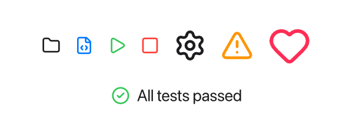
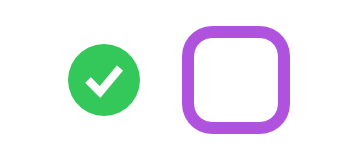
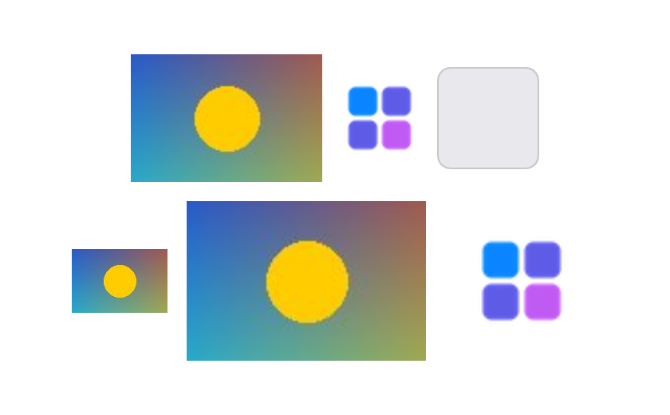

Tessel has three views for pictures:

- `Icon(.name)` shows one of the built-in icons;
- `Svg("<svg …>")` draws SVG markup written in your program;
- `Image("file.svg")` draws an SVG file.

## Built-in icons

```tessel
HStack(spacing: 12) {
    Icon(.folder)
    Icon(.fileCode).color(.blue)
    Icon(.play).color(.green)
    Icon(.stop).color(.red)
    Icon(.settings).font(size: 24)
    Icon(.warning).font(size: 24).color(.orange)
    Icon(.heart).font(size: 32).color(.pink)
}
HStack(spacing: 6) {
    Icon(.circleCheck).color(.green)
    Text("All tests passed")
}
```



An icon behaves like a piece of text:

- **Its size follows the font size.** An icon is a square a little larger than
  the current font size (16 points at the default 14), so it lines up with the
  text next to it. Change it with `.font(size:)`.
- **Its color follows `.color`.** Icons are drawn in the current text color,
  and like text they inherit `.font` and `.color` from the stack around them.

The icons come from the [Lucide](https://lucide.dev) set (ISC license). See
the [icon reference](/reference/icons/) for every name, such as `.folder`,
`.trash`, `.search`, `.chevronRight` and `.settings`.

Icon names are values of the built-in `IconName` type, so you can store them
in state, pass them to your own views, or choose one with `if`:

```tessel
view ToolButton(icon: IconName, label: String, action: fn()) {
    HStack(spacing: 5) {
        Icon(icon)
        Text(label)
    }
    .padding(6)
    .onTap { action() }
}

app Player(width: 300, height: 120) {
    state liked = false

    Icon(if liked { .heart } else { .star }).color(.pink)
    ToolButton(icon: .heart, label: "Like") { liked = !liked }
}
```

To make an icon clickable, add [`.onTap`](/ui/controls/#making-any-view-clickable),
and [`.hoverBackground`](/ui/styling/#hover-backgrounds) so it looks
clickable.

## Your own SVG with `Svg`

`Svg` draws SVG markup that you write as a string. Since Tessel strings use
double quotes, use single quotes for the SVG's attributes:

```tessel
Svg("<svg xmlns='http://www.w3.org/2000/svg' width='40' height='40'><circle cx='20' cy='20' r='18' fill='#34c759'/><path d='M12 20l6 6 10-12' stroke='white' stroke-width='4' fill='none'/></svg>")

Svg("<svg xmlns='http://www.w3.org/2000/svg' viewBox='0 0 40 40'><rect x='4' y='4' width='32' height='32' rx='8' fill='none' stroke='currentColor' stroke-width='4'/></svg>")
    .color(.purple)
    .frame(width: 60, height: 60)
```



- **Size.** An SVG is drawn at the size it declares with its `width` and
  `height` attributes (or its `viewBox`, if it has no width and height). Give
  it a `.frame(width:height:)` to scale it; it keeps its proportions and is
  centered in the frame.
- **Color.** Wherever the SVG says `currentColor`, Tessel uses the view's
  current `.color`, just like it does for icons. That's how the second shape
  above turns purple.
- If the markup isn't valid SVG, nothing is drawn.

## Picture files with `Image`

`Image` shows a picture from a file: an SVG, a PNG or a JPEG.

```tessel
Image("assets/logo.svg").frame(width: 80)
Image("assets/photo.jpg")
Image("assets/photo.jpg").frame(height: 100)
```

The path is relative to the folder the app is started from (the current
folder), not to the source file. For pictures that come with the app, use
[`appFolder()`](/reference/stdlib/#apppath-and-appfolder):
`Image(joinPath(appFolder(), "assets/photo.jpg"))`.

- **SVG files** work like `Svg`: they have their own size, scale with `.frame`,
  and use `currentColor`.
- **PNG and JPEG files** are as large as their pixels, one point for each, and
  made smaller when there's less room than that. A `.frame(width:)` or
  `.frame(height:)` scales the picture to fit, keeping its proportions; with
  both, it's centered in the frame. Transparent parts of a PNG show what's
  behind it.



When the file can't be read, or it's another kind of file, `Image` shows a gray
placeholder box instead (64 × 64 points unless you give it a frame), like the
third one above. A picture is read again when its file changes.
