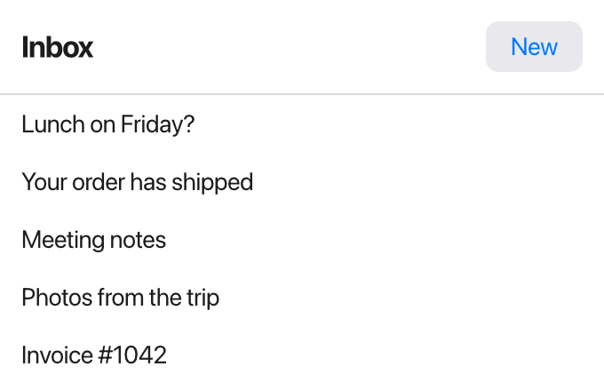
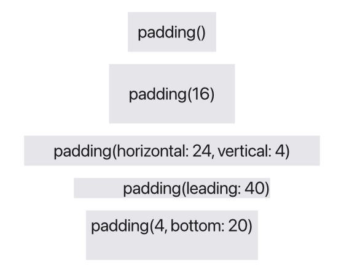

Tessel arranges views with *stacks*: you put views in a row, a column or a
pile, and nest stacks inside each other to build any layout.

```tessel
app Inbox(width: 340, height: 220) {
    state messages = ["Lunch on Friday?", "Your order has shipped", "Meeting notes",
        "Photos from the trip", "Invoice #1042", "Welcome to Tessel"]

    VStack(spacing: 0) {
        HStack {
            Text("Inbox").font(size: 17, weight: .bold)
            Spacer()
            Button("New") { messages.insert("New message", at: 0) }
        }
        .padding(12)
        Divider()
        Scroll {
            VStack(spacing: 0, alignment: .leading) {
                for m in messages {
                    Text(m).padding(horizontal: 12, vertical: 8)
                }
            }
        }
    }
}
```



The rest of this page goes through each piece.

## Stacks

| Stack | Arranges its children |
|-------|-----------------------|
| `VStack { … }` | top to bottom |
| `HStack { … }` | left to right |
| `ZStack { … }` | on top of each other, the first one at the back |

```tessel
VStack {
    Text("Name")
    HStack {
        Text("First")
        Text("Last")
    }
    ZStack {
        Text("Behind").font(size: 30).color(.lightGray)
        Text("In front")
    }
}
```

A stack is just big enough for its children. By default it centers them: a
`VStack` centers each child horizontally, an `HStack` vertically. You can change
that with `alignment:`; see [Alignment](/ui/alignment/).

The body of an `app` or `view` works like a `VStack` too: its views go from
top to bottom, 8 points apart, centered.

### Spacing

`VStack` and `HStack` put 8 points between their children. Pass `spacing:` to
change that:

```tessel
VStack(spacing: 0) {
    Text("Tight")
    Text("lines")
}
HStack(spacing: 24) {
    Text("Far")
    Text("apart")
}
```

The spacing goes *between* children only, not before the first or after the
last. Hidden views (see [`.hidden`](/ui/styling/#hiding-and-disabling)) don't
count.

## Spacer

`Spacer()` is empty space that grows. In an `HStack` it grows sideways, in a
`VStack` up and down, pushing the other views apart:

```tessel
HStack {
    Text("Left")
    Spacer()
    Text("Right")
}
```

With two or more spacers in the same stack, the free space is shared equally
between them. A `Spacer` with a fixed size is a handy way to make a gap of a
certain width:

```tessel
HStack(spacing: 0) {
    Spacer().frame(width: 20)
    Text("Indented by 20 points")
}
```

## Divider

`Divider()` draws a thin line across its stack: a horizontal line in a
`VStack`, a vertical one in an `HStack`. It stretches to the stack's full width
(or height), so it separates sections cleanly:

```tessel
VStack(spacing: 0) {
    Text("Toolbar").padding(8)
    Divider()
    Text("Content").padding(8)
}
```

## Scroll

`Scroll { … }` shows content that may be taller than the space available, and
lets the user scroll it with the mouse wheel or trackpad, or by dragging the
scroll bar that shows at its right edge when there's more than fits:

```tessel
Scroll {
    VStack(alignment: .leading) {
        for i in 0..100 {
            Text("Line {i}")
        }
    }
}
```

A `Scroll` takes all the space it's offered, and its content starts at the top
left. If you put several views directly inside a `Scroll`, it stacks them
downwards, 8 points apart, as a `VStack` with `.leading` alignment would.

### Across, and both ways

A `Scroll` scrolls up and down unless you say otherwise. `Scroll(.horizontal)`
scrolls across instead, and `Scroll(.both)` both ways, for content wider
than the view, like a sheet of cells or a large drawing:

```tessel
Scroll(.horizontal) {
    HStack {
        for photo in photos {
            Image(photo).frame(height: 80)
        }
    }
}
```

The content gets all the width it asks for, and a scroll bar along the
bottom when it's wider than the view. The wheel and trackpad move it the way
they turn; a mouse wheel turned down over a `Scroll(.horizontal)` moves it
across, unless there's a scroll view around it that goes down: then that
one scrolls, so a strip of pictures in a page doesn't stop the page.

### Scrolling from code

`scrollTo(id)` scrolls the scroll views around the view with that
[`.id`](/ui/lists/#identity-with-id) until it shows. Use it to jump to a
search result, or to keep a log at its newest line:

```tessel
app Log(width: 320, height: 240) {
    state lines: [String] = []

    VStack {
        Button("Add") {
            lines.append("Line {lines.count + 1}")
            scrollTo(lines.count - 1)
        }
        Scroll {
            for (i, line) in lines.enumerated() {
                Text(line).id(i)
            }
        }
    }
}
```

- `align:` says where the view ends up: `.nearest` (the default: no further
  than it takes to show it), `.top`, `.center` or `.bottom`. In a
  `Scroll(.horizontal)`, they mean the leading edge, the middle and the
  trailing edge.
- It happens when the views are next laid out, so a view the same block adds,
  as above, is there to scroll to. If no view has the id then, nothing
  scrolls.
- In a [`LazyVStack`](/ui/lists/#long-lists-with-lazyvstack), a row's number
  is its id: `scrollTo(5000)` shows row 5000 even before it's built. A view
  with that `.id` elsewhere in the window comes first.

## Split views

`HSplit` puts two views side by side with a line between them that the user
drags to share out the room; `VSplit` puts one above the other:

```tessel
app Atlas(width: 800, height: 500) {
    state sidebar = 220.0

    HSplit(size: sidebar) {
        LayerList()
            .frame(minWidth: 150)
        VSplit {
            MapView()
            AttributeTable()
                .frame(minHeight: 80)
        }
    }
}
```

- `size:` is the first pane's width (for `VSplit`, its height) in points. It
  keeps that size when the window is resized, and the second pane gets the
  rest: right for a sidebar. Bind it to a `state` to set it, or to save it
  with the app's settings. Without it, the panes start out halves, and keep
  where the divider is dragged for as long as the app runs.
- A pane's `.frame(minWidth:)` (for `VSplit`, `minHeight:`) is as small as
  the divider lets it get; without one, a pane is never less than 24 points.
- For three panes, put a split view in a pane of another, as above.
- A split view takes all the space it's offered. Its panes are its first two
  views.

## Grids

A `Grid` lines views up in rows and columns. Each `GridRow` is a row, and
each view in it a cell; a column is as wide as its widest cell, so labels
and fields line up from row to row. It's the way to lay out a form:

```tessel
app Signup(width: 420, height: 260) {
    state name = ""
    state email = ""
    state plan = "Free"

    Grid(spacing: 10) {
        GridRow {
            Text("Name").gridColumnAlignment(.trailing)
            TextField("", text: name)
        }
        GridRow {
            Text("Email address")
            TextField("", text: email)
        }
        Divider()
        GridRow {
            Text("Plan")
            Picker(selection: plan, style: .radio) {
                Text("Free").tag("Free")
                Text("Pro").tag("Pro")
            }
        }
        GridRow {
            Text("You can change your plan at any time.")
                .gridCellColumns(2)
                .color(.secondary)
        }
    }
    .padding(20)
}
```

- `spacing:` is the room between columns, and between rows unless
  `rowSpacing:` says otherwise (8 points each by default).
- `alignment:` lines up each cell in its row and column: `.leading` (the
  default) puts it at the left, centered from top to bottom. A cell with
  `.gridColumnAlignment(.trailing)` lines up its whole column, as the
  labels above.
- `.gridCellColumns(2)` makes a cell take two columns (or more).
- A view in the grid that isn't in a `GridRow`, like the `Divider` above,
  is a row of its own, as wide as the grid.
- Columns with a flexible view in them, such as a text field, share the
  room the others leave, so a grid in a wide window has wide fields.
- A row can come from a view of your own: `view Field(…) { GridRow { … } }`
  makes one row of the grid it's in. Rows from `for` and `if` work too.
- Outside a `Grid`, a `GridRow` is laid out like an `HStack`.

## Turning and scaling

`.rotation(degrees)` turns a view clockwise around its middle, and
`.scale(…)` makes it larger or smaller. Unlike [`.offset`](/reference/modifiers/#offset),
they change the layout: the view takes the room of the box around it as
it now shows, and the views around it move:

```tessel
app Labels(width: 300, height: 220) {
    HStack(spacing: 12) {
        Text("Normal")
        Text("Turned").rotation(-90)
        Text("Big").scale(1.6)
        Text("Wide").scale(x: 2, y: 1)
    }
}
```

The text turned by a quarter takes a column as tall as it was wide. Clicks
go by the view's new shape, and what's in it turns and grows with it.

## Padding

`.padding` adds space around a view, inside its background and border. You
can pad every edge, the two axes, or single edges:

```tessel
Text("padding()").padding().background(.lightGray)
Text("padding(16)").padding(16).background(.lightGray)
Text("padding(horizontal: 24, vertical: 4)")
    .padding(horizontal: 24, vertical: 4)
    .background(.lightGray)
Text("padding(leading: 40)").padding(leading: 40).background(.lightGray)
Text("padding(4, bottom: 20)").padding(4, bottom: 20).background(.lightGray)
```



The rules:

- `.padding()` with nothing in the parentheses pads every edge by 8 points.
- `.padding(16)` pads every edge by 16.
- `horizontal:` sets the leading and trailing edges; `vertical:` sets the top
  and bottom.
- `top:`, `leading:`, `bottom:` and `trailing:` set one edge each. (*Leading*
  is the left edge, *trailing* the right.)
- When you name some edges, the edges you don't name get 0, unless you also
  give a first amount for them: `.padding(4, bottom: 20)` is 4 everywhere except
  the bottom. The most specific value wins.
- Calling `.padding` more than once adds the amounts together.

## Fixed sizes with `.frame`

`.frame(width:height:)` gives a view an exact size:

```tessel
Text("Fixed").frame(width: 120, height: 40).background(.yellow)
```

The view's content is centered inside the frame (see
[Alignment](/ui/alignment/) to place it elsewhere). Text that doesn't fit in
the width wraps onto more lines. You can give just one of the two; the other
then comes from the content as usual.

`.frame` also takes `minWidth:`, `maxWidth:`, `minHeight:` and `maxHeight:`,
for views that grow or shrink within limits. Those are covered in
[Alignment](/ui/alignment/#growing-with-maxwidth-and-maxheight).

:::note[Modifier order]
In Tessel, a view's padding, frame, background and border are properties of
that one view, so the order you write them in doesn't change the result:
`.padding(8).background(.red)` and `.background(.red).padding(8)` look the
same. The padding is always inside the frame and inside the background. (This
is different from SwiftUI, where each modifier wraps the view in a new layer.)
To put a background *inside* some padding, wrap the view in a stack and pad the
stack.
:::

## How sizes are decided

When Tessel lays out a window, each view gets offered some space and picks its
size. Knowing the rules helps when a layout doesn't come out as you expect.

**Most views are exactly as big as their content.** A `Text` is as big as its
text (and wraps onto more lines when it's offered less width than it needs), a
`Button` fits its label, an `Icon` follows the font size, and a stack fits its
children plus spacing.

**Some views are flexible** and take the space they're offered:

| View | Grows |
|------|-------|
| `Spacer()` | along its stack (sideways in an `HStack`, downward in a `VStack`) |
| `TextField` | in width |
| `Divider()` | across its stack |
| `Scroll`, `CodeEditor`, `TabView` | in both directions |
| any view with `.frame(maxWidth:)` or `.frame(maxHeight:)` | in that direction, up to the maximum |

A fixed `.frame(width:)` or `.frame(height:)` turns growing off in that
direction.

**A stack with something flexible inside becomes flexible too.** An `HStack`
containing a `Spacer` stretches across the whole width it's offered, which is
how `Text("Left")`, `Spacer()`, `Text("Right")` reaches both edges.

**Stacks share out their space** in two rounds: first every fixed-size child
gets what it needs, then the flexible children split what's left equally. If
there are no flexible children, the children are packed together in the middle
of the stack.

**The window centers its content.** The app's body is placed in the middle of
the window, at its natural size, unless something flexible inside it makes it
fill the window. That's why a simple app floats in the center, and one with a
`Spacer`, `Scroll` or `TabView` in its outer stack fills the window edge to
edge.

To see what size each view actually got, run your app with the `dump` script
command; see [Testing your UI](/ui/testing/).
