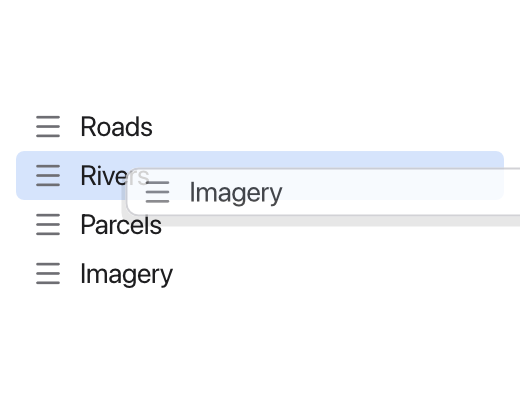
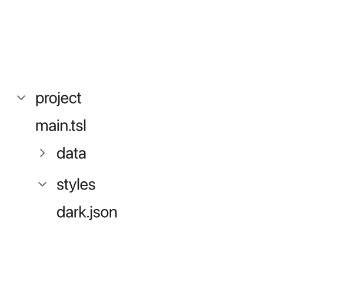
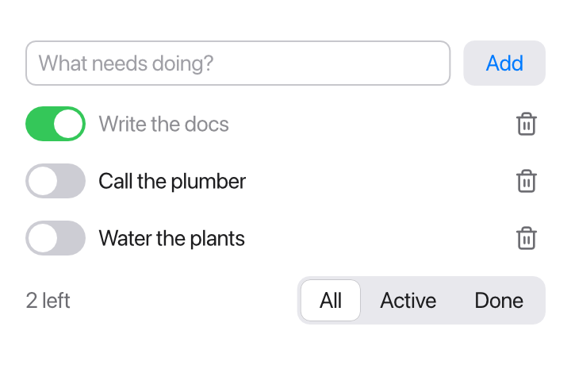

Inside a view body, `for`, `if` and `match` decide *which* views to show. They
use the same syntax as everywhere else in Tessel (see
[Control flow](/language/control-flow/)), but instead of running code they
produce views.

## `for`: one view per item

A `for` loop in a body shows its content once for each item:

```tessel
app Shopping(width: 300, height: 200) {
    state items = ["Apples", "Bread", "Coffee"]

    VStack(alignment: .leading) {
        for item in items {
            Text("• {item}")
        }
    }
}
```

When the list changes, the next rebuild shows the new items; there's nothing
else to update. Loops also work over ranges (`for i in 0..5`), and you can
nest them.

If the loop goes over a `state` list (or a `var` or `bind` one), the loop
variable can be passed to `bind` parameters, so each row can edit its own
item. See [Binding struct fields and list elements](/ui/state/#binding-struct-fields-and-list-elements).

## `if`: showing views on a condition

```tessel
if todos.isEmpty {
    Text("Nothing to do!").color(.secondary)
} else {
    Text("{todos.count} things to do")
}
```

`else if` chains work, and so does `if let` for [optionals](/language/optionals/):

```tessel
if let name = selected {
    Text("Selected: {name}")
} else {
    Text("Nothing selected")
}
```

When a condition becomes false, its views disappear, along with any
[state](/ui/state/#state-in-your-own-views) they had.

## `match`: one view per case

`match` picks views by the value of an enum (or any value you can match on).
Each arm can be a single view, or a block of several:

```tessel
enum Mode { list, grid, empty }

app Browser(width: 360, height: 240) {
    state mode = Mode.list

    Picker(selection: mode) {
        Text("List").tag(.list)
        Text("Grid").tag(.grid)
        Text("Empty").tag(.empty)
    }
    match mode {
        .list -> {
            for i in 0..3 {
                Text("Row {i}")
            }
        }
        .grid -> HStack {
            Text("A")
            Text("B")
        }
        .empty -> Text("Nothing here").color(.secondary)
    }
}
```

As everywhere, a `match` must cover every case; use `_ ->` for "everything
else".

## `let` in a body

A body may use `let` to name a value it uses more than once:

```tessel
let done = todos.filter { t in t.done }.count
Text("{done} of {todos.count} done")
ProgressLabel(done: done)
```

(`var` isn't allowed, because a body describes the UI rather than running
steps.)

## Identity with `.id`

Each time the body runs, Tessel matches the new views to the old ones, so
that things that belong to a view survive: its `state`, which text field is
being edited, its undo history, its scroll position. By default views are
matched **by position**: the third row now is assumed to be the third row from
before.

For a list that only grows at the end, that's fine. But when items are
removed, inserted or reordered, the rows shift, and state stays behind at the
old position. If the second row was expanded and the first item is deleted,
the row that is now second (the old third) appears expanded instead.

`.id(…)` fixes this by giving a view an identity that goes with its item:

```tessel
for todo in todos {
    TodoRow(todo: todo)
        .id(todo.id)
}
```

Now each row's state follows its to-do wherever it moves. The id must be an
`Int` or a `String`, and it should be unique among the items of the list.
Structs don't get an id automatically, so give your items one, for example a
counter you increase for each new item.

## Removing items

Items are usually removed with `removeAll(where:)` or `remove(at:)`, from a
function that has access to the list. A row can't remove itself from its
caller's list, so give it an action to call instead, a parameter of type
`fn()`:

```tessel
view TodoRow(todo: bind Todo, onDelete: fn()) {
    HStack(spacing: 8) {
        Toggle(isOn: todo.done)
        Text(todo.title)
        Spacer()
        Icon(.trash).onTap { onDelete() }
    }
}
```

The caller decides what deleting means:

```tessel
for todo in todos {
    TodoRow(todo: todo) { remove(id: todo.id) }
        .id(todo.id)
}
```

## Reordering by dragging

A row with [`.draggable(…)`](/reference/modifiers/#draggable) can be dragged
with the mouse, and a view with
[`.dropTarget { payload, x, y in … }`](/reference/modifiers/#droptarget) can
take it. That's how a layers panel lets its layers be put in another order:

```tessel
view LayerRow(name: String, index: Int, move: fn(String, Int)) {
    state targeted = false

    HStack {
        Icon(.menu).color(.secondary)
        Text(name)
        Spacer()
    }
    .padding(horizontal: 8, vertical: 4)
    .background(if targeted { .highlight } else { .clear }, radius: 4)
    .draggable(name)
    .dropTarget(isTargeted: targeted) { payload, x, y in
        // On the lower half of the row: after it.
        move(payload, if y > 8 { index + 1 } else { index })
    }
}

app Layers(width: 260, height: 200) {
    state layers = ["Roads", "Rivers", "Parcels", "Imagery"]

    VStack(spacing: 0, alignment: .leading) {
        for (i, name) in layers.enumerated() {
            LayerRow(name: name, index: i, move: { payload, to in
                moveLayer(payload, to: to)
            })
            .id(name)
        }
    }
    .padding(8)

    fn moveLayer(_ name: String, to: Int) {
        if let from = layers.index(of: name) {
            layers.remove(at: from)
            layers.insert(name, at: if to > from { to - 1 } else { to })
        }
    }
}
```



- The payload is a `String` that says what's dragged: here the layer's name.
  Use an id when names can repeat.
- While a row is dragged, a see-through copy of it follows the mouse, and
  the drop target under the mouse has its `isTargeted:` set to `true`. Each
  `LayerRow` keeps its own `targeted` state, so only the row under the mouse
  lights up.
- `x` and `y` say where in the target the row was dropped (inside its
  padding), to put it before or after.
- `.id(name)` keeps each row's state with its layer as the order changes.
- Escape cancels a drag, and letting go anywhere that isn't a drop target
  does nothing.

Rows of a [`LazyVStack`](#long-lists-with-lazyvstack) can be dragged and
dropped on in the same way.

## Long lists with `LazyVStack`

A `for` loop builds a view for every item, each time the body runs. That's
fine for hundreds of items, but a table of 100 000 features would take a
while to build, every time anything changes. `LazyVStack` builds only the
rows that show (and a screenful more on each side); scroll, and it builds
the ones that come into view:

```tessel
app Features(width: 320, height: 300) {
    state selected = -1

    VStack(spacing: 0) {
        Text(if selected < 0 { "Click a feature" } else { "Feature {selected}" }).padding(8)
        Scroll {
            LazyVStack(count: 100000, rowHeight: 22) { i in
                HStack {
                    Text("Feature {i}")
                    Spacer()
                    Text("{i * 7 % 100} m").color(.secondary)
                }
                .padding(horizontal: 8)
                .background(if i == selected { .highlight } else { .clear })
                .onTap { selected = i }
            }
        }
    }
}
```

`count:` is how many rows there are and `rowHeight:` how tall each one is,
in points; every row is the same height, which is how the list knows which
rows show without building them. The block after it builds row `i`, from 0
to `count - 1`. Put the list in a [`Scroll`](/ui/layout/#scroll), where
it's as tall as all its rows.

## Trees with `DisclosureGroup`

A [`DisclosureGroup`](/reference/views/#disclosuregroup) is a title with an
arrow, and content that shows while it's open. Clicking the title opens or
closes it, through a `Bool` it's bound to. Groups inside groups make a tree:

```tessel
struct Folder {
    name: String
    files: [String]
    folders: [Folder]
}

view FolderRow(folder: Folder) {
    state open = false

    DisclosureGroup(folder.name, isExpanded: open) {
        for file in folder.files {
            Text(file)
        }
        for sub in folder.folders {
            FolderRow(folder: sub)
        }
    }
}

app Browser(width: 300, height: 260) {
    let root = Folder(name: "project", files: ["main.tsl"], folders: [
        Folder(name: "data", files: ["roads.shp", "rivers.shp"], folders: []),
        Folder(name: "styles", files: ["dark.json"], folders: []),
    ])

    VStack(alignment: .leading) {
        FolderRow(folder: root)
    }
    .padding(12)
}
```



Each `FolderRow` keeps whether it's open in its own `state`, and shows its
sub-folders as more `FolderRow`s, indented one level further. A group's
content is only built while it's open, so a large tree costs little until
it's opened. When a group closes, the groups inside it go away with their
state; keep what's open in your own data (a `Set` of paths, say) to
remember it.

## A complete example

Here is a small to-do app that puts it all together: a text field to add
items, rows that edit their item through a binding, a delete button, a filter,
and a count.

```tessel
struct Todo {
    id: Int
    title: String
    done: Bool = false
}

enum Filter { all, active, done }

app Todos(width: 380, height: 300) {
    state todos: [Todo] = []
    state nextId = 1
    state draft = ""
    state filter = Filter.all

    VStack(spacing: 12) {
        HStack {
            TextField("What needs doing?", text: draft).onSubmit { add() }
            Button("Add") { add() }
        }
        for todo in todos {
            if shows(todo) {
                TodoRow(todo: todo) { remove(id: todo.id) }
                    .id(todo.id)
            }
        }
        HStack {
            Text("{remaining()} left").color(.secondary)
            Spacer()
            Picker(selection: filter) {
                Text("All").tag(.all)
                Text("Active").tag(.active)
                Text("Done").tag(.done)
            }
        }
    }
    .padding(16)

    fn add() {
        if draft != "" {
            todos.append(Todo(id: nextId, title: draft))
            nextId += 1
            draft = ""
        }
    }

    fn remove(id: Int) {
        todos.removeAll(where: { t in t.id == id })
    }

    fn shows(todo: Todo) -> Bool {
        match filter {
            .all -> true
            .active -> !todo.done
            .done -> todo.done
        }
    }

    fn remaining() -> Int {
        todos.filter { t in !t.done }.count
    }
}

view TodoRow(todo: bind Todo, onDelete: fn()) {
    HStack(spacing: 8) {
        Toggle(isOn: todo.done)
        Text(todo.title)
            .color(if todo.done { .gray } else { .primary })
        Spacer()
        Icon(.trash)
            .color(.secondary)
            .padding(4)
            .hoverBackground(.lightGray, radius: 4)
            .onTap { onDelete() }
    }
}
```



A few things to notice:

- The loop goes over all of `todos`, and `if shows(todo)` inside it does the
  filtering, so `todo` stays bindable (a loop over `todos.filter { … }` would
  give copies).
- Deleting goes through `remove(id:)`, which looks the item up by its id.
- `.id(todo.id)` keeps each row's identity stable when items above it are
  deleted.
