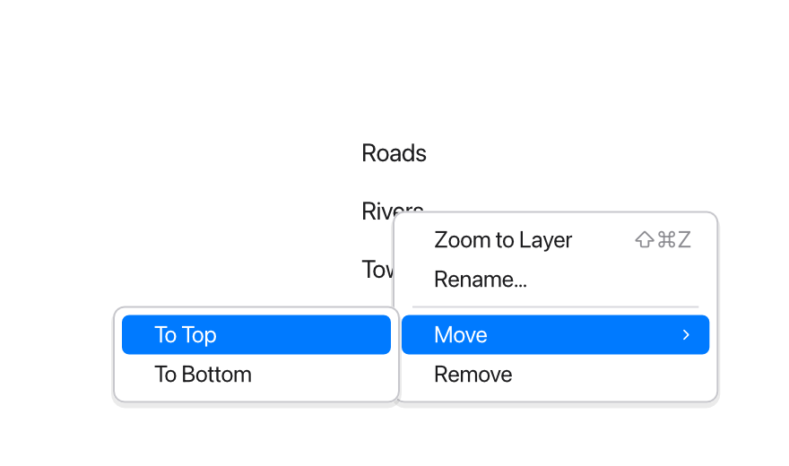
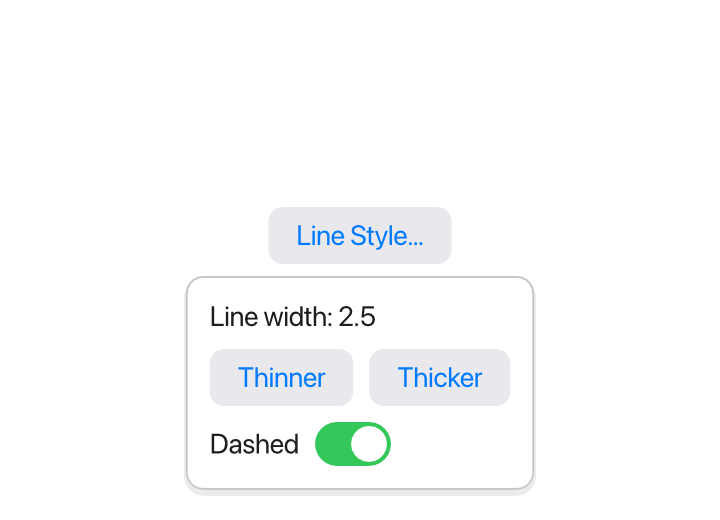
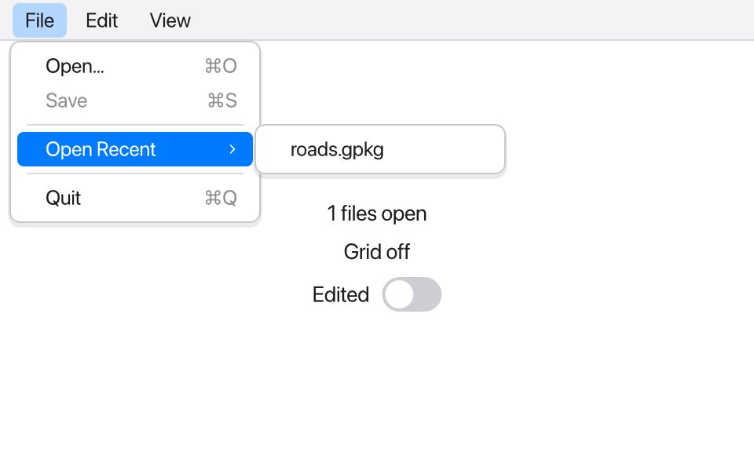

A desktop app is more than its window's content: it has a menu bar, menus
that open with a right click, small panels that pop up next to a button,
other windows, files it's asked to open, and a question to ask before it
closes with unsaved changes. This page shows each of them.

## Context menus

`.contextMenu { … }` gives a view a menu that opens where the user right
clicks it (or Ctrl-clicks, on macOS). The menu's items are `MenuItem`s,
with `MenuDivider()` between groups and `Menu("…") { … }` for a submenu:

```tessel
app Layers(width: 440, height: 260) {
    state layers = ["Roads", "Rivers", "Towns"]
    state status = ""

    VStack(alignment: .leading) {
        for layer in layers {
            Text(layer)
                .padding(4)
                .contextMenu {
                    MenuItem("Zoom to Layer", shortcut: "cmd+shift+z") { status = "Zoomed to {layer}" }
                    MenuItem("Rename…") { status = "Renaming {layer}" }
                    MenuDivider()
                    Menu("Move") {
                        MenuItem("To Top") {
                            let name = layer
                            layers.removeAll { l in l == name }
                            layers.insert(name, at: 0)
                        }
                        MenuItem("To Bottom") {
                            let name = layer
                            layers.removeAll { l in l == name }
                            layers.append(name)
                        }
                    }
                    MenuItem("Remove") { layers.removeAll { l in l == layer } }
                        .disabled(layers.count == 1)
                }
        }
        Text(status).color(.secondary)
    }
}
```



(`let name = layer` keeps the name: once the list changes, `layer` would be
the item now in its place.)

A menu is drawn in the window, over everything else. The mouse or the
keyboard chooses an item: Up and Down move through the items (skipping
dividers and disabled ones), Right opens a submenu and Left closes it, Enter
chooses, and Escape (or a click outside) closes the menu.

`MenuItem(title, shortcut:, checked:) { … }` takes:

- **`shortcut:`** the keys to show next to it (see [Shortcut keys](#shortcut-keys)).
  In a context menu they're only shown, as a reminder: give the same item to
  the [menu bar](#the-menu-bar) for the keys to work.
- **`checked:`** `true` to show a check mark, for a setting that's on.
- `.disabled(…)` grays an item out, and `.hidden(…)` leaves it out. On a
  `Menu`, they do the same to all its items.

Menus are built again with the rest of the view whenever state changes, so
their items can come from a `for` loop, change their titles, or be checked
or disabled by state. A view of your own whose body is menu items can be used
in a menu, too. `MenuItem`, `MenuDivider` and `Menu` only go in menus, and
only they go there: `tessel check` reports a `Button` in a menu, or a
`MenuItem` in a `VStack`.

A view with both `.contextMenu` and [`.onPointer`](/reference/modifiers/#onpointer)
opens its menu on a right click; the other buttons go to `.onPointer`.

## Popovers

`.popover(isPresented: bind Bool, edge: Edge = .bottom) { … }` shows views
next to another one, over the rest of the window, while the `Bool` is
`true`:

```tessel
app Style(width: 360, height: 260) {
    state showStyle = false
    state lineWidth = 2.0
    state dashed = false

    VStack {
        Button("Line Style…") { showStyle = true }
            .popover(isPresented: showStyle) {
                VStack(alignment: .leading) {
                    Text("Line width: {lineWidth}")
                    HStack {
                        Button("Thinner") { lineWidth = max(0.5, lineWidth - 0.5) }
                        Button("Thicker") { lineWidth += 0.5 }
                    }
                    Toggle("Dashed", isOn: dashed)
                }
            }
        Text("{lineWidth} pt{if dashed { ", dashed" } else { "" }}")
    }
}
```



- The popover shows below the view (`edge: .bottom`), or `.top`, `.leading`
  or `.trailing` of it; when there's no room on that side, it goes on the
  other, and it always stays inside the window.
- A click outside it, or Escape, closes it: the binding becomes `false`. (That
  click doesn't go on to what's under it.) Set the binding to `false` to close
  it yourself, as a Done button would.
- Its content gets 12 points of room around it, and at most 280 points of
  width unless it asks for more with `.frame(width:)`.
- Tab moves between the text fields in the popover only.
- A popover can open another one from a view inside it; a click in the first
  one closes the second.

For views that must be answered before going on, in the middle of the
window, see [Sheets](/ui/dialogs/#sheets).

## The menu bar

`.menuBar { … }` declares the app's menus, each a `Menu` of items. Put it on
the app's content (on any view of the main window, really: the first one
that has it counts):

```tessel
app Atlas(width: 480, height: 300) {
    state files: [String] = []
    state edited = false
    state showGrid = true

    VStack {
        Text("{files.count} files open")
        Text(if showGrid { "Grid on" } else { "Grid off" })
        Toggle("Edited", isOn: edited)
    }
    .menuBar {
        Menu("File") {
            MenuItem("Open…", shortcut: "cmd+o") {
                if let path = openFile(types: ["gpkg", "geojson"]) {
                    files.append(path)
                }
            }
            MenuItem("Save", shortcut: "cmd+s") { edited = false }
                .disabled(!edited)
            MenuDivider()
            Menu("Open Recent") {
                for path in files {
                    MenuItem(path.fileName) { print("open {path}") }
                }
            }
            .disabled(files.isEmpty)
        }
        Menu("View") {
            MenuItem("Show Grid", shortcut: "cmd+g", checked: showGrid) { showGrid = !showGrid }
        }
    }
}
```

On macOS this is the system's menu bar at the top of the screen. Tessel adds
the standard menus around yours:

- the **app menu**, named after the app: About, Hide (Cmd+H), Hide Others,
  Show All and Quit (Cmd+Q);
- **Edit**: Undo, Redo, Cut, Copy, Paste and Select All, which work on the
  text field being edited (when none is, their keys go to your
  [`.shortcut`s](/ui/shortcuts/));
- **Window**: Minimize (Cmd+M), Zoom and Close Window (Cmd+W).

A menu of yours called "Edit" or "Window" gets its items after the standard
ones. An app without `.menuBar` still gets the standard menus on macOS.

On Windows there's no menu bar at the top of the screen, so the
menu bar is drawn at the top of the window, and the window's content goes
below it. It has your menus with the standard Edit menu, and Quit at the end
of the first menu:



The menu bar is built again when state changes, like the rest of the app:
here Save is enabled only when there's something to save, Show Grid has its
check mark while the grid shows, and Open Recent lists the files opened so
far.

A menu bar item's shortcut works wherever the keyboard focus is, before the
views' own [`.shortcut`s](/ui/shortcuts/). If an item has Cmd+C (or another
of the editing keys: A, X, V, Z), the text being edited keeps it: the key,
and the item, copy the text instead. A standard item whose keys one of your
items (or a view's `.shortcut`) has gives them up: with a `.shortcut("w")`,
Cmd+W runs it rather than closing the window.

### Shortcut keys

A `shortcut:` is written as modifier keys and a key, joined by `+`:
`"cmd+s"`, `"cmd+shift+s"`, `"alt+cmd+left"`. Or with the symbols macOS
menus show, followed by the key: `"⌘S"`, `"⇧⌘S"`, `"⌥⌘left"`.

- The modifiers are `cmd` (Cmd on macOS, Ctrl on Windows), `shift`
  and `alt` (`option` too; Option on macOS); or `⌘`, `⇧` and `⌥`.
- The key is one character, such as `"s"`, `","` or `"1"` (a letter in any
  case: `"⌘S"` is Cmd+S, not Shift+Cmd+S), or one of `enter`, `escape`,
  `tab`, `backspace` (the Mac's delete key), `delete` (forward delete),
  `left`, `right`, `up`, `down`, `home`, `end` and `space`.
- The menu shows the keys the platform's way: `⇧⌘S` on macOS, `Ctrl+Shift+S`
  elsewhere.

`tessel check` reports a shortcut it can't read.

## More windows

`Window(title, isOpen: bind Bool, width:, height:) { … }` in the `app`'s body
is another window, open while the `Bool` is `true`:

```tessel
app Survey(width: 400, height: 260) {
    state points = ["P1", "P2", "P3"]
    state selected = ""
    state showTable = false

    VStack {
        Text("{points.count} points, selected: {selected}")
        Toggle("Attribute Table", isOn: showTable)
    }

    Window("Attribute Table", isOpen: showTable, width: 280, height: 220) {
        VStack(alignment: .leading) {
            for point in points {
                Button(point) { selected = point }
            }
            Button("Add Point") { points.append("P{points.count + 1}") }
        }
    }
}
```

- The window shares the app's state: a click in one window shows in the
  other at once.
- It opens at `width` × `height` (480 × 360 if they're not given), titled
  `title`; a new title shows in its title bar.
- When the user closes it, the binding becomes `false`. Set it to `false` to
  close the window yourself (or call [`closeWindow()`](#asking-before-closing)
  from inside it).
- Its views lay out as the main window's do. It can have its own popovers,
  context menus and `.onCloseRequest`, but the menu bar is the main
  window's.
- A `Window` can only be declared in the `app` (directly, or in an `if` or
  `for` there). Closing the main window ends the app, with its other windows.

## Opening documents

`.onOpenFile { path in … }` runs when the system asks the app to open a file:
when the user opens one with the app from Finder ("Open With", or
double-clicking a file of a type the app opens), drops one on its Dock icon,
or starts the app by opening a file. On Windows, a file the app is
started with (an argument that's an existing file, as "Open with" passes it)
comes to `.onOpenFile` too.

To have the system offer the app for some kinds of files, list their
extensions in `documentTypes:`:

```tessel
app Notes(width: 420, height: 280, documentTypes: ["note"]) {
    state path = ""
    state text = ""
    state saved = ""
    state asking = false

    VStack {
        Text(if path.isEmpty { "No note open" } else { path.fileName })
        TextField("Note", text: text)
        if asking {
            Text("Save the changes to this note?")
            HStack {
                Button("Don't Save") { quit() }
                Button("Cancel") { asking = false }
                Button("Save") {
                    if writeFile(path: path, text: text) {
                        quit()
                    }
                }
            }
        }
    }
    .onOpenFile { file in
        path = file
        text = readFile(path: file) ?? ""
        saved = text
    }
    .onCloseRequest {
        if text == saved {
            closeWindow()
        } else {
            asking = true
        }
    }
}
```

`tessel build --bundle` writes them into the app bundle (as
`CFBundleDocumentTypes` in its `Info.plist`), so Finder knows the app opens
`.note` files. Write the extensions without the dot; the list must be written
out in the `app` (not computed), since the bundle is made from the source.
The project's [`tessel.toml`](/start/project/#documents) can list them too,
with a name for each kind of file.

- The first view (from the top of the main window's views) with
  `.onOpenFile` gets each file.
- A file that arrives before there's such a view, like the one the app was
  started to open, waits until there is one.
- Files dropped on the window go to [`.onDrop`](/reference/modifiers/#ondrop)
  instead.

## Asking before closing

`.onCloseRequest { … }` runs, instead of closing, when the user closes the
window (its close button, or Close Window and Cmd+W on macOS) or quits the
app (Quit in the menu, Cmd+Q, or from the Dock). The app then decides, often after asking about unsaved changes as
the Notes app above does:

- **`closeWindow()`** closes the window the event came from. For the main
  window, the app ends.
- **`quit()`** ends the app.

Neither asks `.onCloseRequest` again. Without `.onCloseRequest`, closing the
main window or quitting ends the app at once, and closing another window
just closes it. A `Window`'s own `.onCloseRequest` decides for that window;
quitting asks the main window's.

## In test scripts

[Test scripts](/ui/testing/) drive all of this without a window:

| Command | Does |
|---|---|
| `rightclick "Roads"` | Right-clicks a view: its context menu opens. `click "Remove"` then chooses an item of the open menu, `hover "Move"` opens a submenu, and `key down`, `key right`, `key enter`, `key escape` work as in a window. |
| `tree` | Shows the open menu after the views (with the selected item marked), popovers as `Popover` at the end of the tree, `MenuBar` with the menus' titles first, and the other open windows last. |
| `menu "File" "Open Recent" "roads.gpkg"` | Chooses a menu bar item, by the titles of its menus and its own. |
| `menus` | Lists the menu bar, every menu and item. |
| `menubar drawn` | Draws the menu bar in the window (as on Windows), or `menubar native` (as on macOS, where it's not in the window). Scripts start the way the platform does, so tests that depend on it should say which. |
| `open "/tmp/a.note"` | The system asks the app to open a file. |
| `close window` | The user closes the window: `.onCloseRequest` runs, or it closes. |
| `quit` | The user quits the app. |
| `window "Attribute Table"` | Sends the commands that follow to that window (`window main` for the main one): `click`, `tree`, `size`, `snapshot`, `close window`… |

When the app ends (by `quit()`, or its main window closing), the script stops
there.

```text
click "Attribute Table"
window "Attribute Table"
click "P2"
close window
tree
```
