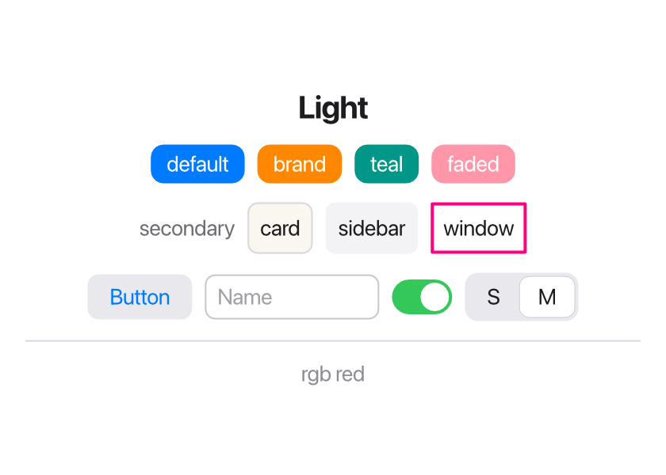
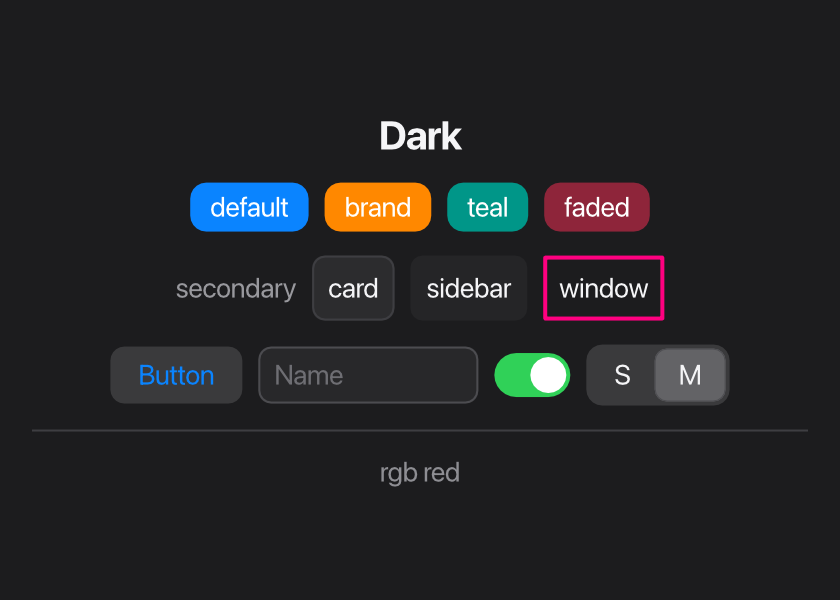

Views have a plain look until you style them with *modifiers*. This page covers
text and the modifiers that change appearance. For sizes and positions, see
[Layout](/ui/layout/) and [Alignment](/ui/alignment/).

## Text

`Text` shows a string:

```tessel
Text("Hello, world!")
Text("You have {count} new messages")
Text("First line\nSecond line")
```

Text can contain `{…}` interpolation, like any Tessel string, and `\n` starts a
new line. When a text is offered less width than it needs, it wraps onto more
lines at word boundaries.

## Fonts

`.font(size:weight:)` sets the text size (in points) and weight. Both are
optional, so you can change just one:

```tessel
Text("Title").font(size: 24, weight: .bold)
Text("Bigger").font(size: 18)
Text("Heavier").font(weight: .semibold)
```

The default is 14 points, regular weight, in the system's interface font.
There are four weights:

```tessel
Text("Regular").font(size: 20, weight: .regular)
Text("Medium").font(size: 20, weight: .medium)
Text("Semibold").font(size: 20, weight: .semibold)
Text("Bold").font(size: 20, weight: .bold)
```


`.font` is *inherited*: set it on a stack and it applies to every text inside,
unless a view inside sets its own.

```tessel
VStack {
    Text("Both lines")
    Text("are 12 points")
}
.font(size: 12)
```

The font size also sizes [icons](/ui/icons/), so an icon next to text matches
it.

## Colors

`.color(…)` sets the color of text and icons. Like `.font`, it's inherited by
everything inside a stack.

```tessel
Text("Error").color(.red)
Text("Details").color(.secondary)
```

Colors are values of the built-in `Color` type, written with a leading dot:

| Color | Use |
|-------|-----|
| `.primary` | The default text color: near black, or near white in the dark appearance. |
| `.secondary` | Gray, for less important text. |
| `.gray`, `.lightGray` | Neutral grays. |
| `.red`, `.orange`, `.yellow`, `.green`, `.blue`, `.purple`, `.pink` | Accent colors. |
| `.white`, `.black` | Pure white and black. |
| `.clear` | Fully transparent. |
| `.sidebar` | A very light gray, for side panels. |
| `.highlight` | A light blue, for selected rows. |
| `.separator` | The gray used by `Divider()`. |
| `.background` | The window's background. |
| `.rgb(r, g, b)` | A color of your own, from red, green and blue (each 0 to 255). |
| `.rgba(r, g, b, opacity)` | The same, see-through: `opacity` goes from 0 to 1. |

See the [colors reference](/reference/colors/) for swatches and exact values.

### Your own colors

`.rgb` and `.rgba` make any color. Like every `Color`, one can be kept in a
`let`, passed to your own views, and compared:

```tessel
let brand: Color = .rgb(255, 136, 0)

Text("Sale").color(.white).padding(8).background(brand, radius: 8)
Text("Soon").padding(8).background(.rgba(255, 136, 0, 0.2), radius: 8)
```

A web color like `#FF8800` is `.rgb(255, 136, 0)`: its three pairs of digits
are red, green and blue, in base 16.

## Light and dark

An app looks light or dark as the system does, and changes with it while it
runs. Text, the window, the built-in controls and the named colors all have
a version for each:





To look right in both:

- Leave text its default color, or use `.primary` and `.secondary`.
- For backgrounds, use `.background`, `.sidebar`, `.lightGray` and
  `.highlight`, which are dark in the dark appearance. `.white` and `.black`
  never change, and neither do `.rgb` colors.
- For a color of your own in each appearance, ask `isDarkMode()`:

```tessel
let card: Color = if isDarkMode() { .rgb(44, 44, 46) } else { .rgb(250, 246, 240) }
```

`isDarkMode()` is `true` while the app shows in its dark appearance. The app is
built again when the appearance changes, so views that use it follow.

An app that should always look one way says so:

```tessel
app Player(appearance: .dark) {
    …
}
```

`appearance:` is `.system` (the default), `.light` or `.dark`.

A `Button`'s label is blue by default. Setting `.color` on the button itself
changes it; a color inherited from an outer stack does not.

## Backgrounds and borders

`.background(color, radius:)` fills the view's area with a color, and
`radius:` rounds the corners. `.border(color, width:, radius:)` draws an
outline; the width is 1 point unless you say otherwise.

```tessel
Text("background").padding(8).background(.yellow)
Text("radius: 8").padding(8).background(.lightGray, radius: 8)
Text("border").padding(8).border(.blue, width: 2, radius: 8)
Text("opacity").padding(8).background(.green, radius: 8).opacity(0.4)
Button("Disabled") {}.disabled()
```


The background and border cover the view's whole area, including its padding,
so padding is what gives text some room inside its background. (The order of
`.padding` and `.background` doesn't matter; see
[the note on modifier order](/ui/layout/#fixed-sizes-with-frame).)

The border is drawn on top of the view's content, the background behind it.

## Opacity

`.opacity(value)` makes a view and everything inside it see-through, from `0`
(invisible) to `1` (solid). An invisible view still takes up its space and can
still be clicked; to remove it, use `.hidden()`.

## Hiding and disabling

`.hidden()` removes a view from the window: it isn't drawn, takes no space,
and can't be clicked. `.disabled()` keeps the view visible but faded, and it
doesn't react to clicks or [keyboard shortcuts](/ui/shortcuts/). Both apply to
everything inside the view.

Both take an optional `Bool`, so you can switch them on a condition:

```tessel
Button("Send") { send() }.disabled(message == "")
Text("Saving…").hidden(!saving)
```

`.hidden(true)` is the same as `.hidden()`, and `.hidden(false)` shows the view
normally.

An `if` also shows and hides views, so when should you use `.hidden`? The
difference is that a hidden view still exists: if it's a custom view with
[state](/ui/state/#state-in-your-own-views), that state is kept while it's
hidden. A view left out by an `if` is gone, and its state with it.

## Hover backgrounds

`.hoverBackground(color, radius:)` draws a background while the mouse pointer is
over the view. It's meant for things you can click that don't look like
buttons, such as rows in a list or icon buttons in a toolbar, and goes together
with [`.onTap`](/ui/controls/#making-any-view-clickable):

```tessel
HStack {
    Icon(.file)
    Text("notes.txt")
    Spacer()
}
.padding(4)
.hoverBackground(.lightGray, radius: 4)
.onTap { open() }
```

It works on any view, not only ones you can click. When views with a hover
background are nested, only the innermost one under the pointer shows its
hover background.

## Text alignment

`.textAlignment(.leading | .center | .trailing)` lines up the lines of a
multi-line text. It's covered in
[Alignment](/ui/alignment/#lining-up-lines-of-text).

## Animation

Normally a view that changes is drawn in its new place at once. With
`.animation()`, a view and the views inside it take a moment to get there:

```tessel
app Drawer(width: 360, height: 200) {
    state open = false

    HStack(spacing: 0) {
        VStack {
            Text("Menu")
        }
        .frame(width: if open { 160 } else { 40 }, maxHeight: .infinity)
        .background(.sidebar)

        Button(if open { "Close" } else { "Open" }) { open = !open }
            .frame(maxWidth: .infinity)
    }
    .animation()
}
```

Clicking the button widens the side panel smoothly, and the button slides
along, instead of both jumping.

What's animated, between one state of the UI and the next:

- a view's position and size,
- its `.opacity`,
- its `.background` color (one that's added or removed fades in or out),
- and a view that appears fades in.

`.animation()` takes a quarter of a second; `.animation(0.6)` takes 0.6
seconds. It covers the view it's on and everything inside it, so putting it on
your outermost stack animates the whole window. `.animation(0)` turns it off
again for a part.

A few things to know:

- A view that disappears is gone at once (the views around it then move to
  fill the gap).
- Tessel tells views apart by their position among their neighbors. When views
  are added or removed in the middle of a list, give each one an
  [`.id`](/ui/lists/#identity-with-id), so that the right ones move.
- Scrolling and resizing the window aren't slowed down.
- A `Toggle` always slides, with or without `.animation`.
