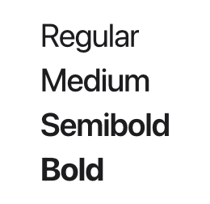
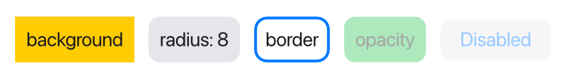

Views have a plain look until you style them with *modifiers*. This page covers
text and the modifiers that change appearance. For sizes and positions, see
[Layout](/ui/layout/) and [Alignment](/ui/alignment/).

## Text

`Text` shows a string:

```tessel
Text("Hello, world!")
Text("You have {count} new messages")
Text("First line\nSecond line")
```

Text can contain `{…}` interpolation, like any Tessel string, and `\n` starts a
new line. When a text is offered less width than it needs, it wraps onto more
lines at word boundaries.

## Fonts

`.font(size:weight:)` sets the text size (in points) and weight. Both are
optional, so you can change just one:

```tessel
Text("Title").font(size: 24, weight: .bold)
Text("Bigger").font(size: 18)
Text("Heavier").font(weight: .semibold)
```

The default is 14 points, regular weight, in the system's interface font.
There are four weights:

```tessel
Text("Regular").font(size: 20, weight: .regular)
Text("Medium").font(size: 20, weight: .medium)
Text("Semibold").font(size: 20, weight: .semibold)
Text("Bold").font(size: 20, weight: .bold)
```



`.font` is *inherited*: set it on a stack and it applies to every text inside,
unless a view inside sets its own.

```tessel
VStack {
    Text("Both lines")
    Text("are 12 points")
}
.font(size: 12)
```

The font size also sizes [icons](/ui/icons/), so an icon next to text matches
it.

## Colors

`.color(…)` sets the color of text and icons. Like `.font`, it's inherited by
everything inside a stack.

```tessel
Text("Error").color(.red)
Text("Details").color(.secondary)
```

Colors are values of the built-in `Color` type, written with a leading dot:

| Color | Use |
|-------|-----|
| `.primary` | The default text color, near black. |
| `.secondary` | Dark gray, for less important text. |
| `.gray`, `.lightGray` | Neutral grays. |
| `.red`, `.orange`, `.yellow`, `.green`, `.blue`, `.purple`, `.pink` | Accent colors. |
| `.white`, `.black` | Pure white and black. |
| `.clear` | Fully transparent. |
| `.sidebar` | A very light gray, for side panels. |
| `.highlight` | A light blue, for selected rows. |
| `.separator` | The gray used by `Divider()`. |

See the [colors reference](/reference/colors/) for swatches and exact values.

:::note
These named colors are the only ones for now: there's no way yet to write your
own RGB color. The UI is always light; there's no dark mode yet.
:::

A `Button`'s label is blue by default. Setting `.color` on the button itself
changes it; a color inherited from an outer stack does not.

## Backgrounds and borders

`.background(color, radius:)` fills the view's area with a color, and
`radius:` rounds the corners. `.border(color, width:, radius:)` draws an
outline; the width is 1 point unless you say otherwise.

```tessel
Text("background").padding(8).background(.yellow)
Text("radius: 8").padding(8).background(.lightGray, radius: 8)
Text("border").padding(8).border(.blue, width: 2, radius: 8)
Text("opacity").padding(8).background(.green, radius: 8).opacity(0.4)
Button("Disabled") {}.disabled()
```



The background and border cover the view's whole area, including its padding,
so padding is what gives text some room inside its background. (The order of
`.padding` and `.background` doesn't matter; see
[the note on modifier order](/ui/layout/#fixed-sizes-with-frame).)

The border is drawn on top of the view's content, the background behind it.

## Opacity

`.opacity(value)` makes a view and everything inside it see-through, from `0`
(invisible) to `1` (solid). An invisible view still takes up its space and can
still be clicked; to remove it, use `.hidden()`.

## Hiding and disabling

`.hidden()` removes a view from the window: it isn't drawn, takes no space,
and can't be clicked. `.disabled()` keeps the view visible but faded, and it
doesn't react to clicks or [keyboard shortcuts](/ui/shortcuts/). Both apply to
everything inside the view.

Both take an optional `Bool`, so you can switch them on a condition:

```tessel
Button("Send") { send() }.disabled(message == "")
Text("Saving…").hidden(!saving)
```

`.hidden(true)` is the same as `.hidden()`, and `.hidden(false)` shows the view
normally.

An `if` also shows and hides views, so when should you use `.hidden`? The
difference is that a hidden view still exists: if it's a custom view with
[state](/ui/state/#state-in-your-own-views), that state is kept while it's
hidden. A view left out by an `if` is gone, and its state with it.

## Hover backgrounds

`.hoverBackground(color, radius:)` draws a background while the mouse pointer is
over the view. It's meant for things you can click that don't look like
buttons, such as rows in a list or icon buttons in a toolbar, and goes together
with [`.onTap`](/ui/controls/#making-any-view-clickable):

```tessel
HStack {
    Icon(.file)
    Text("notes.txt")
    Spacer()
}
.padding(4)
.hoverBackground(.lightGray, radius: 4)
.onTap { open() }
```

The hover background only shows on views that react to the mouse: views with
`.onTap`, and buttons, toggles, text fields and pickers.

## Text alignment

`.textAlignment(.leading | .center | .trailing)` lines up the lines of a
multi-line text. It's covered in
[Alignment](/ui/alignment/#lining-up-lines-of-text).
