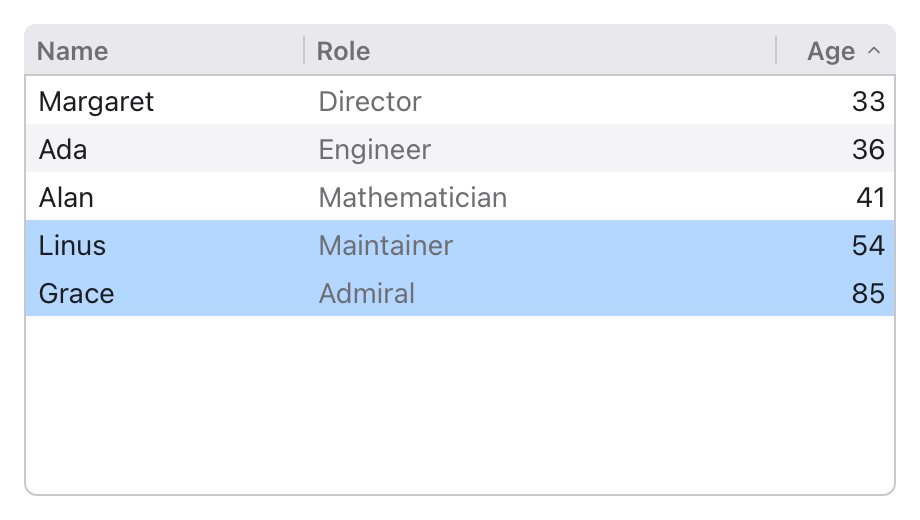
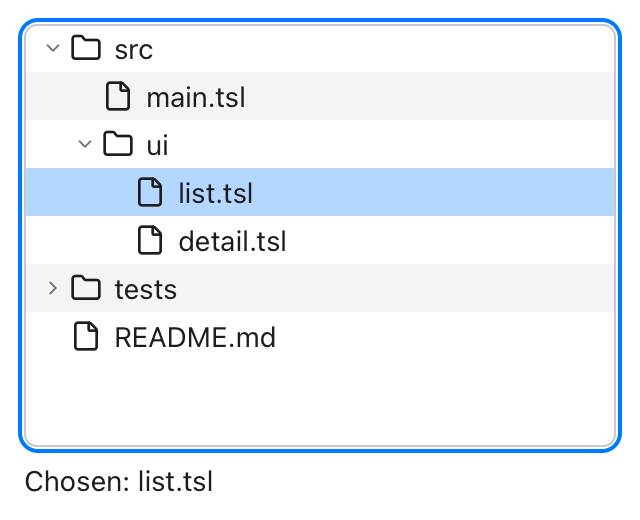

A `Table` shows rows of your data in columns, under a header. A `Tree`
shows data that's nested (folders in folders, a document's outline) a
level at a time, opened with an arrow. Both build only the rows that show,
so they stay quick with a hundred thousand rows.

## A table

The block after `Table` gives its columns. Each `TableColumn` has a title
and a block that builds its cell in row `i`:

```tessel
struct Person {
    name: String
    role: String
    age: Int
}

app Team(title: "Team", width: 460, height: 260) {
    state people = [
        Person(name: "Ada", role: "Engineer", age: 36),
        Person(name: "Grace", role: "Admiral", age: 85),
        Person(name: "Linus", role: "Maintainer", age: 54),
        Person(name: "Alan", role: "Mathematician", age: 41),
        Person(name: "Margaret", role: "Director", age: 33),
    ]
    // The rows in the order they show: sorting changes this, not `people`.
    state order = [0, 1, 2, 3, 4]
    state picked: [Int] = []
    state column = 0
    state up = true

    Table(rows: order.count, selection: picked, sortColumn: column, ascending: up, onSort: { sort() }) {
        TableColumn("Name", width: 140) { i in Text(people[order[i]].name) }
        TableColumn("Role") { i in Text(people[order[i]].role).color(.secondary) }
        TableColumn("Age", width: 60, alignment: .trailing) { i in Text("{people[order[i]].age}") }
    }
    .padding(12)

    fn sort() {
        order = order.sorted { a, b in
            let (x, y) = if up { (people[a], people[b]) } else { (people[b], people[a]) }
            match column {
                1 -> x.role < y.role
                2 -> x.age < y.age
                _ -> x.name < y.name
            }
        }
        picked = []
    }
}
```



- **Your data stays yours.** `rows:` says how many rows there are; a
  cell's block reads whatever row `i` stands for. Here `order` holds the
  rows in the order they show, so sorting moves numbers in a list and not
  the people.
- **Widths.** A column with `width:` is that wide; the columns without one
  share what's left. The user can drag the edge between two titles to
  make a column wider or narrower.
- **Alignment.** `alignment: .trailing` lines the column's cells (and its
  title) up on the right, as numbers usually are; `.center` in the middle.
- Each cell can hold any views: an icon and a text in an `HStack`, a
  `Toggle`, a `TextField` bound to the data so it can be edited there.
  Make the rows taller for controls: `rowHeight: 32`.
- A table is as large as it's allowed to be (give it a `.frame` to size
  it), and scrolls when its rows don't fit.

## Sorting

Clicking a column's title sorts by it; clicking it again, the other way.
The table doesn't sort your data itself: it sets `sortColumn:` (the
column's number, from 0) and `ascending:`, shows an arrow by that title,
and runs `onSort:`, where you put the rows in that order. Leave
`sortColumn:` out and the titles can't be clicked.

The rows selected are numbers of rows as they show: once the order
changes they mean other people, so `sort()` above clears the selection.

## Selecting

`selection:` holds the numbers of the rows selected, in order:

| | |
|---|---|
| Click | Selects only that row. |
| Shift-click | Selects the rows from the one selecting started at to this one. |
| Cmd-click (Ctrl on Windows) | Adds the row, or takes it out. |
| Up and down arrows | Move the selection (with Shift: select more). Home, End, Page Up and Page Down too. |
| Double-click, or Enter | Runs `onOpen:` with the row's number. |

`multiple: false` keeps it to one row. A table without `selection:` can't
be selected.

## A tree

A `Tree` asks your data what's in it: `children:` is given a node's
**path** (where it is: `[0]` is the first node at the top, `[0, 1]` its
second child, `[]` the top itself) and says how many children it has. The
block after it builds the row of the node at a path:

```tessel
struct Item {
    name: String
    children: [Item] = []
}

fn itemAt(_ items: [Item], _ path: [Int]) -> Item {
    var level = items
    var found = Item(name: "")
    for i in path {
        found = level[i]
        level = found.children
    }
    found
}

app Files(title: "Files", width: 320, height: 260) {
    state files = [
        Item(name: "src", children: [Item(name: "main.tsl"), Item(name: "ui", children: [Item(name: "list.tsl"), Item(name: "detail.tsl")])]),
        Item(name: "tests", children: [Item(name: "main.script")]),
        Item(name: "README.md"),
    ]
    state chosen: [Int] = []

    VStack(alignment: .leading) {
        Tree(children: { path in if path.isEmpty { files.count } else { itemAt(files, path).children.count } }, selection: chosen) { path in
            HStack(spacing: 6) {
                Icon(if itemAt(files, path).children.isEmpty { IconName.file } else { IconName.folder })
                Text(itemAt(files, path).name)
            }
        }
        Text(if chosen.isEmpty { "Nothing chosen" } else { "Chosen: {itemAt(files, chosen).name}" })
    }
    .padding(12)
}
```



- Each level is indented, and a node with children has an arrow: click it,
  or press the right arrow key to open the node and the left one to close
  it (or to go to its parent).
- `selection:` holds the selected node's path (`[]` for none), and
  `onOpen:` is given it on a double-click or Enter.
- The tree remembers which nodes are open while it's shown.

## In tests

In a [headless run](/ui/testing/), `tree` shows a table's columns and what
it's sorted by and what's selected, and each row built:
`Table ["Name", "Age"] 100000 rows, sorted by "Age" up, selected [3]`.
`click "Name"` clicks a column's title; `click shift "Alan"` and
`click cmd "Alan"` click with the key held.
