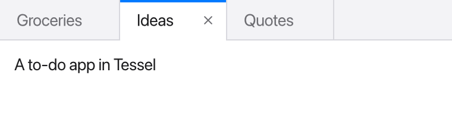

`TabView` shows a row of tabs above a set of pages. One page is visible at a
time; clicking a tab switches to its page.

```tessel
struct Note {
    name: String
    text: String
}

app Notes(width: 380, height: 200) {
    state notes = [
        Note(name: "Groceries", text: "Milk, eggs, bread"),
        Note(name: "Ideas", text: "A to-do app in Tessel"),
        Note(name: "Quotes", text: "Simple things should be simple."),
    ]
    state current = "Ideas"

    TabView(selection: current, onClose: { name in close(name: name) }) {
        for note in notes {
            Text(note.text)
                .padding(12)
                .frame(maxWidth: .infinity, maxHeight: .infinity, alignment: .topLeading)
                .tabItem(note.name)
                .tag(note.name)
        }
    }

    fn close(name: String) {
        notes.removeAll(where: { n in n.name == name })
        if current == name {
            current = notes.first?.name ?? ""
        }
    }
}
```



## Pages, titles and tags

Each view directly inside the `TabView`'s block is one page. Usually you write
them with a `for` loop, as above, but you can also list them one by one. Each
page gets two modifiers:

- `.tabItem("Title")` sets the text on its tab. A page without one is titled
  "Untitled".
- `.tag(value)` gives the page a value that identifies it.

`selection:` is bound to the tag of the page being shown. Clicking a tab sets
`selection` to that page's tag, and setting `selection` in your code switches
tabs; for example, `current = "Quotes"` brings the Quotes page to the front.

The tags can be of any type, as long as they all match the type of the
selection. Strings and enums are the most common:

```tessel
enum Panel { problems, console }

app Output(width: 400, height: 240) {
    state panel = Panel.problems
    state problems: [String] = []
    state console: [String] = ["Build finished"]

    TabView(selection: panel) {
        Text("{problems.count} problems")
            .tabItem("Problems")
            .tag(Panel.problems)
        Text(console.joined(separator: "\n"))
            .tabItem("Console")
            .tag(Panel.console)
    }
}
```

If `selection` doesn't match any page's tag, the first page is shown.

Only the selected page is shown, but the other pages still exist: any
[state](/ui/state/#state-in-your-own-views) inside them is kept while you look
at another tab, and comes back when you switch back.

## Closing tabs

Give `TabView` an `onClose:` function to show close buttons on the tabs. The
close button appears on the selected tab, and on any tab under the mouse
pointer. Clicking it calls `onClose` with that page's tag.

`onClose` doesn't remove anything by itself: your function decides what
closing means. Usually it removes the item from the list the pages are made
from, and, if the closed tab was the selected one, picks another tab to show,
as `close(name:)` does above. Because it's your code, it can also do other
things first, like saving the file that was open in the tab.

The function takes one parameter, of the same type as the tags:
`onClose: { name in close(name: name) }` receives a `String` here because the
tags are strings.

## Size

A `TabView` takes all the space it's offered, in both directions, and gives
its page everything below the tab bar. To make a `TabView` a fixed height, for
example a panel at the bottom of a window, use `.frame(height:)`:

```tessel
TabView(selection: panel) {
    Text("Problems").tabItem("Problems").tag(Panel.problems)
    Text("Console").tabItem("Console").tag(Panel.console)
}
.frame(height: 220)
```

Each tab is at least 90 points wide.

:::note
The tab bar doesn't scroll yet, so a very large number of tabs won't all fit
in a narrow window.
:::

## In a real app

The [Tessel IDE](/start/ide/) (in the repository's `ide/` folder) uses two
`TabView`s: one for the open files, where each page is a
[`CodeEditor`](/ui/code-editor/) tagged with its file path, and one at the
bottom for its Problems and Console panels, tagged with an enum.
